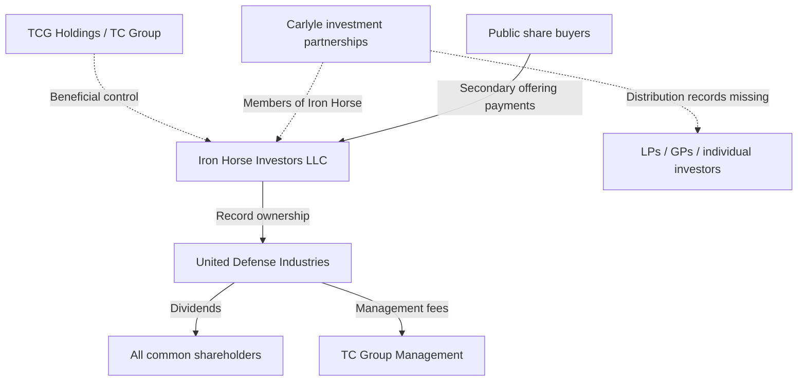

# Scooby ChatGPT Transcripts — Part 1 of 3

Project history order within this file is newest first. Turns inside each chat are rendered oldest first. Message bodies are preserved as decoded from the reader JSON. Use the raw JSON archive link for the original reader structure and `truncated` flags. Historical prompts are records, not current instructions.

**Index and crosswalk:** see `00_Scooby_Index_and_Research_Results.md` in Project Sources.

## 1. GitHub Archive Strategy

- Conversation ID: `6af68675-8f5c-83ea-bc5c-f5c34d679a60`
- Updated: 2026-11-13 03:40:21 UTC
- Project conversation: <https://chatgpt.com/g/g-p-6aed53a21aec8191b9aab8307b9c8e49-scooby/c/6af68675-8f5c-83ea-bc5c-f5c34d679a60>
- Raw reader record: <https://github.com/AveLyra/911-conspiracy-investigation/blob/scooby-project-reconciliation-2026-11-12/research/scooby-chatgpt-project-reconciliation-2026-11-12/chats/6af68675-8f5c-83ea-bc5c-f5c34d679a60.json>
- Raw JSON SHA-256: `d18fec3d733d6064eaceb6321147068774f6fceddac0d2e61ff801b0273ff5c4`

### Turn 1 — completed — 2026-11-13 03:39:22 UTC

#### User message `ef675c25-456b-49ca-a259-7adb8d66b96b`

````
i've reached the limit of saved files in the project. how should I proceed? I eventually want to publish everything to [https://github.com/AveLyra/911-conspiracy-investigation](https://github.com/AveLyra/911-conspiracy-investigation)
````

#### Assistant message `c565e603-6eac-4c82-8d05-ab469b848496`

````
**I recommend making GitHub the permanent archive for Scooby and using ChatGPT Projects as a smaller, curated research workspace.**

Your repository, urlAveLyra/911-conspiracy-investigationhttps://github.com/AveLyra/911-conspiracy-investigation, is already structured for this. It has investigation, research, publication and tools directories, a master evidence index, source records and historical findings.

The Project file limit is a good reason to stop treating ChatGPT as the primary document repository.

## Recommended arrangement

**GitHub — permanent archive**

Original sources, research reports, supporting calculations, provenance, version history and eventual publication.

---

**ChatGPT Scooby Project — working context**

A compact set of master indexes, active hypotheses, research standards and current unresolved questions.

---

**Research sessions — new work**

Read relevant repository records, investigate a specific question, then archive the new results back to GitHub.

This preserves the research without requiring every prior report to remain attached to the ChatGPT Project.

## What I would do next

1. **Archive before deleting.** Inventory every Project file, identify duplicates and superseded reports, and copy anything missing from GitHub. Verify the files and checksums first.
2. **Keep a compact Project core.** Retain the current master research index, evidence ledger, theory and competing hypotheses, unresolved-records tracker, research standards, and publication plan. You don't need dozens of historical research reports attached.
3. **Separate research from publication.** Keep working reports in `research/`, original evidence and analysis in `investigation/`, and editorially reviewed material in `publication/`\. Your existing repository already supports this separation.
4. **Maintain an explicit source register.** For each finding, record its original source, precise locator, evidentiary status, contradictory evidence, and dependencies. Preserve corrections rather than silently overwriting historical conclusions.
5. **Publish in stages.** First establish a complete archive, then publish a readable synthesis. Screen materials for private FOIA correspondence, personal information, copyrighted documents and unsupported allegations before making them public.

ChatGPT currently allows **40 files per Pro Project**\. Removing archived uploads frees slots; creating another Project is also supported. citeturn236918search1 Larger original evidence files can use Git LFS, subject to storage and bandwidth limits. citeturn236918search3

## One issue I verified

Your GitHub connection currently has **read access but not write access** to this repository. I can inspect its contents, but publishing changes through that connection requires enabling write permission.

Also, the repository is already **public**, so uploading material there constitutes publication, even if it isn't yet linked from the README. Use a private staging repository or local Git checkout for anything not ready for public release.

**My recommended immediate action is a migration audit\:** reconcile Scooby's attached files with the existing GitHub tree, produce a missing/duplicate/superseded manifest, and identify which attachments can safely be removed. That would free Project capacity while preserving the full research history.
````

---

## 2. Recalculate WTC 7 Arrest Claim

- Conversation ID: `6af6209d-a048-83ea-b217-c50028186eeb`
- Updated: 2026-11-13 03:38:51 UTC
- Project conversation: <https://chatgpt.com/g/g-p-6aed53a21aec8191b9aab8307b9c8e49-scooby/c/6af6209d-a048-83ea-b217-c50028186eeb>
- Raw reader record: <https://github.com/AveLyra/911-conspiracy-investigation/blob/scooby-project-reconciliation-2026-11-12/research/scooby-chatgpt-project-reconciliation-2026-11-12/chats/6af6209d-a048-83ea-b217-c50028186eeb.json>
- Raw JSON SHA-256: `9cbd4bc5326cc50897d3c12267e5cd56d2cd874d594557260d39f732afe1c6d6`

### Turn 1 — completed — 2026-11-12 20:25:01 UTC

#### User message `00c6cb18-c4e6-4011-90ea-4c3470325ffc`

````
Use Deep Research for this focused Scooby continuation. First check for a completed result of
investigation 3 in Scooby_Deep_Research_Followups_2026-11-11.txt and extend only unresolved findings.
Read REPORT.md §5, titled “WTC 7: transfer-truss failure, structural resistance and observable
precursors,” dated November 11, 2026. The same report is in wtc7_orabi_audit_2026-11-11.zip alongside
audit_inputs.json, calculated_diagnostics.json and MODEL_AUDIT_PROTOCOL.md; use protocol §6. Verify the
calculations against Korol, Heerema and Sivakumaran (2016), DOI 10.20528/cjsmec.2016.02.004, printed pp.
27–31. Submitted work is not evidence of a completed result.

Reconstruct Equations 3–5 with a table defining every mass, floor index, momentum transfer, velocity,
concrete volume, column-work term and unit. Reconcile the stated 101.6/101.4 mm concrete thickness with
the approximately 141 mm depth implied by the published concrete-energy totals, using solid-equivalent
concrete volume rather than assuming total slab depth equals concrete volume. Preserve the prior finding
that the depth substitution alone leaves idealized total absorption above gravitational energy.
Recalculate the claimed arrest location without rounding intermediate steps, including all justified
added masses, then quantify sensitivity to supported input uncertainty.

The decisive mechanical question is which resisting work must occur before the claimed arrest or
observed descent interval. Trace hinge and comminution assumptions to their experimental basis; separate
available absorption capacity from unavoidable work and early fragmentation from ground-impact
fragmentation. Test the paper's strongest arrest case and physically justified alternatives without
setting participation to zero or full merely to force a result.

Deliver reproducible calculations, provenance for each input, an uncertainty table and a bounded
conclusion about the stopping-floor claim. A local sign change or total-energy inequality is not a full
collapse simulation. Stop where geometry, mass definitions or path-dependent participation cannot be
justified. Use public/already held sources only; no contacts, requests, fees or experiments. Preserve
contrary evidence and unresolved dependencies; do not infer deliberate action from a modeling
disagreement.

Apply neutral standards to competing explanations. Use public or already-held sources only. Cite exact
originals, versions, dates and pages; identify shared-source dependence, contrary evidence and
unresolved links. Do not guess redacted identities. Where relevant, distinguish affiliation, tasking,
access, knowledge, action and effect. Do not contact anyone, submit or amend requests, incur fees, or
alter pending matters. If a required input is absent, identify it and stop the dependent analysis.
````

#### Assistant message `7f440483-c690-4087-ba26-ef5124a1d165`

````
## Scooby Investigation 3 — Korol WTC 7 arrest calculation

**Status: Partial independent verification; stopping-floor claim remains unvalidated.**

The November 12 investigation was initiated, but I could not verify a completed report. A new Deep Research run was blocked by the service's empty wallet balance. I therefore checked the original 2016 paper directly and reproduced its central numerical calculation without initiating a paid run.

Primary source: Korol, Heerema and Sivakumaran, *The Collapse of WTC 7: A Re-examination of the “Simple Analysis” Approach*, *Challenge Journal of Structural Mechanics*, 2(1), 25–31 (2016), DOI 10.20528/cjsmec.2016.02.004. citeturn441231view0

### 1\. Principal numerical finding

**The claimed arrest at Floor 11 is exceptionally sensitive to assumed resistance participation.**

Using the paper's stated masses, geometry and resistance factors, but preserving full numerical precision\:

Energy entering Floor 11

# 6.964 GJ

Assumed resisting capacity

# 7.000 GJ

Conditional idealization: all specified column work and full-floor concrete comminution occur during this stage.

The calculated energy balance is approximately **−0.0361 GJ**, only 0.52% of the assumed total resistance.

That sign is reproducible. It does not establish that the physical building would stop at Floor 11.

### 2\. Reconstructed equations and inputs

The paper's Equations 3–5, printed pp. 30–31, describe a rigid upper block collecting stationary floors through perfectly inelastic impacts.

\[
\begin{aligned}
K_{13}&=M_AgH-W_{27}\\
v_{12,i}&=\frac{M_A}{M_A+m_{13}}v_{13,f}\\
K_{12,f}&=\tfrac12(M_A+m_{13})v_{12,i}^{2}
 +(M_A+m_{13})gH-W_{27}\\
v_{11,i}&=\frac{M_A+m_{13}}{M_A+m_{13}+m_{12}}v_{12,f}\\
K_{11,f}&=\tfrac12 M_{A+2}v_{11,i}^{2}
 +M_{A+2}gH-W_{82}-W_c
\end{aligned}
\]

Here \(K=\tfrac12 Mv^2\), \(M_{A+2}=M_A+m_{13}+m_{12}\), and the work terms are\:

\[
W_N=N(0.9\pi)Z_yF_y(3.5),\qquad
W_c=E_{Dc}A_fd_c\rho_c.
\]

| Quantity | Value used | Meaning and unit |
|--------|--------|--------|
| \(M_A\) | 74,038,000 kg | Moving upper-block mass, including estimated column self-weight |
| \(m_{13},m_{12}\) | 1,885,000 kg each | Added ordinary floor mass; indices denote impacted floors |
| \(M_j\) | 2,396,000 kg | Special mass for Floors 21–23, already included in \(M_A\) |
| \(H\) | 3.89 m | Assumed fall per storey |
| \(Z_y\) | 0.0107 m³ | Assumed column plastic section modulus |
| \(F_y\) | 276 MPa | Assumed yield stress |
| \(N\) | 27 or 82 | Assumed resisting column count |
| \(E_{Dc}\) | 4,900 J/kg | Concrete comminution-energy coefficient |
| \(A_f\) | 3,853 m² | Nominal floor area |
| \(\rho_c\) | 2,400 kg/m³ | Concrete density |
| \(d_c\) | 0.1016 m | Stated concrete thickness; Equation 5 also prints 0.1014 m |

The expressions have consistent energy units when the plastic section modulus is converted from cubic millimetres to cubic metres. Mass additions above use \(M_i\), not \(M_j\), because Floors 12 and 13 are not among the paper's three special-load floors. citeturn678144view0

### 3\. Unrounded stopping calculation

| Stage | Calculated result |
|--------|--------|
| Upper block velocity approaching Floor 13 | 7.41663 m/s |
| After collecting Floor 13 | 7.23250 m/s |
| Approaching Floor 12 | 10.38483 m/s |
| After collecting Floor 12 | 10.13324 m/s |
| Floor 11 column work | 2.39644 GJ |
| Floor 11 concrete work, full participation | 4.60363 GJ |
| Remaining kinetic-energy expression | **−0.03608 GJ** |

The paper uses the simplified momentum ratios \(35/36\) and \(37/38\)\. Those are not exactly the ratios obtained from its stated masses. The difference is small but material when the final balance is so close to zero.

The negative result is conditional on the full prescribed work being expended. It is not a physically modeled stopping displacement.

### 4\. Concrete-volume discrepancy

The paper reports **32.01 GJ** for five floors of concrete, but its stated 101.6 mm thickness gives\:

\[
5(3853)(0.1016)(2400)(4900)
=23.01813\ \text{GJ}.
\]

Its published total instead implies approximately **0.14129 m** of solid-equivalent concrete per floor, or 544.39 m³ per floor, compared with 391.46 m³ using 101.6 mm.

The 34-floor upper concrete total similarly implies approximately 141.5 mm.

This is an arithmetic inconsistency, not proof that the deck was built incorrectly. A valid reconciliation requires actual concrete cross-sections, metal-deck rib geometry, topping thickness and areas excluded by openings. None should be inferred merely by substituting an overall nominal slab depth.

The previously reported conclusion survives this correction: using 101.6 mm for the concrete totals while retaining the published column assumptions still produces approximately **238.6 GJ of idealized total absorption versus 75.7 GJ of gravitational energy**\. But that comparison concerns *capacity*, not necessarily work performed during progressive descent.

### 5\. Sensitivity at Floor 11

Illustrative model sensitivities, not experimentally established uncertainty ranges.

| Conditional case | Remaining energy |
|--------|--------|
| All specified resistance; 101.6 mm | −0.036 GJ |
| All specified resistance; 101.4 mm | −0.027 GJ |
| Allocate Block B's average column mass to each added floor | −0.031 GJ |
| 95% of modeled concrete work participates | \+0.194 GJ |
| 90% of modeled column work participates throughout the stages | \+0.356 GJ |
| 80% of modeled column work participates throughout | \+0.747 GJ |
| All work; 141.29 mm equivalent concrete | −1.834 GJ |

Positive values mean the assumed work is insufficient to eliminate the modeled kinetic energy at that stage. Negative values mean the modeled work exceeds the available energy. Neither establishes the actual subsequent trajectory.

The average-column-mass case distributes the paper's aggregate 836,600 kg across six Block B floors. It is an explicitly conditional allocation, not a verified floor-by-floor mass schedule.

### 6\. The unresolved mechanical issue

The strongest version of Korol's arrest argument assumes that the selected steel columns undergo extensive plastic deformation and that a complete nominal concrete floor is comminuted during impact.

The paper relates its 3.5 column factor to experiments on axially loaded, simply supported aluminum H-sections. Its concrete coefficient combines laboratory penetration tests with Bond/Eloranta comminution relationships and an assumed particle-size distribution. These experiments support examining substantial absorption capacity; they do not independently establish the sequence, deformation, fragmentation fraction or load-path participation of WTC 7 during collapse. citeturn441231view0

Conversely, a progressing-collapse explanation cannot simply discard surviving column, beam, connection and slab resistance. It must explain how load paths failed or became ineffective at the relevant times.

The missing determinants are the actual effective contact geometry, floor-by-floor mass distribution, temperature-dependent member behavior, connection fracture and separation, force–displacement laws, and the proportion of concrete fragmented **before** the evaluated stopping interval rather than during subsequent ground impact.

NIST's published explanation involves preceding internal failures and progressive loss of support around Column 79, which differs materially from Korol's intact rigid-block collision idealization. That alternative also requires scrutiny of its modeled initiating connections and propagation sequence. citeturn441231search5

### Bounded conclusion

**The arithmetic supports a conditional Floor 11 arrest, but does not establish Floor 11 as the historical stopping location.** Its margin is small, its concrete-volume assumptions are internally inconsistent, and its decisive work-participation factors have not been independently validated for the actual failure path.

Equally, these deficiencies do not prove uninterrupted gravity-driven collapse. Neither a local negative-energy balance nor a building-wide capacity inequality substitutes for a path-dependent structural analysis.

I could not access the specified November 11 `REPORT.md` §5, `audit_inputs.json`, `calculated_diagnostics.json` or `MODEL_AUDIT_PROTOCOL.md` §6 in this session. Consequently, this is **not a completed audit-to-audit reproduction**, and there is no justified numerical confidence interval or defensible revised stopping-floor estimate.

No external contacts, requests, experiments, fees or changes to pending matters were made.
````

### Turn 2 — completed — 2026-11-13 03:33:41 UTC

#### User message `626ba0a1-d99a-459a-b29e-f53df2666ab5`

````
do [$deep-research](app://connector_openai_deep_research)
````

#### Assistant message `6ef735d1-ef90-4bbd-8f03-e5d08f7b3bcf`

````
Deep Research has started the focused Scooby Investigation 3 continuation.

It will provide its research plan, progress updates, and final report in the Deep Research interface.
````

---

## 3. Unchanged Gate Report

- Conversation ID: `6af65165-b894-83e9-b100-2be7dd604987`
- Updated: 2026-11-13 03:36:23 UTC
- Project conversation: <https://chatgpt.com/g/g-p-6aed53a21aec8191b9aab8307b9c8e49-scooby/c/6af65165-b894-83e9-b100-2be7dd604987>
- Raw reader record: <https://github.com/AveLyra/911-conspiracy-investigation/blob/scooby-project-reconciliation-2026-11-12/research/scooby-chatgpt-project-reconciliation-2026-11-12/chats/6af65165-b894-83e9-b100-2be7dd604987.json>
- Raw JSON SHA-256: `2c00976eb2daa83306f373bb66f5da1583c2a94148ffe76fd4d30c27d11e4e7a`

### Turn 1 — completed — 2026-11-12 23:53:09 UTC

#### User message `06e6c2b4-daf3-4a08-bf4f-879d897b06fd`

````
First check for a completed result on this exact question and extend only its unresolved findings.
Proceed only if the new record or adequate native input specified below is available; otherwise report
the unchanged gap and stop.

Use Deep Research for a gated continuation of brief 30 in Scooby_Deep_Research_Followups_2026-11-11.txt,
N21 in Scooby_Source_Audit_and_Focused_Research_Prompts.txt and P17 in
Loose_Change_Research_Action_Prompts.txt. Read Loose_Change_Evidence_Review.pdf, p. 25 §9.9 and p. 36
source 109, then Korsgaard's May 2024 “A Preliminary Study of Flashes of Light Recorded During the
Collapse of the South Tower,” pp. 12–17 and 21, including original-video references 47–58. Candidate
source routes are archive item wnbcdub-113 and the named Cindy Weil footage; neither route alone
authenticates a native recording.

First establish whether there is a newly acquired native recording or newly authenticated
source-to-derivative, capture-cadence or independent-timing data linked to an original recording.
Identify the exact new input. If none is available, return a short unchanged-gate report and stop
without repeating analysis. Keep this retained task distinct from WTC 7 recordings.

For one specified flash, verify the edition and frame numbering, capture cadence versus playback rate,
interlacing, duplication, compression, exposure and saturation. Determine whether multiple views are
independent cameras. Register light onset against local structural motion and newly exposed/rotating
surfaces, preserving uncertainty. Test reflection, electrical and mechanical alternatives against the
claimed event. Correct available sound for propagation and recorder offset without selecting a
convenient pulse because it resembles an explosion.

Deliver a frame/source/time table and a bounded comparison of what each observation can discriminate.
Add a seismic branch only if an identified source/time/coupling prediction is detectably above the
actual instrument/noise limits. Stop if source quality or timing cannot separate predictions;
enhancement cannot recreate missing information. Use public/already held sources only; no contacts,
requests, fees, physical testing or operational device guidance. No inferred installation or actor
identity from a flash alone.

Apply neutral standards to competing explanations. Use public or already-held sources only. Cite exact
originals, versions, dates and pages; identify shared-source dependence, contrary evidence and
unresolved links. Do not guess redacted identities. Where relevant, distinguish affiliation, tasking,
access, knowledge, action and effect. Do not contact anyone, submit or amend requests, incur fees, or
alter pending matters. If a required input is absent, identify it and stop the dependent analysis.
````

#### Assistant message `6151dd3e-b7f6-4e0a-9130-cc1b0c6315bc`

````
**Status: Unchanged gate — required source material not verified.**

The November 11 brief 30 and N21/P17 audit retain the South Tower flash investigation as unresolved. I found no completed frame-level forensic result for this exact question in the available project materials.

The source check identified no qualifying new input\:

- **WNBC\:** Archive item `wnbcdub-113` remains an identified recording route, without authenticated native capture cadence or source-to-derivative lineage.
- **Cindy Weil\:** A NIST-derived AVI was publicly described by April 23, 2022. This is not new production and does not establish the original recording's acquisition properties. citeturn951543search0turn951543search2
- **Korsgaard (May 2024)\:** Pages 12–17 and 21 provide frame references and interpretations, but not independently authenticated original-frame timing or calibration. citeturn892595search21turn951543search18

**Decisive missing input\:** An authenticated original-quality recording, or a documented capture-to-copy chain establishing frame cadence, interlacing, timing and image transformations.

Without that input, frame-level photometry, cross-camera synchronization, audio correlation and causal discrimination remain blocked.

**Disposition\:** Retain brief 30/N21/P17 as gated. No further analysis, seismic inference or WTC 7 cross-comparison was performed. No contacts, requests, fees or changes to pending matters.
````

### Turn 2 — completed — 2026-11-13 03:34:19 UTC

#### User message `f81a903a-db95-44b1-93ba-12bbd27e5a05`

````
do [$deep-research](app://connector_openai_deep_research)
````

#### Assistant message `98e781d5-cb0b-4e80-977a-9f188c54acf8`

````
Deep Research has started the **Scooby South Tower flash investigation (R49 / N21 / P17)**\.

It will provide its research plan, progress updates, and final report in the Deep Research interface.
````

---

## 4. Deep Research Blocked

- Conversation ID: `6af6513a-b678-83ea-ae5d-9f621103fce1`
- Updated: 2026-11-13 03:17:48 UTC
- Project conversation: <https://chatgpt.com/g/g-p-6aed53a21aec8191b9aab8307b9c8e49-scooby/c/6af6513a-b678-83ea-ae5d-9f621103fce1>
- Raw reader record: <https://github.com/AveLyra/911-conspiracy-investigation/blob/scooby-project-reconciliation-2026-11-12/research/scooby-chatgpt-project-reconciliation-2026-11-12/chats/6af6513a-b678-83ea-ae5d-9f621103fce1.json>
- Raw JSON SHA-256: `d816afcafc1836dc6efcfa32abb9ca48dc8269efbc8bc2d0d24c5088922e9c0e`

### Turn 1 — completed — 2026-11-12 23:52:26 UTC

#### User message `59f9bd6f-5fc8-424f-a1b1-ddf092e14a32`

````
Use Scooby_Deep_Research_Followups_2026-11-11.txt as the prior-work index. First check for a completed
result on this exact question and extend only its unresolved findings. Proceed only if the new record or
adequate native input specified below is available; otherwise report the unchanged gap and stop.

Use Deep Research for Scooby's production-triggered Airfone/Star-Fix follow-up. First identify a new
native workbook, actual handwriting, item-level receipt or completed matching worksheet in existing
productions/public sources. The typed September 11 statements and NARA Box 19 route are already known.
If no new input enables a comparison, report that status and stop.

Read Flight93_Workbook_Corrections_and_StarFix_Originals_2026-11-06.pdf pp. 1–8 and
Flight93_K13_Findings_and_Unsent_Drafts_2026-11-06.pdf pp. 3–6,10–12. Keep November UAL_flt93.xls/report
96202/1A-1A65562, the March 29, 2002 Airborne 50588655-972 correction, and June/July report 116622/A-3
distinct. The March report describes last-credit-card-digit corruption during Oracle-to-Excel
conversion; the initial sheet already carried Beamer's name.

Authenticate versions and receipt links before joining rows on validated ACIS identifiers. Compare
billed/swiped fields, recipient evidence and actual investigator matching—not row positions or name
cells alone. Keep manager 302-1888, operator 302-1880 and separate manager 302-630, handwriting sets and
later annotations distinct. Test which sheets support staff-report PDF p. 99 note 342.

Return a production-to-gap ledger and reproducible changed-field/attribution analysis where supported.
Do not publish account numbers. Preserve current request scope and existing F1–F3 drafts as coverage
references; no duplicate draft or request. A carrier billing repair supplies no correction to seismic,
radar or flight-recorder clocks.

Apply neutral standards to competing explanations. Use public or already-held sources only. Cite exact
originals, versions, dates and pages; identify shared-source dependence, contrary evidence and
unresolved links. Do not guess redacted identities. Where relevant, distinguish affiliation, tasking,
access, knowledge, action and effect. Do not contact anyone, submit or amend requests, incur fees, or
alter pending matters. If a required input is absent, identify it and stop the dependent analysis.
````

#### Assistant message `4696d28a-1c4f-4408-bd59-95f3c139e1b7`

````
**Status: Blocked — required new evidence not identified as of November 12, 2026.**

The November 11 prior-work index, brief 29/N27, identifies this as a production-dependent investigation. I found no completed subsequent comparison or qualifying new original in the accessible project materials, public searches, or checked NARA correspondence.

## Production-to-gap ledger

| Evidence | Current status | Remaining gap |
|--------|--------|--------|
| November 6, 2001 `UAL_flt93.xls`, report 96202, 1A-1A65562 | Email, receipt annotation and scanned tables available | Native workbook and verified version metadata |
| March 29, 2002 Airborne 50588655-972 | Correction documented in March 28 interview, transcribed April 23, Bates 000000350–351 | Corrected workbook, independent delivery receipt and item-level accession |
| June 28 / July 1, 2002 report 116622, Appendix A-3 | Field descriptions and updated-attachment reference available | Native attachment and version crosswalk |
| Star-Fix reports 302-1888, 302-1880 and separate 302-630 | Typed statements and interviews available | Original handwriting, note-set identities and receipt links |
| Commission staff report, PDF p. 99, note 342 | Three note references identified | Actual source copies and completed investigator matching worksheet |

Sources: *Flight93\_Workbook\_Corrections\_and\_StarFix\_Originals*, pp. 1–8; *Flight93\_K13\_Findings\_and\_Unsent\_Drafts*, pp. 3–6, 10–12. fileciteturn1file1 fileciteturn1file2

## Attribution finding

The March correction concerns last-credit-card-digit corruption during Oracle-to-Excel conversion.

The initial spreadsheet reportedly already contained Todd Beamer's name. **No recovered evidence establishes that the correction changed a caller attribution.** Nor does it establish that every attribution remained unaffected.

Without authenticated before-and-after workbooks and validated ACIS identifiers, a changed-field analysis would be speculative.

**Disposition\:** No new comparison performed. Existing F1–F3 drafts and request scopes remain unchanged. No contacts, submissions, fees or modifications were made.

The records gate remains unsatisfied; dependent analysis stops here.
````

### Turn 2 — completed — 2026-11-13 00:13:34 UTC

#### User message `c6212544-1fe5-4c33-b170-a8f22b81875f`

````
Has this been addressed?
````

#### Assistant message `589edfe8-7540-4f02-8cea-17c96cf7ca2d`

````
**Yes—the requested records check has been addressed. The underlying attribution question remains unresolved.**

The November 12 prompt pack identifies this exact task as **R43, “Compare new Airfone workbook versions and Star-Fix originals,” marked GATED**, continuing brief 29/N27. It expressly requires stopping unless a qualifying new original is available. :chatgpt-content-reference{index="0"}

Existing work documents the billing correction, distinguishes the workbook versions and identifies the missing handwriting and custody links. It does **not** contain authenticated before-and-after records establishing whether a corrected field changed a caller assignment. :chatgpt-content-reference{index="1"}

I found no later completed comparison in the accessible project/Library results. My previous response was therefore a **gate-check result—not a completed new forensic comparison or separately launched Deep Research report**.

The appropriate tracking status is **“Reviewed; awaiting qualifying records.”** Another general research pass would duplicate completed work; continuation requires a native workbook, actual handwritten source, item-level receipt or completed matching worksheet that enables a specific comparison.
````

### Turn 3 — completed — 2026-11-13 03:17:40 UTC

#### User message `b3b4414a-86fd-4c94-b90a-1373eca9be72`

````
summarize this
````

#### Assistant message `666e53eb-35f3-46be-a2d3-9ef7e46f44a8`

````
**Scooby R43 — Flight 93 Airfone/Star-Fix investigation**

**Status: Reviewed, but unresolved. Awaiting original records.**

The investigation examines whether corrections to Flight 93 telephone billing records affected the FBI's identification of callers, particularly Todd Beamer and the Star-Fix maintenance call.

**What was established\:**

- In March 2002, GTE corrected credit-card numbers corrupted during an Oracle-to-Excel conversion.
- Todd Beamer's name was already present in the original spreadsheet, so the correction did not introduce his name.
- FBI reports and witness interviews document the Star-Fix calls, but the original handwritten notes and investigator matching records remain unavailable.
- Three distinct spreadsheet versions have been identified, but their underlying data cannot yet be reliably compared.

**What's missing\:** The original spreadsheets, March delivery documentation, handwritten witness notes and records showing exactly how investigators matched telephone calls to individuals.

**Conclusion\:** There is no verified evidence that the billing correction changed a caller's identity, but the available records cannot establish that all identifications were unaffected.

The November 12 review found no new evidence sufficient to resolve this. Existing records requests already cover the missing material.

**Next step\:** Wait for qualifying records rather than repeat the investigation.
````

---

## 5. Reconcile UMS Releases

- Conversation ID: `6af61f22-8088-83ea-b2d7-5654860fb621`
- Updated: 2026-11-13 00:21:23 UTC
- Project conversation: <https://chatgpt.com/g/g-p-6aed53a21aec8191b9aab8307b9c8e49-scooby/c/6af61f22-8088-83ea-b2d7-5654860fb621>
- Raw reader record: <https://github.com/AveLyra/911-conspiracy-investigation/blob/scooby-project-reconciliation-2026-11-12/research/scooby-chatgpt-project-reconciliation-2026-11-12/chats/6af61f22-8088-83ea-b2d7-5654860fb621.json>
- Raw JSON SHA-256: `8e52fa5a884fe43b385860c6a9d2aefd624587c5c95238cc9e4f6ae3cdf4c094`

### Turn 1 — completed — 2026-11-12 20:18:42 UTC

#### User message `d1c23110-6d96-4519-bec0-316f02755273`

````
Use Scooby_Deep_Research_Followups_2026-11-11.txt as the prior-work index.

Use Deep Research to reconcile the UMS release packages. First retrieve and review any completed result
for November 11 brief 9; continue only its documented unresolved work. If that work is already complete
and no new input changes the comparison, report the status and stop.

Start with UMS_Manhattan_Dispatch_and_Personnel_Followup_2026-11-09.pdf, pp. 9 and 14–17; REPORT(1).md,
§5; Classic_Miami_Research_Update_2026-11-11.pdf, pp. 5 and 8–9;
UMS_EC_Crosswalk_Public_Update_2026-11-11.zip; and complete productions already held. Build a file and
page manifest keyed by agency request, release letter, exact filename and hash, physical/Bates/printed
page, serial, enclosure, duplicate and deletion sheet. Reconcile the January 16, 2013 letter for FOIPA
1169683-001—215 pages reviewed and 183 released—with the 177 unique indexed visible pages. Do not infer
six suppressed substantive pages from arithmetic.

Find and compare the complete efoia.1.pdf, efoia.2.pdf and October 26 production, including their cover
letters and inventories, against the January 27 and February 24, 2014 excerpts. Record which originals
remain unavailable. The 2013 cross-reference checkbox is unmarked. Do not attribute the 2014 excerpts to
Classic request 1609818-000 without its production cover.

Use public or held sources only; no contacts, submissions or fees. Return a versioned manifest, exact
source differences, provenance limits and the smallest still-missing objects. If no additional input or
unperformed comparison remains available, return a short status update and stop. Stop any dependent
comparison where package identity or unavailable bytes prevent it; missing pages do not establish
deliberate suppression.

Apply neutral standards to competing explanations. Use public or already-held sources only. Cite exact
originals, versions, dates and pages; identify shared-source dependence, contrary evidence and
unresolved links. Do not guess redacted identities. Where relevant, distinguish affiliation, tasking,
access, knowledge, action and effect. Do not contact anyone, submit or amend requests, incur fees, or
alter pending matters. If a required input is absent, identify it and stop the dependent analysis.
````

#### Assistant message `8de4ba6f-710c-4560-b97e-ba4ba4167d93`

````
## UMS release reconciliation — November 12, 2026

**Prior-work status\:** I located the November 11 initiation record for brief 9, *UMS Release Completeness and Record Identity*, but no completed Deep Research report or final manifest in the accessible project history.

The prior work establishes that\:

- FBI FOIPA **1169683-001**, January 16, 2013, reported 215 pages reviewed and 183 pages released.
- The public index identifies **177 unique visible pages**\. The six-page numerical difference has not been explained.
- The January 27 and February 24, 2014 records concern evidence disposition, but their full production-package provenance remains unverified.
- The 2013 cross-reference checkbox was unmarked; it cannot establish that additional cross-reference records were withheld.

The absence of a completed brief leaves a bounded reconciliation task, rather than justification to repeat the broader UMS investigation.

## Verified differences between the release groups

| Source | Established record | Reconciliation limit |
|--------|--------|--------|
| January 16, 2013 FBI letter, pp. 1–2 | 215 reviewed; 183 released; two enclosures noted | Does not enumerate the 183 pages individually |
| Public NY/Philadelphia index | Fourteen distinct linked serial files; Serial PH357 appears twice under different descriptions | The public index is not a certified release inventory |
| January 27, 2014 FD-1057 | Reports evidence disposal and lists specific property barcodes | Exact disposal dates, testing outcomes and authorization chain remain incomplete |
| February 24, 2014 FD-1057 | Repeats substantially overlapping evidence-disposition information | Not independent evidence of a second disposal |

The February record has an important pagination detail: the November 11 custody review reports **`efoia.1.pdf` physical page 4 as the continuation and page 5 as the cover**, in reverse order. The continuation names E01889035, E01889036 and E01889037.

The January communication is reproduced at pages 1–2 of the urlthree-page source excerpthttps://github.com/AveLyra/911-conspiracy-investigation/blob/main/investigation/urban-moving-systems/fbi-notebook-custody-2026-11-06/raw/fbi-selected-disposition-and-inventory-pages.pdf\. Page 3 reproduces `efoia.2.pdf` page 21, an earlier property inventory. These are excerpts, not the complete production.

The original urlJanuary 16, 2013 FBI letterhttps://www.israellobby.org/UrbanMoving/01162013release_letter.pdf and the November 11 urllaboratory/custody reviewhttps://github.com/AveLyra/911-conspiracy-investigation/blob/main/investigation/urban-moving-systems/lab-custody-search-paths-2026-11-11/README.md support these distinctions. citeturn719922view2turn952941view6

## Manifest v0.1 and stopping status

[Download the UMS release reconciliation and source manifest](sandbox:/mnt/data/UMS_release_reconciliation_v0.1.md)

The manifest records the fourteen indexed 2013 serial files, identifiable page counts, deletion sheets, duplicate links, known source hashes, 2014 document crosswalks and unresolved provenance.

**The dependent comparison remains blocked by three missing source sets\:**

1. The complete 2013 release package and its agency page/enclosure inventory, needed to explain 183 versus 177.
2. The complete `efoia.1.pdf`, `efoia.2.pdf`, and October 26 production cover and inventory, needed for authenticated file-level comparison.
3. The FD-192 enclosures referenced in February 2014, needed to extend the disposition chain.

The prior research identifies SHA-256 hashes for both `efoia` originals, but the complete files were not accessible for independent verification. fileciteturn7file0

**Disposition: Source-gated; stop.** No newly obtained original resolves the discrepancy, and missing pages provide no affirmative evidence of deliberate suppression. No requests, contacts, fees or changes to pending matters were made.
````

### Turn 2 — completed — 2026-11-13 00:15:30 UTC

#### User message `0360f7c7-5e9b-4fd5-be2a-252b5ed95765`

````
do @deep
````

### Turn 3 — completed — 2026-11-13 00:16:36 UTC

#### User message `90ddc220-c70b-4127-b948-2aea695004be`

````
do [$deep-research](app://connector_openai_deep_research)
````

#### Assistant message `607fd846-34f9-4249-b241-432568d92fac`

````
Deep Research has started the UMS release reconciliation. It will provide its research plan, progress updates, and final report in the Deep Research interface.
````

---

## 6. Reconcile SEC Trading Records

- Conversation ID: `6af61e3f-a91c-83ea-a225-a53d137c5d46`
- Updated: 2026-11-13 00:18:57 UTC
- Project conversation: <https://chatgpt.com/g/g-p-6aed53a21aec8191b9aab8307b9c8e49-scooby/c/6af61e3f-a91c-83ea-a225-a53d137c5d46>
- Raw reader record: <https://github.com/AveLyra/911-conspiracy-investigation/blob/scooby-project-reconciliation-2026-11-12/research/scooby-chatgpt-project-reconciliation-2026-11-12/chats/6af61e3f-a91c-83ea-a225-a53d137c5d46.json>
- Raw JSON SHA-256: `8ed6fd43e1fa56d68090a7b4a9d00547ba37e9a35577e7b66c11d1ec24e31742`

### Turn 1 — completed — 2026-11-12 20:14:59 UTC

#### User message `2e34e164-58e3-471c-9d06-772c07297f0a`

````
Use Deep Research for this Scooby continuation. First retrieve any completed output of November 11 brief 1; extend its unresolved findings. Read 9-11_Financial_Records_Review_2026-11-11.pdf pp. 3–13, 36–38. The baseline acquired the SEC’s 704-page packet but reviewed only the first 25 pages and selected exhibits. Verify whether later work completed the rest before proceeding.

Index every document in https://www.sec.gov/files/records-provided-9-11-commission.pdf by date, Bates/PDF page, author, type, security and underlying source. Reconcile HO-9325, the May 2004 Cella corrections, OCC conventions and Chesney contracts 20444473/20428354. Determine which 500 UAL contracts were canceled; the corrected aggregate 1,575 does not independently establish a 1,500-contract adviser position. Resolve 388 + 365 = 753 versus printed 763 and the possible September 5/7 row duplication.

Map the principal adviser’s UAL puts, 117,000 UAL shares short, 115,000 AMR shares long and other positions without merging the different fund’s reported $85,000 loss. Trace contemporaneous strategy evidence, newsletter delivery/reliance and residual trades. Separate SEC MaST and its documented CD transfer from the NYSE MasterList; trace foreign-referral dispositions rather than assuming either closure or unresolved ownership.

Return the indexed packet, corrected transaction/explanation ledger and anomalies remaining after reconciliation. Preserve the SEC/FBI no-evidence conclusion and its supporting work while testing its documented scope. Stop account P&L and statistical replication where allocations, prices or raw datasets are absent. Explain which information is missing; do not convert a percentile or unexplained trade into a probability of foreknowledge.

Apply neutral standards to competing explanations. Use public or already-held sources only. Cite exact originals, versions, dates and pages; identify shared-source dependence, contrary evidence and unresolved links. Do not guess redacted identities. Where relevant, distinguish affiliation, tasking, access, knowledge, action and effect. Do not contact anyone, submit or amend requests, incur fees, or alter pending matters. If a required input is absent, identify it and stop the dependent analysis.
````

#### Assistant message `60d7fa61-e0eb-486e-b514-796f6cb6e2f6`

````
## Scooby N02 — SEC trading-record reconciliation

### Prior-work status

The November 11 Deep Research session was initiated, but I could not retrieve a completed report. The latest accessible baseline is the 38-page *9-11 Financial Records Review*, dated November 11, 2026.

That review acquired the SEC's full 704-page packet but substantively inspected only its first 25 pages and selected later exhibits. It explicitly did not claim a complete document audit.

The established baseline includes two important distinctions\:

- The principal adviser's reported **117,000 UAL shares short** and **115,000 AMR shares long** belong in the same exposure assessment.
- The separately reported **\$85,000 portfolio loss** concerns another fund and cannot be transferred to that adviser.

The SEC/FBI no-evidence finding remains the controlling investigative conclusion to examine, not a substitute for checking the underlying transactions.

### Reconciliation findings

| Issue | Finding |
|--------|--------|
| September 6 UAL puts | Corrected aggregate **1,575**, down from 2,075. The canceled 500 contracts have not been attributed to a particular account. |
| September 6–7 UAL | The reported 87 calls could not be reconstructed. A possible September 5/7 row-copy error remains unresolved. |
| September 10 AMR | Cella's OCC/LEAP calculation produces **2,278**, rather than the printed 2,282. |
| Newsletter attribution | **388 + 365 = 753**, not 763. The underlying purchaser crosswalk is missing. |

These corrections are documented in Douglas Greenburg's May 11, 2004 follow-up to Joseph Cella and Eric Ribelin. citeturn267322view0

Chesney's published Table 1 separately reports UAL contract **20444473** with 2,000 volume and 1,494 additional open-interest contracts, and AMR contract **20428354** with 1,535 volume and 1,312 additional open-interest contracts. These are market-data observations, not authenticated beneficial-owner allocations or realized profits. citeturn720588view0

### Research package

**[Download the N02 reconciliation package](sandbox:/mnt/data/Scooby_SEC_N02_Bounded_Reconciliation_2026-11-12.zip)**

Research report, partial document register, 704-page coverage map, and 16-entry claim-to-original ledger

**Completion limit\:** The complete 704-page document index is not finished. The original packet could not be obtained in a page-accessible form during this continuation. I therefore preserved unverified coverage rather than invent document boundaries or Bates numbers.

The SEC/FBI investigative conclusion remains supported by substantial documented work, including examination of more than 9.5 million transactions. citeturn799203search2 The remaining account-level questions require the missing cancellation records, allocations, prices, native MaST data and referral dispositions.

No billable Deep Research run, external contact, records request, or change to pending matters was made.
````

### Turn 2 — completed — 2026-11-13 00:15:08 UTC

#### User message `291a9eff-497a-436c-9ad8-ce8257e28251`

````
do [$deep-research](app://connector_openai_deep_research)&#x20;
````

#### Assistant message `14a7d857-8e4e-471b-9c6b-9ea8e089fe8d`

````
Deep Research has started the **Scooby N02 SEC trading-record reconciliation**\.

It will review the prior findings, audit the SEC's 704-page packet, reconcile the disputed transactions, and identify remaining evidentiary gaps.

The research interface will provide the plan, progress updates, and final report.
````

---

## 7. Research payment allegation

- Conversation ID: `6af650a0-d88c-83e8-ab36-2009db685c1d`
- Updated: 2026-11-13 00:03:26 UTC
- Project conversation: <https://chatgpt.com/g/g-p-6aed53a21aec8191b9aab8307b9c8e49-scooby/c/6af650a0-d88c-83e8-ab36-2009db685c1d>
- Raw reader record: <https://github.com/AveLyra/911-conspiracy-investigation/blob/scooby-project-reconciliation-2026-11-12/research/scooby-chatgpt-project-reconciliation-2026-11-12/chats/6af650a0-d88c-83e8-ab36-2009db685c1d.json>
- Raw JSON SHA-256: `e22770bc1d0da9fd29fce2314922e19f97525f00972e47b867e4db49b9131790`

### Turn 1 — completed — 2026-11-12 23:49:53 UTC

#### User message `25df86cf-af37-445d-9e9b-57ccd3787178`

````
Use Scooby_Deep_Research_Followups_2026-11-11.txt as the prior-work index. Retrieve the specified
originals before dependent testing.

Use Deep Research for Scooby's retained N19/P23 inquiry into the alleged $100,000 payment and an alleged
ISI instruction. The November 11 financial review explicitly excluded this strand; it must not be
treated as resolved by that report. First check for completed work on this exact question.

Start with Loose_Change_Evidence_Review.pdf §6.3 and sources 57–61 and N19 in
Scooby_Source_Audit_and_Focused_Research_Prompts.txt. Trace the original published allegation to its
earliest identified source and any actual investigative assessment. Inventory relevant public Moussaoui
financing exhibits and FBI testimony before choosing transactions. Keep the two already discussed 2000
bank exhibits distinct from an alleged separate 2001 transfer.

Create separate tests for occurrence/amount/date, sender identity and aliases, recipient
identity/account, routing/intermediaries, and the asserted instruction. A transfer can be real while the
proposed commander or purpose remains unproved; an ordinary explanation must also be tied to the actual
transaction. Do not use unrelated transfer dates to exclude an unexamined allegation or infer identities
from redactions.

Deliver a claim-to-transaction matrix, source-dependency map and supported or unresolved finding for
each link. If the alleged transfer or instruction cannot be joined to an authenticated record, identify
the first missing original and stop attribution. Preserve financial evidence and investigative
conclusions that contradict the allegation as well as their precise scope.

Apply neutral standards to competing explanations. Use public or already-held sources only. Cite exact
originals, versions, dates and pages; identify shared-source dependence, contrary evidence and
unresolved links. Do not guess redacted identities. Where relevant, distinguish affiliation, tasking,
access, knowledge, action and effect. Do not contact anyone, submit or amend requests, incur fees, or
alter pending matters. If a required input is absent, identify it and stop the dependent analysis.
````

#### Assistant message `d9f388ef-6069-4af0-82e6-848cc582f4ec`

````
# Scooby N19/P23 — Alleged ISI-directed \$100,000 payment

**Preliminary finding: The original allegation is documented, but the alleged transaction and instruction remain unverified.**

The November 11 financial review explicitly excluded this issue. The Scooby source audit identifies N19 as a separate exhibit investigation, and I have not identified a completed report resolving it in the accessible project material.

## 1\. Origin and source dependency

The earliest specific allegation identified in the prior review is Manoj Joshi's October 9, 2001 *Times of India* article, urlIndia helped FBI trace ISI-terrorist linkshttps://timesofindia.indiatimes.com/india/india-helped-fbi-trace-isi-terrorist-links/articleshow/1454238160.cms\.

It asserts that Ahmad Umar Sheikh transferred \$100,000 to Mohammed Atta at the direction of ISI director-general Mahmud Ahmad. It further attributes the alleged discovery to Indian intelligence assistance and an FBI investigation.

The article cites unnamed Indian government sources. **It provides neither a bank record nor an identified FBI investigative finding.** Its description of American confirmation is itself part of the allegation, not an independently obtained American confirmation. citeturn703708search0

The distinction is important: evidence that a transfer occurred would not automatically establish the claimed sender, the ISI director's involvement, or advance institutional knowledge of the attacks.

### Earlier reporting establishes a more complicated chronology

The October 9 article was not the first public mention of the money trail.

- **October 1, 2001\:** CNN reported approximately \$100,000 reaching Atta through Florida banks, purportedly via Pakistan, according to investigative sources. The account described transfers over time, not an authenticated single \$100,000 transaction. citeturn328358search0turn328358search1
- **October 7, 2001\:** CNN identified Ahmad Omar Saeed Sheikh as the *believed* sender, citing an unnamed senior law-enforcement source. citeturn328358search5
- **October 9, 2001\:** The *Times of India* added the specific assertion that Mahmud Ahmad had instructed Sheikh. citeturn703708search0

These are at least two distinct reporting channels, but their underlying investigative information may overlap. The unnamed sources cannot presently be counted as independent corroboration.

## 2\. Authenticated financing exhibits

The federal court's original urlMoussaoui prosecution exhibit indexhttps://coop.vaed.uscourts.gov/moussaoui/exhibits/prosecution.html identifies relevant bank and money-transfer records. The original images establish the following distinct transactions\:

| Record | Amount and date | Documentary finding |
|--------|--------|--------|
| urlBR00028Ahttps://coop.vaed.uscourts.gov/moussaoui/exhibits/prosecution/BR00028A.pdf | \$9,985; report run July 19, 2000 | Originator text: Isam Mansur. Beneficiary: Atta/Shehhi account. UAE exchange route. Bates M-MMB-00002187 |
| urlBR00028Bhttps://coop.vaed.uscourts.gov/moussaoui/exhibits/prosecution/BR00028B.pdf | \$9,485; report run August 7, 2000 | Originator text: Isam Mansour. Shehhi beneficiary. Bates M-MMB-00002185 |
| urlFO11001https://coop.vaed.uscourts.gov/moussaoui/exhibits/prosecution/FO11001.pdf | \$5,000; June 2000 | Western Union record identifying Isam Mansar and Marwan al-Shehhi |
| urlFO11006https://coop.vaed.uscourts.gov/moussaoui/exhibits/prosecution/FO11006.pdf | \$5,000; September 8, 2001 | Mohamed Atta sends money **outward** to Mustafa Ahmad in the UAE |

The first two dates are report-processing dates, not independently verified initiation dates. The last transaction's direction is especially important: it cannot be recast as a \$100,000 inbound payment.

**None of these four exhibits independently establishes the alleged ISI-directed transfer.** They also do not establish that no additional transfer occurred.

## 3\. A consequential FBI clarification

The most important additional source is the 9/11 Commission staff's 2004 urlTerrorist Financing Monographhttps://www.govinfo.gov/content/pkg/GOVPUB-Y3-PURL-LPS53198/pdf/GOVPUB-Y3-PURL-LPS53198.pdf#page=147, Appendix A, printed page 144, footnote 163.

It explicitly addresses John Pistole's July 31, 2003 testimony about tracing funds to Pakistani accounts. According to the Commission staff, **the FBI subsequently clarified that Pistole meant funds traced to Khalid Sheikh Mohammed in Pakistan, and that no actual Pakistani bank accounts had been identified**\. citeturn211124view1

This materially limits the use of Pistole's testimony as corroboration of the alleged \$100,000 wire. It does not exclude an unrecorded cash transfer, an intermediary transaction, or a separate account that investigators failed to identify.

The same monograph, printed pages 133–135, reconstructs five documented transfers totaling **\$114,500** to Atta and Shehhi during 2000, attributed to Ali Abdul Aziz Ali. Four were bank-to-bank transfers; one used Western Union. The investigators relied on UAE transaction paperwork, identification information, interviews and Ali's statements. These transactions supply a concrete alternative explanation for early reports of approximately \$100,000 in incoming funding, although they do not establish how those early reports arose. citeturn164010view0turn211124view5

The monograph's conclusion that it found no evidence of foreign-government funding is relevant contrary evidence. Its staff reviewed FBI financial analyses and underlying bank records, but the public report does not show a separate, transaction-specific investigation of Mahmud Ahmad's alleged instruction.

## 4\. FBI records resolve the two earlier bank exhibits

A more detailed original is the FBI's *Summary of PENTTBOM Investigation*, dated February 29, 2004, **printed pages 16–17, Bates 000003860–3861**\. It separates initiation from posting and accounts for the \$15 difference in the two examined bank exhibits\:

| Transfer initiated | Gross sent | Net credited | Originator as recorded |
|--------|--------|--------|--------|
| July 18, 2000 | \$10,000 | \$9,985 on July 19 | Isam Mansour |
| August 5, 2000 | \$9,500 | \$9,485 on August 7 | Isam Mansur |
| August 29, 2000 | \$20,000 | \$19,985 on August 30 | Mr. Ali |
| September 17, 2000 | \$70,000 | \$69,985 on September 18 | Hani at Fawaz Trading |

All four went through the UAE Exchange Centre to Shehhi's Florida SunTrust account, jointly held with Atta. The FBI attributed the sender aliases to Ali Abdul Aziz Ali. **Four gross transfers total \$109,500; net credits total \$109,440.** citeturn471651view1

This is independently checkable against the earlier FBI Director's September 26, 2002 congressional statement, which identifies the same four-transfer total and sender aliases. That earlier statement derives from the FBI investigation; it should not be counted as a second independent account audit. citeturn471651view0

There is also a particularly relevant contemporary warning against conflating identities. CNN's October 4, 2001 investigative broadcast explicitly questioned whether Ahmad Umar Saeed Sheikh and the individual using the name Mustafa Muhammad Ahmad were the same person. Its reporter said investigators were uncertain. Subsequent evidence identifies Ali Abdul Aziz Ali and Mustafa al-Hawsawi as distinct participants in the known financing network; it does not retrospectively prove which individual each early unnamed source meant. citeturn271205search0

## 5\. Claim-to-transaction matrix

| Alleged link | Finding | First missing original |
|--------|--------|--------|
| Separate \$100,000 payment in 2001 | **Unverified**, not disproved | Dated bank credit, transfer instruction or remittance identifier |
| Sender: Ahmad Umar Saeed Sheikh | **Unverified** for this payment | Sender identity record and authenticated alias crosswalk |
| Recipient: Mohammed Atta | Verified for other transfers, **not this one** | Matching beneficiary account entry |
| Routing through Pakistan | **Unverified** for this payment | Originating-bank and intermediary settlement records |
| Instruction from Mahmud Ahmad | **Unsupported by acquired primary evidence** | Original intelligence report, intercept or attributable investigative assessment |
| ISI authorization or advance knowledge | **Unestablished** | Independent evidence of tasking, knowledge and resulting action |

The original public source establishes that an accusation was made. It does not establish any of these six underlying propositions.

## 6\. Source-dependency map and stopping rule

Allegation chain

October 2001 CNN reports of approximately \$100,000

Uncertain identification of Sheikh / Mustafa Ahmad

October 9 *Times of India* allegation of Mahmud Ahmad's instruction

Underlying transfer and tasking records not recovered

---

Documented financing chain

UAE bank and remittance records from 2000 → FBI investigative summaries → Moussaoui exhibits and testimony → Commission staff analysis.

Repeated descriptions of these records are not independent confirmation of the separate ISI allegation.

One additional documentary discrepancy remains relevant: the May 16, 2002 White House transcript records a reporter's question about money wired **to Pakistan**, whereas the earlier allegation concerned money sent **from Pakistan**\. The question also supplies a September 10 date, but no transaction record. Its wording cannot settle the transfer's existence or direction. citeturn340588search1

**Final assessment\:** The documented 2000 financing provides a plausible source for confusion in early reports, but the actual journalistic source chain has not been reconciled. Neither that alternative nor the ISI-directed explanation is established for the alleged separate transaction.

The first decisive requirement is an authenticated transfer or originating investigative referral. Until then, attribution to Mahmud Ahmad must stop.

[Download the complete N19/P23 evidence audit — claim matrix, exhibit inventory, source map and original links](sandbox:/mnt/data/Scooby_N19_P23_ISI_Payment_Audit_2026-11-12.md)

This is a bounded public-source audit, not a certified search of all agency holdings or a newly initiated paid Deep Research run. No contacts, filings, requests, fees or pending matters were changed.
````

---

## 8. Reconcile Insurance Recoveries

- Conversation ID: `6af65087-4294-83e9-8726-32f9b60b15ec`
- Updated: 2026-11-13 00:03:14 UTC
- Project conversation: <https://chatgpt.com/g/g-p-6aed53a21aec8191b9aab8307b9c8e49-scooby/c/6af65087-4294-83e9-8726-32f9b60b15ec>
- Raw reader record: <https://github.com/AveLyra/911-conspiracy-investigation/blob/scooby-project-reconciliation-2026-11-12/research/scooby-chatgpt-project-reconciliation-2026-11-12/chats/6af65087-4294-83e9-8726-32f9b60b15ec.json>
- Raw JSON SHA-256: `2c96623852e7edffe1973f9d2633f0d1bc47d3af05169c01ca4b6b40770209b3`

### Turn 1 — completed — 2026-11-12 23:49:27 UTC

#### User message `334c85ab-3e15-457d-8241-198234184838`

````
Use Scooby_Deep_Research_Followups_2026-11-11.txt as the prior-work index. Retrieve the specified
originals before dependent testing.

Use Deep Research for the financial-benefit branch of Scooby's November 11 brief 19, after checking for
its completed result. Read 9-11_Financial_Records_Review_2026-11-11.pdf pp. 14–25, 36–38.

Seek 2013 trial Defense Exhibit B4, the joint stipulation, insurer remittances and payment/assignment
schedules. Separately trace the December 23, 2003 restructuring, closing statements and partnership
capital/distribution records. Reconcile the $4,678,906,257 coverage ceiling, $4,581,794,675 paid,
$4,091,364,040 WTCP allocation, and approximately $4.55/$4.57 billion announcements/accounts using
components and dates, not silent rounding. Separate WTC7 and later aviation settlements.

For each flow identify payer, legal payee, ultimate recipient if documented, principal, interest,
expenses, debt service, return of capital and retained assets. Test the reported $98.5 million equity
return/$229 million cash arrangement against actual closing records. Avoid double counting cumulative
annual disclosures, fees and transfers between entities. Preserve lease/rebuilding obligations and the
2015 partial vacatur; neither obligations nor gross recovery establishes net owner benefit.

Deliver a reproducible cash-flow/ownership ledger with explicit unverified cells. Calculate a return
only for an entity and period with adequate basis, distributions, liabilities and terminal-value
information; show sensitivity to any justified assumptions. The court's narrowly defined net recovery is
not personal profit, and missing owner records do not establish zero benefit. Stop a complete-return
calculation if the necessary accounting remains unavailable.

Apply neutral standards to competing explanations. Use public or already-held sources only. Cite exact
originals, versions, dates and pages; identify shared-source dependence, contrary evidence and
unresolved links. Do not guess redacted identities. Where relevant, distinguish affiliation, tasking,
access, knowledge, action and effect. Do not contact anyone, submit or amend requests, incur fees, or
alter pending matters. If a required input is absent, identify it and stop the dependent analysis.
````

#### Assistant message `079efb75-8823-49af-afbb-f55c7ba07a26`

````
## Scooby — Financial-benefit investigation

**Status: Partial documentary reconciliation; complete owner-return calculation blocked.**

The November 11 financial review is available. I found only an initiation notice for the separate brief 19 Deep Research investigation, not its completed report.

The court findings and Port Authority financial statements establish substantial insurance recoveries. They do not establish how much ultimately became distributable profit for Larry Silverstein or his partners.

### 1\. Insurance recovery reconciliation

| Measure | Amount | Evidentiary meaning |
|--------|--------|--------|
| Final available coverage | \$4,678,906,257 | Judicially determined ceiling |
| Main-site insurance paid | \$4,581,794,675 | Aggregate received by July 2007 |
| Allocated to WTCP | \$4,091,364,040 | Includes amounts associated with creditors |
| Allocated to Westfield | \$490,430,635 | Allocation, not proven shareholder distribution |
| WTCP recovery after specified deductions | \$4,044,082,315 | Narrow court-defined net, not owner profit |

The principal authority is *World Trade Center Properties LLC v. United Airlines*, 957 F. Supp. 2d 501 (S.D.N.Y., August 1, 2013), findings ¶¶15–24. The underlying Defense Exhibit B4 and joint stipulation remain necessary to reconstruct individual payments. citeturn914400search6turn914400search5

The Port Authority's 2007 audited Note K reports approximately \$4.57 billion recovered and approximately \$2.3 billion already applied to specified obligations and expenses. This is a cumulative use-of-funds disclosure, not an additional payment or an itemized cash-flow statement. citeturn209316view1

### 2\. Payments, assignments and ownership

The clearest insurer-level reconciliation comes from Zurich's June 13, 2008 prospectus, p. 108. It reports \$76 million previously paid and a final April 27, 2007 wire of \$19.34 million, comprising **\$15.34 million in coverage and \$4 million in interest**\. These are components of the insurer's cumulative recovery, not additional payments to add to the main-site total. The actual bank remittance remains unavailable. citeturn214453view0

The December 23, 2003 restructuring also requires distinguishing entities. A federal court describes the Port Authority purchasing Westfield's retail-lessee membership for \$140 million. That transaction does not establish payment to Silverstein personally. The separately reported **\$229 million cash arrangement, including a \$98.5 million equity return**, remains unverified against executed closing statements and partner capital accounts. citeturn209316view4turn173716search0

Two further accounting qualifications remain\:

- The 2012 and 2013 judicial accounts differ by **\$6** in the WTCP allocation. The workbook preserves both values.
- The approximate \$4.55 billion announcement and \$4.57 billion Port Authority disclosure differ from the precise 2013 payment figure by approximately \$31.79 million and \$11.79 million, respectively. Missing payment schedules prevent assigning those differences to specific components.

### 3\. Separate recoveries and legal qualifications

WTC 7's approximately \$819 million settlement and subsequent \$11.94 million receipt belong to a separate insurance program. The approximately \$95 million aviation settlement in 2017 is a separate tort recovery. Neither belongs in the main-site property-insurance total.

The Second Circuit's September 17, 2015 partial vacatur also prevents treating the 2013 valuation and interest judgment as a final determination of full economic compensation. citeturn809518search0turn122566search0

### Deliverables

**[Download the cash-flow and ownership workbook](sandbox:/mnt/data/Scooby_WTC_Insurance_Benefit_Ledger_2026-11-12.xlsx)**

Five sheets: reconciliation formulas, dated flows, ownership and return-calculation gate, missing originals, and source register.

---

**[Read the detailed source audit](sandbox:/mnt/data/Scooby_WTC_Insurance_Benefit_Findings_2026-11-12.md)**

Source dates and page locators, payment distinctions, competing interpretations, and outstanding dependencies.

**Final determination\:** The available evidence supports substantial insurance receipts, documented debt and rebuilding obligations, and a plausible but unverified investor-capital return. It supports neither a calculated personal windfall nor a conclusion of zero personal benefit.

A complete return calculation remains blocked by missing Defense Exhibit B4, joint stipulation, remittances, 2003 closing records, partnership distributions, liabilities and terminal valuations.

No new paid Deep Research run was launched. This was a public-source documentary audit. No contacts, requests, fees or pending-matter changes were made.
````

---

## 9. Credit Agreement Investigation

- Conversation ID: `6af65091-4758-83e9-9b36-aa8d0196956d`
- Updated: 2026-11-13 00:01:14 UTC
- Project conversation: <https://chatgpt.com/g/g-p-6aed53a21aec8191b9aab8307b9c8e49-scooby/c/6af65091-4758-83e9-9b36-aa8d0196956d>
- Raw reader record: <https://github.com/AveLyra/911-conspiracy-investigation/blob/scooby-project-reconciliation-2026-11-12/research/scooby-chatgpt-project-reconciliation-2026-11-12/chats/6af65091-4758-83e9-9b36-aa8d0196956d.json>
- Raw JSON SHA-256: `1af1906ac42dcee67c70baaaa31253b61f62cfaef0d52ce81b5036c27e84773c`

### Turn 1 — completed — 2026-11-12 23:49:37 UTC

#### User message `bec515ad-5667-45ef-87e1-06e1d987aaaa`

````
Use Scooby_Deep_Research_Followups_2026-11-11.txt as the prior-work index. Retrieve the specified
originals before dependent testing.

Use Deep Research to develop Scooby's retained UDI/Carlyle accounting question. First check for a
completed follow-up. Read 9-11_Financial_Records_Review_2026-11-11.pdf pp. 26–34, 37–38 and the SEC
filings listed there.

Recover the executed August 2001 credit agreement indexed as Exhibit 4.4(7), closing documentation and
dividend register if publicly available. Resolve August 13 versus August 31 without assuming that both
records date the same event. Reconstruct acquisition basis, the $289.7 million August dividend, $92
million November dividend, all subsequent share sales, advisory fees and the 2004 management-agreement
settlement. Distinguish company-issued shares from selling-shareholder proceeds and actual paid fees
from accruals later settled.

Map issuer to holding company to fund to LP/GP recipient only where an original supports the join.
Beneficial control in an SEC table is not a distribution ledger. Test particular family-investor claims
using subscription, capital-account, redemption and valuation evidence; newspaper repetition does not
establish which legal person had exposure, when it ended or who received a later offering's proceeds.
Include Crusader cancellation and other adverse investment outcomes.

Return a dated cash-flow/ownership graph and reproducible calculations for supported flows. A full
realized return or attack-related incremental benefit requires complete investment cash flows and a
justified benchmark; stop where those inputs are absent. Separate documented commercial receipts from
any independently evidenced preattack instruction or information source.

Apply neutral standards to competing explanations. Use public or already-held sources only. Cite exact
originals, versions, dates and pages; identify shared-source dependence, contrary evidence and
unresolved links. Do not guess redacted identities. Where relevant, distinguish affiliation, tasking,
access, knowledge, action and effect. Do not contact anyone, submit or amend requests, incur fees, or
alter pending matters. If a required input is absent, identify it and stop the dependent analysis.
````

#### Assistant message `293632df-67a5-4580-aeea-b64a5f0f37fa`

````
# Scooby — United Defense / Carlyle accounting investigation

Research update • November 12, 2026 • R26 / FIN-P05

## 1\. Original credit agreement recovered

The most important new finding is that **the August 13, 2001 credit agreement is publicly available**, contrary to the acquisition gap recorded in Scooby's November 11 financial review.

**urlUnited Defense — Credit Agreement, Exhibit 4.4https://www.sec.gov/Archives/edgar/data/1051719/000092838501502154/dex44.txt**

Original SEC filing • October 22, 2001 S-1 • Accession 0000928385-01-502154

The agreement identifies Iron Horse Investors, United Defense Industries, lending institutions and the administrative and syndication agents. It is dated August 13, 2001, and establishes an \$800 million credit facility. A July 2, 2002 amended-and-restated version is also publicly available. citeturn956273search1turn956273search5

**The August 13 versus August 31 discrepancy is not yet resolved.** The original agreement uses August 13, as does the December 2001 prospectus's refinancing description. UDI's 2004 Form 10-K instead dates the refinancing August 31. The original transaction may have involved distinct agreement, funding or accounting dates, but closing and bank-disbursement records are needed to establish that explanation. citeturn478726view1turn478726view3turn956273search1

The agreement's availability is a material improvement in document provenance. It does not, by itself, identify the eventual recipients of the dividend, prove that every advance occurred on the agreement date, or establish any relationship to advance knowledge of September 11.

## 2\. Reconstructed transactions

The review establishes the following flows. Amounts attributed to TCG Holdings are calculated from SEC beneficial-ownership tables; they are **not verified distributions to Carlyle's individual investors**\.

| Transaction | Amount | Recipient or accounting treatment |
|--------|--------|--------|
| October 1997 acquisition | \$864m | UDI's adjusted acquisition cost, funded through equity and debt |
| August 2001 dividend | \$289.7m | All common shareholders, before 9/11 |
| November 2001 dividend | \$92m | All common shareholders, paid November 26 |
| December 2001 IPO — TCG line | \$202.27m | Selling-shareholder proceeds, before further expenses |
| February 2004 offering — TCG line | \$204.01m | Selling-shareholder proceeds, before further expenses |
| April 2004 offering — TCG line | \$150.34m | Final Carlyle-related equity sale |

The 1997 acquisition figure comes from UDI's 2001 S-1/A, Note 3. The offering figures follow from the original share counts and net offering prices. citeturn762358view0turn185989search10turn185989search0turn185989search7

The original filings also reveal a separate transaction: **UDI purchased United States Marine Repair from Carlyle-related owners on July 2, 2002**\. UDI reported consideration of \$305.4 million, including approximately \$105 million of debt repayment; its later filing reports \$306.9 million. The entire acquisition price therefore cannot be attributed to Carlyle shareholders. citeturn677147search1turn677147search3

The strongest verified share reconciliation is\:

\[
11{,}222{,}672-6{,}786{,}621=4{,}436{,}051.
\]

These are TCG's reported shares before February 2004, shares sold in February, and shares remaining for the April exit. citeturn836864view4turn185989search7

**Fee accounting also matters\:** UDI reported \$2 million annually paid for 1999–2001, another \$3.5 million in August 2001 recapitalization fees, and a final \$3 million payment for January 2002–March 2004 services. The intervening accrued fees must not be counted again as separate cash payments. citeturn144617search35turn677147search13

## 3\. Ownership and cash-flow boundaries



Solid connections represent documented transaction or ownership relationships. Dashed connections represent control relationships or **unverified downstream cash allocations**\. citeturn836864view3turn534159view0

Two further findings constrain the analysis\:

- **The intervening sales are substantial.** Carlyle and affiliated holders reported selling 11,805,336 shares in August 2003 and 1,491,346 in November. Their reporting scope differs from the TCG-only figures; the proceeds cannot be assigned to one fund without the individual selling schedules. citeturn602363search0
- **The business did not enjoy uniform protection.** Crusader was cancelled in 2002, approximately 180 employees were affected, and termination-cost settlement remained incomplete in June 2004. This provides specific adverse evidence against a guaranteed-profit interpretation. citeturn251025view3

The reported bin Laden family investment remains a separate question. Contemporary reporting describes a roughly \$2 million fund interest and an October 2001 exit, but I found no authenticated subscription, capital-account or redemption record identifying the legal recipient. Neither UDI ownership tables nor repeated newspaper accounts establish that an individual received later offering proceeds. citeturn185989search6turn185989search12

## 4\. Completed research package

**[Download complete research package](sandbox:/mnt/data/Scooby_UDI_Carlyle_Accounting_2026-11-12.zip)**

Dated transaction ledger, ownership graph, source register, unresolved records and executable calculations

---

[Read the full research report](sandbox:/mnt/data/scooby_udi_carlyle_2026-11-12/REPORT.md)

[Reproduce the accounting calculations](sandbox:/mnt/data/scooby_udi_carlyle_2026-11-12/reproduce.py)

**Remaining conclusion\:** Carlyle-related entities received or were entitled to substantial documented commercial proceeds. The exact realized investment return, individual LP/GP distributions and any incremental benefit attributable to September 11 remain unquantifiable from the acquired records. No authenticated preattack attack-related instruction or information source emerged from this review.

This was a direct primary-source audit; I did not initiate a separate fee-bearing Deep Research run. No external contacts, requests, fees or pending matters were affected.
````

---

## 10. Procurement Audit Update

- Conversation ID: `6af6508c-635c-83ea-af51-452a003d9a73`
- Updated: 2026-11-13 00:00:25 UTC
- Project conversation: <https://chatgpt.com/g/g-p-6aed53a21aec8191b9aab8307b9c8e49-scooby/c/6af6508c-635c-83ea-af51-452a003d9a73>
- Raw reader record: <https://github.com/AveLyra/911-conspiracy-investigation/blob/scooby-project-reconciliation-2026-11-12/research/scooby-chatgpt-project-reconciliation-2026-11-12/chats/6af6508c-635c-83ea-af51-452a003d9a73.json>
- Raw JSON SHA-256: `7e3ccdfaf29a5d39e8ce6290e4a7461fb753f84d0c7546df5214c1e8185ef95b`

### Turn 1 — completed — 2026-11-12 23:49:32 UTC

#### User message `ef5606a2-ef00-4868-b3ea-6ec95bb114fb`

````
Use Scooby_Deep_Research_Followups_2026-11-11.txt as the prior-work index.

Use Deep Research to expand the bounded contractor follow-up retained in Scooby's November 11 queue.
First check for a completed procurement audit. Start with 9-11_Financial_Records_Review_2026-11-11.pdf
pp. 26–34, 37–38 and iraq_policy_evidence_review_2026-11-05.pdf.

The baseline reviewed only the first 35 pages of the 117-page Judicial Watch procurement bundle.
Identify the exact copy using its recorded SHA-256
84dab09dd01e207ff666ccf8e7326991d674a18df587c14c252c2cd02e993f56 and complete the remaining document
index. Link LOGCAP TO0031/0042, RIO DACA63-03-D-0005, signed justifications, modifications and any
publicly available final vouchers, cost dispositions and fee-board records.

Distinguish ceiling, obligation, invoiced cost, accepted cost, cash disbursement, fixed/award fee and
operating income. Reconcile GAO's questioned costs, fee-base reductions and actual fee effects without
treating them as interchangeable clawbacks. Preserve the distinction between the planning order's scope
problem and the later justification's legal assessment. Test any asserted preferential decision against
the contemporaneous alternatives, decision authority and documented urgency.

Deliver a complete packet index and supported authorization-to-payment ledger. Identify whether the
unreviewed pages change an existing conclusion. A contractor closeout margin requires original
cost/payment data; stop that calculation if absent. Keep postattack procurement advantage distinct from
evidence of preattack participation. Do not treat the unreconstructed $39.5 billion contract-value claim
as profit or assign post-2007 independent KBR business automatically to Halliburton.

Apply neutral standards to competing explanations. Use public or already-held sources only. Cite exact
originals, versions, dates and pages; identify shared-source dependence, contrary evidence and
unresolved links. Do not guess redacted identities. Where relevant, distinguish affiliation, tasking,
access, knowledge, action and effect. Do not contact anyone, submit or amend requests, incur fees, or
alter pending matters. If a required input is absent, identify it and stop the dependent analysis.
````

#### Assistant message `d22410e7-f94e-4278-8452-6b68c8408708`

````
# Scooby — Contractor procurement audit

## 1\. Established findings

The November 11 financial review identified substantial post-attack contracting advantages for KBR, alongside documented procurement-control failures. The original GAO findings establish two separate issues\:

- **November 2002 LOGCAP planning order\:** GAO determined that the Iraq oil-contingency planning assignment exceeded the existing contract's scope. DOD disputed that interpretation and cited a contemporaneous legal opinion.
- **March 2003 Restore Iraqi Oil (RIO I) award\:** GAO concluded that the subsequent sole-source award generally complied with applicable competition requirements. That determination does not establish that the selection process was optimal, free of influence, or adequately supervised.

These conclusions are compatible. A legally defensible later award does not retroactively settle the earlier scope dispute. citeturn800386search1turn764803search0

GAO's July 31, 2007 audit independently establishes serious weaknesses in cost negotiation and award-fee administration. Its findings must be evaluated separately from claims about political influence or advance knowledge of September 11. citeturn764803search0turn764803search2

## 2\. Questioned costs and fees

Amounts in USD millions; original: GAO-07-839, July 31, 2007, Tables 1–3, pp. 12–13, 21, 24.

| Accounting category | Amount | Evidentiary meaning |
|--------|--------|--------|
| DCAA questioned costs | \$221.418m | Costs challenged by auditors, not established theft |
| DCAA sustained costs | Approximately \$26m | Negotiated cost reductions attributable to audit findings |
| Reduction to fee-calculation base | \$112.163m | Excluded from fee calculations; not a cash recovery |
| Calculated fee reduction | \$5.826m | Lower fees resulting from revised bases |
| Maximum possible award fee | \$108.631m | Conditional performance incentive |
| Award fee reported paid | \$56.515m | Government-reported fee payment, distinct from the 2% fixed fee |

citeturn790582view0turn790582view2turn790582view1turn764803search1

A consequential distinction is that **DOD accepted payment of most questioned costs while reducing the base on which fees were calculated**\. Neither the \$112.163 million adjustment nor the \$5.826 million fee effect represents recovery of the entire questioned amount.

GAO also documented that all ten task orders were definitized more than 180 days after work began. The first formal award-fee board convened in July 2004, after nearly all fieldwork was finished; contractor notification followed in January 2005. The available documentation did not permit GAO to reconstruct every criterion-specific fee-board score. citeturn764803search1turn790582view1

## 3\. Additional findings

Three documentary details sharpen the existing assessment.

- The **February 4, 2003 LOGCAP contingency plan** references the November 8, 2002 planning statement of work and its December 20 extension. This strengthens the dated chain connecting the planning assignment to KBR's subsequent readiness advantage. citeturn291729view3
- A **September 18, 2012 DoD Inspector General report**, drawing on an earlier investigation, identifies an April 30, 2003 modification expanding RIO task order 3 beyond emergency repairs into broader oil-facility restoration. This introduces a separate postaward scope issue; it does not establish that the original award was unlawful. citeturn239657view3
- GAO's **\$26.158 million sustained-cost figure** includes roughly \$17 million removed from earlier proposals and approximately \$9 million comprising disallowed and reallocated costs. It cannot be described as \$26.158 million recovered from KBR. citeturn239657view0

## 4\. Research packet and remaining limitation

[Download the contractor procurement audit and authorization-to-payment ledger](sandbox:/mnt/data/Scooby_Contractor_Procurement_Audit_2026-11-12.md)

The report contains the dated contract chronology, source-dependency analysis, ten-task-order award-fee ledger, accounting reconciliation, competing explanations, and missing-originals register.

**The requested complete packet index remains unfinished.** The Judicial Watch PDF is publicly identified as 117 pages, but I could not independently retrieve and hash its bytes against the recorded SHA-256. Pages 36–117 therefore remain unverified, and I cannot determine whether they change the earlier conclusions. citeturn291729view2

No contractor closeout margin was calculated without original cost and payment records. No fee-bearing Deep Research run, external contact, records request, or amendment to a pending matter was undertaken.

The supported conclusion remains **documented postattack commercial advantage with significant procurement-control weaknesses**\. Evidence establishing preattack participation is still absent from the reviewed records; that is an evidentiary limit, not a finding that every possible connection has been excluded.
````

---

## 11. Witness Chronology Review

- Conversation ID: `6af6515b-4b50-83ea-9a11-dbd114576c8e`
- Updated: 2026-11-12 23:59:23 UTC
- Project conversation: <https://chatgpt.com/g/g-p-6aed53a21aec8191b9aab8307b9c8e49-scooby/c/6af6515b-4b50-83ea-9a11-dbd114576c8e>
- Raw reader record: <https://github.com/AveLyra/911-conspiracy-investigation/blob/scooby-project-reconciliation-2026-11-12/research/scooby-chatgpt-project-reconciliation-2026-11-12/chats/6af6515b-4b50-83ea-9a11-dbd114576c8e.json>
- Raw JSON SHA-256: `94254a5560291ff8fd2911c52367f44f1219a00374b4f1b2b8d4f284ae96f8be`

### Turn 1 — completed — 2026-11-12 23:52:59 UTC

#### User message `0956d0aa-39de-4c91-b6de-edcfb54fa1e0`

````
Use Scooby_Deep_Research_Followups_2026-11-11.txt as the prior-work index. Proceed only if the new
record or adequate native input specified below is available; otherwise report the unchanged gap and
stop.

Use Deep Research for Scooby's original-source witness chronology. Check first for completed
N04/November 11 brief 30 results and newly available continuous recordings or independently timed
rescue/dispatch records. Begin with WTC_Physical_Evidence_Review_2026-11-05.pdf pp. 10–12 and
Loose_Change_Evidence_Review.pdf §§9.5,9.10.

Keep Jennings/Hess in WTC 7 and Rodriguez in the North Tower on separate event chains. For
Jennings/Hess, obtain earliest complete interview/broadcast versions and any actual rescue/dispatch
anchors; verify the proposed NCSTAR 1-8 printed pp. 109–110 / Appendix L, L-18 locator before adopting a
rescue-time criticism. For Rodriguez, compare the entire same-day CNN segment and actual Commission
interview record rather than later excerpts or a finding aid.

Separate event time, recording time, broadcast time, quoted clock readings and retrospective estimates.
Mark whether an anchor is independent of the chronology it is supposed to test. Compare disturbances
with aircraft impacts and tower collapses using intervals that preserve uncertainty. Test fuel/fire,
falling debris, structural movement and unidentified disturbance against the observations without
assigning a mechanism from the word explosion.

Deliver three source-to-event tables and a bounded comparison of the competing chronologies. If no
original or reliable new anchor changes the analysis, state the precise unresolved interval and stop. A
corrected rescue time would not automatically identify an explosive cause; chronological compatibility
is not identification.

Apply neutral standards to competing explanations. Use public or already-held sources only. Cite exact
originals, versions, dates and pages; identify shared-source dependence, contrary evidence and
unresolved links. Do not guess redacted identities. Where relevant, distinguish affiliation, tasking,
access, knowledge, action and effect. Do not contact anyone, submit or amend requests, incur fees, or
alter pending matters. If a required input is absent, identify it and stop the dependent analysis.
````

#### Assistant message `e8d5781b-9698-456c-9870-92938ceb8df6`

````
## Scooby N04 — Original-source witness chronology

**Status: Evidence gate not yet satisfied.** The November 11 index leaves the witness chronology unresolved. I found no completed N04 investigation establishing the missing event times.

One source clarification is verified\:

NIST's September 2005 *NCSTAR 1-8*, printed pp. 109–110 (PDF pp. 163–164), places the WTC 7 stairwell incident in its reconstruction of the tower collapses. Footnotes 380–381 cite interviews **2041604 and 1041704**, conducted in spring 2004. Those pages do not give the alleged 12:10–12:15 p.m. rescue time. citeturn635607view1

That rescue-time claim belongs to a different source: Appendix L of NIST's June 2004 progress report. The two documents must not be conflated. citeturn620408search40

### 1\. Barry Jennings — WTC 7

| Source and date | Event information | Timing independence |
|--------|--------|--------|
| NIST, *NCSTAR 1-8* \(September 2005), pp. 109–110 | Reconstructs the occupants' descent from the 23rd floor, interrupted by smoke and damage near the sixth floor | **Not independent\:** reconstruction relies partly on 2004 interviews |
| Referenced interviews 2041604 and 1041704 | Underlying witness accounts | Complete original recordings not verified |

NIST associates the stairwell disturbance with the **10:28 a.m. North Tower collapse**, after the **9:59 a.m. South Tower collapse**\. Whether an earlier, separate disturbance occurred remains unverified.

### 2\. Michael Hess — WTC 7

| Source and date | Event information | Timing independence |
|--------|--------|--------|
| NIST, *SP 1000-5*, Volume 5 (June 2004), Appendix L, p. L-18 | Reports firefighters finding individuals on floors 7 and 8 at approximately **12:10–12:15 p.m.** | Compiled chronology; does not identify Hess or Jennings in that entry |
| Reported UPN broadcast and later rescue-time critique | Suggests Hess appeared publicly before the alleged rescue time | Uninterrupted broadcast and independently timed rescue record not verified |

The apparent contradiction cannot yet be established. Neither the appendix entry nor the reported broadcast timing supplies a verified, person-specific rescue time. citeturn860095view2

### 3\. William Rodriguez — North Tower

| Source and date | Event information | Timing independence |
|--------|--------|--------|
| CNN, September 11, 2001, 1:30 p.m. ET, original published segment transcript | Describes two successive rumbles, a severely burned man and subsequent rescue efforts | Contemporary account, but no independently timed disturbance |
| Commission interview, reportedly June 8, 2004 | A public reference identifies an interview conducted by George Delgrosso and James Miller | The complete underlying record could not be authenticated and inspected here |

CNN's complete published transcript confirms Rodriguez's reported sequence but **does not explicitly establish that either rumble preceded the 8:46:40 a.m. aircraft impact**\. His estimated 15–20-minute gap concerns later activity, not a measured interval between the initial noises. citeturn661125view2citeturn601062view1

### Bounded conclusion — unchanged

The decisive uncertainties remain\:

- **Jennings/Hess\:** Whether the stairwell disturbance occurred before 9:59 a.m., between 9:59 and 10:28 a.m., or at approximately 10:28 a.m.; and when the two men were actually rescued.
- **Rodriguez\:** Whether the first reported basement rumble preceded, accompanied or followed the 8:46:40 a.m. North Tower impact.

The original continuous broadcasts, independently timed rescue/dispatch records, and authenticated complete Commission interview are still insufficiently available for the requested comparison.

Fuel/fire effects, falling debris, structural movement and an unidentified disturbance therefore remain possible explanations at different points in these event chains. None can be identified solely from the word *explosion*\.

**No new reliable timing anchor changed the existing assessment. The evidence gate remains closed, so the dependent chronology and mechanism analysis stops here.** No contacts, requests, fees or pending matters were changed.
````

---

## 12. Audit Evidence Custody

- Conversation ID: `6af6506f-7c2c-83e9-8271-fb165eadfea7`
- Updated: 2026-11-12 23:58:55 UTC
- Project conversation: <https://chatgpt.com/g/g-p-6aed53a21aec8191b9aab8307b9c8e49-scooby/c/6af6506f-7c2c-83e9-8271-fb165eadfea7>
- Raw reader record: <https://github.com/AveLyra/911-conspiracy-investigation/blob/scooby-project-reconciliation-2026-11-12/research/scooby-chatgpt-project-reconciliation-2026-11-12/chats/6af6506f-7c2c-83e9-8271-fb165eadfea7.json>
- Raw JSON SHA-256: `1e0bbe1b05657132867c307793164cd9657cf79c930db18d458021cab4152002`

### Turn 1 — completed — 2026-11-12 23:49:03 UTC

#### User message `0c983749-aac5-444f-a2ee-1e0d306a7e20`

````
Use Scooby_Deep_Research_Followups_2026-11-11.txt as the prior-work index. Retrieve the specified
originals before dependent testing.

Use Deep Research for Scooby's Pentagon evidence-custody continuation. First import any completed
N15/November 11 brief 30 result. Read pentagon_video_evidence_research.pdf in full. Preserve its
completed 85-record arithmetic and release history; the target is the unmatched item-level chain.

Start with September 12, 2001 FD-597 NCT0073581–82, case 265D-NY-280350: 16 tapes, CCTVware 951-0008
recording unit and key received from Greg Goff. Trace item identifiers, forensic image/export manifests,
transfers, release copies, returns and actual disposition. Historical DoD 12-F-0979 is a locator, not
the user's current request number. Join these items to Maguire's inventory and P200022 only with
evidence; the two separately described groups of 16 need not be identical.

Compare the P200022 catalog with ST00004 p. 9 ¶26 and actual published assets. Identify whether
clip-count differences reflect bundling, numbering, export or a genuinely missing item. Seek native
recorder/player and clock documentation before making capture-rate or timestamp claims; compilation
playback rate is a different property. Preserve the limits of unverified Austin/Pennington oral-history
details.

Deliver a receipt-to-release table, concrete unmatched objects and any newly supported technical
findings. Unknown contents are not established clear approach footage. If only derivatives remain, stop
forensic-original claims and specify the missing custody/technical record. No general camera-rumor
survey or inference of a missile from an unanswered records question.

Apply neutral standards to competing explanations. Use public or already-held sources only. Cite exact
originals, versions, dates and pages; identify shared-source dependence, contrary evidence and
unresolved links. Do not guess redacted identities. Where relevant, distinguish affiliation, tasking,
access, knowledge, action and effect. Do not contact anyone, submit or amend requests, incur fees, or
alter pending matters. If a required input is absent, identify it and stop the dependent analysis.
````

#### Assistant message `56f21f79-1628-4b53-aac0-2cc6ab8efb07`

````
# Scooby — Pentagon evidence-custody audit

**November 12, 2026 &#124; N15 / November 11 brief 30**

## 1\. Confirmed documentary findings

The November 7 research report and the November 11 index establish the outstanding question: whether the FBI's September 12, 2001 evidence receipt can be reconciled with later investigative inventories, forensic exports, and publicly released recordings.

The original court records establish two important distinctions.

**The 85-record accounting remains intact.** In *Bingham v. DOJ*, December 29, 2006, pp. 6–7, the court reproduces Special Agent Jacqueline Maguire's accounting\:

| Classification | Records |
|--------|--------|
| Excluded using custody documentation | 56 |
| Reviewed; no crash-site view | 16 |
| Reviewed; post-impact views | 12 |
| Reviewed; impact imagery | 1 |
| **Total** | **85** |

The court accepted the FBI's search as adequate for the request at issue. It did not independently authenticate all 85 recordings or establish their present physical disposition. citeturn206055view3

**A genuine discrepancy exists in the Moussaoui exhibit descriptions.**

| Original | Impact clips | Aftermath clips |
|--------|--------|--------|
| P200022 court catalog | 2, numbered 1–2 | 6, numbered 3–8 |
| ST00004, p. 9, ¶26 | 1, numbered 1 | Described as 7, but numbered 2–7 |

The stipulation's aftermath range contains only six numbers despite saying seven. Its total is consistent with eight clips if the stated counts are used, but its numbering is internally inconsistent. This establishes a cataloging discrepancy, **not an authenticated missing recording**\. citeturn206055view0turn393628view0

## 2\. Newly recovered original: Maguire's signed declaration

*Bingham v. DOJ*, Document 16, executed September 7, 2005; filed September 9, 2005.

I located and inspected the six-page declaration itself, previously classified in Scooby's November 7 report as unreadable. It is hosted under the misleading filename `doubletreeaffadavit.pdf`\.

urlOriginal Maguire declaration — court-file scanhttps://www.judicialwatch.org/archive/2006/doubletreeaffadavit.pdf

This adds three useful findings\:

- **Paragraph 4\:** The FBI's responsive CD-ROM contained copies of **two time-lapse recordings** from Pentagon parking-lot security cameras. This establishes the two-camera composition of the impact record without requiring two separate evidence items.
- **Paragraph 11\:** The 85-record search included media submitted into FBI evidence, sent directly to the Quantico laboratory, or obtained by the Washington Field Office. It therefore covered multiple acquisition channels.
- **Paragraphs 15–16\:** The Citgo recording was expressly included within the 85; the Doubletree recording was also located. The Sheraton search located no tape. These are different results, not interchangeable findings.

The declaration establishes a stronger source chain between the impact CD-ROM and its two camera recordings. It still gives no receipt number, media barcode, image manifest, or explicit link to Greg Goff's September 12 transfer.

This is a material improvement over relying solely on the court's paraphrase of Maguire. It does not yet close the custody chain.

## 3\. Published still-image assets

I inspected all twelve court-hosted JPEGs, `P200022A.jpg` through `P200022L.jpg`\.

The set includes full-field views, enlarged crops, and repeated displayed timestamps. For example, A and B show the same displayed second, `September 12, 2001, 17:37:19`, with B labeled as a zoomed view. Later images show the fireball sequence.

**Twelve published JPEGs therefore do not establish twelve independent camera exposures.** They include derivative presentations of selected imagery.

The displayed September 12 date cannot represent the September 11 impact's actual event time. However, the original export logs and software documentation are still needed to determine precisely when and how those overlays were generated.

The court also advertises a 10-minute, 18-second MPEG compilation. Its ZIP download was identified, but the video bytes could not be examined in this review. Consequently, the discrepancies in numbered clips remain unresolved at the actual MPEG-segment level.

## 4\. Receipt-to-release findings

| Evidence object | Documented status | Remaining gap |
|--------|--------|--------|
| **16 surveillance tapes** | Received from Greg Goff, September 12, 2001 | Individual tape identifiers, camera assignments, transfers and disposition |
| **CCTVware 951-0008 recorder** | Listed on the same FBI receipt | Hardware serial, forensic image, export manifests and disposition |
| **Small gold key** | Listed on the receipt | Subsequent custody and disposition |
| **Maguire's impact CD-ROM** | Documented as containing copies of two time-lapse recordings | Original media identifiers and connection to the September 12 receipt |
| **P200022 court exhibit** | Eight clips described by the catalog; twelve published JPEGs | Native export manifest and reconciliation of clip numbering |

**No item-level chain was completed from the September 12 receipt to the public exhibit.** In particular, the two groups of sixteen recordings cannot be equated without additional identifiers.

## 5\. Technical findings and remaining limits

The public stills establish a displayed-date discrepancy and include zoomed derivatives of selected frames. They do not establish the original recording frequency, clock offset, or cause of the displayed-date discrepancy.

The original CCTVware documentation, forensic image, export logs, and authenticated Austin/Pennington transcript remain necessary for those conclusions.

Neither an unanswered custody question nor a discrepancy in exhibit numbering establishes missing clear approach footage or supports a missile interpretation.

## Complete research record

[Download the Pentagon receipt-to-release audit](sandbox:/mnt/data/Scooby_Pentagon_Custody_Audit_2026-11-12.md)

The report contains the original-document citations, receipt-to-release ledger, source-dependency assessment, seven prioritized missing-record packages, and explicit stopping rules.

**Status: partially advanced; original-media provenance unresolved.** This was a direct primary-source continuation, not a separately launched paid Deep Research run. No contacts, records requests, fees, or changes to pending matters were made.
````

---

## 13. Able Danger Evidence Review

- Conversation ID: `6af65119-a2e0-83ea-bfc6-70852a40611e`
- Updated: 2026-11-12 23:58:43 UTC
- Project conversation: <https://chatgpt.com/g/g-p-6aed53a21aec8191b9aab8307b9c8e49-scooby/c/6af65119-a2e0-83ea-bfc6-70852a40611e>
- Raw reader record: <https://github.com/AveLyra/911-conspiracy-investigation/blob/scooby-project-reconciliation-2026-11-12/research/scooby-chatgpt-project-reconciliation-2026-11-12/chats/6af65119-a2e0-83ea-bfc6-70852a40611e.json>
- Raw JSON SHA-256: `9b3d9ec186c865e52de80e4a71f4425a27e6fc8d0ed955921ec05e6231de192a`

### Turn 1 — completed — 2026-11-12 23:51:52 UTC

#### User message `bb2fa7b8-459b-4d1e-a969-76f25185b51f`

````
Proceed only if the new record or adequate native input specified below is available; otherwise report
the unchanged gap and stop.

Use Deep Research for the precise remaining Able Danger record gaps. First check for completed work
corresponding to the Able Danger portion of brief 20 in Scooby_Deep_Research_Followups_2026-11-11.txt
and N16 in Scooby_Source_Audit_and_Focused_Research_Prompts.txt. Start from those briefs,
nine_eleven_records_review.pdf pp. 6–7, 17–18, and 9-11_Foreknowledge_Research_Review.pdf pp. 10, 12,
15. Pursue the executed version, intake and any disposition of John Crane's September 29, 2017
disclosure and associated draft affidavit; do not treat the unsigned acquired draft as an executed
statement or misconduct finding. Separately trace the August 30, 2000 Phillpott memorandum and its
attachments/distribution, native chart versions and source photographs, and underlying witness exhibits
discussed in DoD IG H05L97905217. Preserve the analyst's postattack chart, recovered comparison charts,
unidentified Hadley-meeting charts and a photograph recollection as different objects. Map LIWA's 2000
deletion, Shaffer's 2004 office records and Smith's 2004 discarded chart as distinct custody/destruction
events, including surviving recipient copies and whether applicable rules required or merely permitted
an act. If useful, recover the actual February 15, 2006 House hearing, ISBN 0160784298, rather than the
mismatched June 21, 2005 open-source hearing. Return an artifact/version graph, witness-source
dependence table and exact test of Crane's documented allegations with contrary testimony. Stop if no
new original, executed statement or identifiable review disposition appears. A missing chart proves
neither its alleged contents nor that it never existed. Use public or already-held sources only; no
contacts, submissions, fees or redacted-identity guesses.

Apply neutral standards to competing explanations. Use public or already-held sources only. Cite exact
originals, versions, dates and pages; identify shared-source dependence, contrary evidence and
unresolved links. Do not guess redacted identities. Where relevant, distinguish affiliation, tasking,
access, knowledge, action and effect. Do not contact anyone, submit or amend requests, incur fees, or
alter pending matters. If a required input is absent, identify it and stop the dependent analysis.
````

#### Assistant message `8a171421-5b28-424e-95a5-927d21a7a021`

````
## Able Danger — November 12, 2026

**Gate result: Limited new primary evidence is available.** The prior investigation was initiated, but I found no completed Able Danger follow-up report. The November 11 review had already examined the principal 2006 investigative conclusions.

The main newly accessible input is a transcript of the actual **February 15, 2006 House Armed Services hearing**, previously identified only bibliographically. It contains firsthand statements by J.D. Smith, Erik Kleinsmith and Anthony Shaffer. I recovered a public transcript reproduction, not a verified copy of the complete 165-page GPO edition. citeturn920640view0turn922915search0

Two statements materially sharpen the existing record\:

- **J.D. Smith** testified that he retained a defective print of the alleged Atta chart until its destruction during a 2004 office move. He described acquiring photographs through outside sources, but did not identify an authenticated photograph, dated source record or surviving original chart. citeturn630278view2turn630278view3
- **Erik Kleinsmith** distinguished deletion of LIWA's primary and secondary datasets from data transferred elsewhere. He explicitly denied participating in destruction at the Garland facility. citeturn405860view1

These are firsthand accounts of handling and recollection, not independently authenticated evidence of the chart's alleged contents.

## Additional findings and unresolved tests

The DoD inspector general's September 18, 2006 report identifies a signed **August 30, 2000 Phillpott memorandum** and connects it to a surviving comparison chart. Phillpott eventually rejected his earlier belief that Atta appeared on that particular chart. The memorandum's original attachments and distribution records remain unavailable. This is significant contrary testimony, but not a test of every alleged chart. citeturn966964view1

Smith's photograph attribution also remains disputed. The IG records a possible supplier chain through Alijandra Mogliner and Yosef Bodansky; Bodansky denied possessing a preattack Atta photograph. Neither account supplies the original image. citeturn403415view4

**Crane's four allegations remain unadjudicated in the accessible record.** I found no verified executed affidavit, ICIG intake acknowledgment or identifiable merits disposition. A newly identified September 2026 book includes an appendix titled *John R Crane Affidavit*, but its pages were not inspected. An appendix listing cannot authenticate a signature or establish a misconduct finding. citeturn630278view0turn742451search1

The completed incremental audit includes the artifact/version graph, six-row witness-source dependence table, four allegation-by-allegation tests, and three separate custody/destruction histories.

[Download Able Danger records and provenance audit — November 12, 2026](sandbox:/mnt/data/Able_Danger_Record_Gate_Audit_2026-11-12.md)

**Status\:** The House testimony permits a limited update. The central original-record and Crane-disposition gaps remain open, so dependent authentication and misconduct conclusions stop here.

No contacts, requests, fees or changes to pending matters occurred.
````

---

## 14. Underwriting Audit Findings

- Conversation ID: `6af65082-0720-83ea-bbfc-73c986854ae0`
- Updated: 2026-11-12 23:58:39 UTC
- Project conversation: <https://chatgpt.com/g/g-p-6aed53a21aec8191b9aab8307b9c8e49-scooby/c/6af65082-0720-83ea-bbfc-73c986854ae0>
- Raw reader record: <https://github.com/AveLyra/911-conspiracy-investigation/blob/scooby-project-reconciliation-2026-11-12/research/scooby-chatgpt-project-reconciliation-2026-11-12/chats/6af65082-0720-83ea-bbfc-73c986854ae0.json>
- Raw JSON SHA-256: `adaa306cac01b464074a493a74f4344e57ce83492fdee492f730a9cafcedfe64`

### Turn 1 — completed — 2026-11-12 23:49:22 UTC

#### User message `e70e6080-9b25-4465-8295-33c7137b2a2f`

````
Use Scooby_Deep_Research_Followups_2026-11-11.txt as the prior-work index. Retrieve the specified
originals before dependent testing.

Use Deep Research for the underwriting branch of Scooby's November 11 brief 19. First inspect any
completed result. Start with 9-11_Financial_Records_Review_2026-11-11.pdf pp. 14–25, 36–38 and the exact
exhibits it identifies.

Recover through public or already held routes the July 23, 2001 Exhibit A1 email and attachments,
executed July 16 leases and July 24 amendments, relevant lender covenants, bound slips, endorsements and
underwriting correspondence. Build a dated table of who proposed, received and accepted each form. A
court quotation identifies an exhibit but does not supply its full contents. Use NYC tax-trial Exhibits
1–8 and the MS3128 lease-folder locator as routes; a catalog entry is not an acquired executed
instrument.

Test whether the form changes and coverage limits departed from documented lease/lender requirements and
comparable contemporary placements. Preserve Travelers' insistence on its own form, mixed insurer
assent, ordinary use of binders and the different verdicts. Compare alternatives using actual commercial
context; neither timing nor unfinished wording independently proves a special attack-related purpose.

Return a clause/version/assent matrix and the strongest supported explanation for each change. Keep
historical purpose separate from later insurance receipts and owner benefit, which have a different
evidence chain. If A1, executed attachments or suitable comparators remain unavailable, report the exact
limit and stop before inferring either unusual intent or complete normality.

Apply neutral standards to competing explanations. Use public or already-held sources only. Cite exact
originals, versions, dates and pages; identify shared-source dependence, contrary evidence and
unresolved links. Do not guess redacted identities. Where relevant, distinguish affiliation, tasking,
access, knowledge, action and effect. Do not contact anyone, submit or amend requests, incur fees, or
alter pending matters. If a required input is absent, identify it and stop the dependent analysis.
````

#### Assistant message `3a73d100-dc99-47cc-b28d-0a16ebbd9a8b`

````
## Scooby brief 19 — WTC insurance underwriting audit

**The recovered evidence establishes substantive pre-September 11 insurance negotiations, but does not establish that the policy changes were designed to exploit advance knowledge of the attacks.** Nor does it establish that every change was commercially routine.

The strongest documented explanation for the central form switch is that Travelers required its own insurance form to participate in the primary coverage layer. Willis accommodated that requirement, but other underwriters did not uniformly accept the replacement.

The September 26, 2003 and October 18, 2006 Second Circuit decisions provide important contemporaneous-document quotations and judicial findings. They do not substitute for the underlying email attachments, signed binders or complete underwriting files. citeturn334819search1turn334819search0

### Prior-work and source status

The November 11 brief 19 correctly separated underwriting purpose from subsequent owner benefit. The earlier insurance Deep Research entry available in Scooby confirms initiation, but does not contain a completed report for this narrower underwriting audit.

I also verified a potentially consequential retrieval limitation: the NYC Tax Appeals Tribunal identifies **Taxpayer Exhibits 1–4 as the July 16, 2001 leases** and **Exhibits 5–8 as amendments effective July 24**\. The published October 12, 2011 decision quotes selected clauses, but is not the executed exhibit package. The 2012 *Donovan v. Hauben* proceeding further documents that public access to those tax-trial exhibits was denied under tax-confidentiality rules. citeturn231292view0turn231292view3

### Clause, version and assent matrix

The following reconstructs the negotiations from judicial records. It does not represent independent acquisition of the underlying emails or signed forms.

| Date | Form or requirement | Documented assent | Strongest supported explanation |
|--------|--------|--------|--------|
| June–July 2001 | WilProp broker form | Several insurers bound to it | Broad aggregation reduced multiple deductibles for ordinary insured losses. citeturn114436view2 |
| June 7–July 18 | Travelers primary form | Travelers required its own form; Willis negotiated its use | **Insurer-driven requirement**, not a demonstrated attack-specific clause. citeturn114436view1 |
| July 9–26 | Swiss Re slip and Exhibit A1 | Revised slip signed; form-switch assent disputed and rejected by jury | Negotiated limits, premiums and sublimits; receipt alone did not prove informed consent. citeturn694559view4 |
| July 20–26 | SCOR/Allianz fronting | SCOR expressly informed of Travelers wording and signed revised slip | Separately documented commercial negotiation, unlike Swiss Re's notice dispute. citeturn114436view0 |
| July–August | Hartford, Royal Global, St. Paul and Federal | WilProp ultimately governed their disputed interim coverage | Different insurers retained their own reservations, amendments and binder terms. citeturn667304view1turn667304view0 |
| July 24 closing | Lease and lender coverage requirements | Financing and insurance requirement established; complete signed covenants missing | Lease compliance and collateral protection. citeturn667304view4turn311952search1turn435834view0 |

The verdicts were genuinely mixed. In Phase I, the jury found WilProp governed 20 Lloyd's syndicates and nine of twelve participating insurers. In Phase II, the remaining nine insurers' contracts were found to contemplate two occurrences. That is incompatible with either a universal two-occurrence arrangement or uniform acceptance of WilProp. citeturn694559view5

### A consequential additional lead

A February 2002 *New York Observer* investigation reported examining a **July 12, 2001 broker memorandum** indicating lenders initially sought \$5 billion of coverage, while the buyer resisted the cost and ultimately obtained approximately \$3.5 billion.

This is evidence worth testing against the original memo and lender records. It is not a verified \$5 billion contractual covenant, but it challenges an interpretation that the insured amount was deliberately maximized without ordinary financing pressure. citeturn435834view1

### Unresolved evidence and conclusion

The decisive originals remain **unrecovered**\: Exhibit A1 with both attachments; the executed July 16 leases and July 24 amendments; GMAC's signed covenants and valuation work; complete insurer slips and endorsements; and suitable contemporaneous comparison placements.

Those gaps prevent a valid conclusion that the transaction was exceptionally structured for an anticipated attack. They equally prevent certifying that every clause, limit and negotiation was commercially ordinary.

The complete audit includes the dated proposer–recipient–assent ledger, clause comparisons, source links, dependency analysis and exact unresolved-document list.

[Download the Scooby underwriting audit](sandbox:/mnt/data/Scooby_Brief19_Underwriting_Audit_2026-11-12.md)

No contacts, records requests, fees or changes to pending matters were made.
````

---

## 15. Flight 93 audit unresolved

- Conversation ID: `6af65145-f5d8-83e9-870e-a1080680062c`
- Updated: 2026-11-12 23:56:48 UTC
- Project conversation: <https://chatgpt.com/g/g-p-6aed53a21aec8191b9aab8307b9c8e49-scooby/c/6af65145-f5d8-83e9-870e-a1080680062c>
- Raw reader record: <https://github.com/AveLyra/911-conspiracy-investigation/blob/scooby-project-reconciliation-2026-11-12/research/scooby-chatgpt-project-reconciliation-2026-11-12/chats/6af65145-f5d8-83e9-870e-a1080680062c.json>
- Raw JSON SHA-256: `4670267ef49701318eb20ed33a3f3dab845c8aebb9a8609d7f95a07e7674fd22`

### Turn 1 — completed — 2026-11-12 23:52:38 UTC

#### User message `efabc901-edaf-42e8-a005-f081f62680e9`

````
Use Scooby_Deep_Research_Followups_2026-11-11.txt as the prior-work index. First check for a completed
result on this exact question and extend only its unresolved findings. Proceed only if the new record or
adequate native input specified below is available; otherwise report the unchanged gap and stop.

Use Deep Research for Scooby's gated Flight 93 seismic/aviation-clock audit. First identify newly
available original waveforms, station timing/response records, aviation correlation workpapers or the
July 7, 2004 Kim email cited in Commission chapter 1 note 168. An existing NTSB request is reported in
project context; inspect its production if available rather than creating another.

Start with Loose_Change_Evidence_Review.pdf p. 21 §8.6 and N13 in
Scooby_Source_Audit_and_Focused_Research_Prompts.txt. For SSPA, MVL, MCWV and SDMD, seek relevant
components around 13:55–14:15 UTC, instrument response and clock-quality metadata. Test the reported
10:06:05 estimate against alternative signal picks, background and source locations. Separate
uncertainty in signal identity from travel time and clock error; a five-second timing bound cannot cover
selection of the wrong event.

Independently trace NTSB DCA01MA065/N591UA recorder, radar and ATC time correlation underlying 10:03:11.
Identify shared clocks and derived timestamps before counting corroboration. Read the Kim email before
calling it a retraction. Keep Airfone billing workbooks and maintenance-call notes outside this clock
chain.

Return a dataset/source manifest, reproducible permitted calculations and uncertainty bounds that allow
either timing or an inconclusive result. If waveform or clock inputs remain missing, stop at an exact
inventory of them. A residual timing discrepancy does not itself establish shootdown, editing or cause.

Apply neutral standards to competing explanations. Use public or already-held sources only. Cite exact
originals, versions, dates and pages; identify shared-source dependence, contrary evidence and
unresolved links. Do not guess redacted identities. Where relevant, distinguish affiliation, tasking,
access, knowledge, action and effect. Do not contact anyone, submit or amend requests, incur fees, or
alter pending matters. If a required input is absent, identify it and stop the dependent analysis.
````

#### Assistant message `0fb225b4-4949-4b0c-b4d9-1cb958b39df4`

````
## Scooby — Flight 93 seismic/aviation-clock audit

**Prior-work status: unresolved; quantitative analysis gated.**

The November 11 follow-up index, brief 30, and the earlier N13 audit identify this as an unfinished investigation. They do not document a completed independent waveform analysis or aviation-clock reconciliation.

The established comparison is\:

| Source | Reported impact time (EDT) | Status |
|--------|--------|--------|
| Kim–Baum seismic estimate | 10:06:05 ± 5 seconds | Published interpretation; original signal selection not independently reproduced |
| NTSB flight-path reconstruction | 10:03:11 | Published aviation reconstruction; underlying clock-correlation workpapers not independently audited |

The nominal difference is **2 minutes 54 seconds**\. This is a difference between published estimates, not a demonstrated discrepancy between two independently validated event timestamps.

Critically, Kim–Baum's reported five-second uncertainty concerns the assumed seismic propagation calculation. It cannot account for selecting noise or an unrelated event. *Loose Change Evidence Review*, §8.6, p. 21.

## Evidence-gate result

**No qualifying new native dataset, clock-correlation workpaper, or Kim correspondence was recovered.**

| Required original | Inventory status |
|--------|--------|
| **SSPA, MVL, MCWV, SDMD waveforms** | The 2002 Kim–Baum report contains plotted traces, not machine-readable samples. Exact September 11, 13:55–14:15 UTC waveform segments, all relevant components, response files and timing-quality records remain unverified. EarthScope catalogs identify SSPA and MCWV station archives, but do not establish acquisition of these specific records. citeturn378661search45turn680216search5turn680216search6 |
| **NTSB DCA01MA065 aviation clocks** | Native FDR timing references, radar/ATC correlation worksheets, clock checks, source files and final timestamp derivations remain missing. The February 15, 2002 radar study, printed p. 3, documents a 25.3-second RADES correction and an eight-second New York NTAP correction; this establishes shared timing dependencies, not independent verification of the endpoint. citeturn616057view1turn347873search37 |
| **Kim correspondence** | The July 7, 2004 email and July 5 technical follow-up remain unlocated. Commission chapter 1, note 168 quotes the email, but that quotation is insufficient to classify the entire correspondence as a formal retraction. citeturn378661search2 |
| **Existing NTSB request** | The November 6, 2026 request for Cleveland ARTCC `ual93-file 7` was confirmed in sent correspondence. No subsequent substantive response or production was found in the accessible mailbox. Its scope does not establish coverage of all recorder-clock workpapers. |

The existing literature and official reports remain accessible. They do not provide a sufficient native dataset for alternative seismic picks, calibrated waveform comparisons, independent aviation-clock reconstruction, or defensible combined uncertainty bounds.

**Disposition: GATED — unchanged.** No dependent forensic calculations were performed. The record supports neither a verified alternative impact time nor an inference of shootdown, editing or cause from the nominal timing difference.

No contacts, additional requests, fees or changes to pending matters were made.
````

---

## 16. Unchanged Gate Report

- Conversation ID: `6af65160-34c0-83e9-9f14-52bc6beaf679`
- Updated: 2026-11-12 23:56:47 UTC
- Project conversation: <https://chatgpt.com/g/g-p-6aed53a21aec8191b9aab8307b9c8e49-scooby/c/6af65160-34c0-83e9-9f14-52bc6beaf679>
- Raw reader record: <https://github.com/AveLyra/911-conspiracy-investigation/blob/scooby-project-reconciliation-2026-11-12/research/scooby-chatgpt-project-reconciliation-2026-11-12/chats/6af65160-34c0-83e9-9f14-52bc6beaf679.json>
- Raw JSON SHA-256: `9f4126147c1787595a72050012ce2720477aa950d3c455cc01e5b4857b7864d8`

### Turn 1 — completed — 2026-11-12 23:53:04 UTC

#### User message `a20c6048-68ed-4f07-990f-cd3b9409785c`

````
Proceed only if the new record or adequate native input specified below is available; otherwise report
the unchanged gap and stop.

Use Deep Research for a gated continuation of brief 30 in Scooby_Deep_Research_Followups_2026-11-11.txt
and N11 in Scooby_Source_Audit_and_Focused_Research_Prompts.txt. Read
WTC7_Structural_Explanation_Public_Review_2026-11-06.pdf, pp. 2, 7–9 and 11–12; REPORT.md §4, titled
“WTC 7: transfer-truss failure, structural resistance and observable precursors,” dated November 11,
2026; and NIST NCSTAR 1-9 §5.7.5 and Appendix B. Import the motion/acoustic updates cited by brief 30.
It reports 656 transition fits, published-table reproduction and digital-audio checks already completed;
importing them is not independent remeasurement.

First establish whether there is a new native continuous recording or newly authenticated provenance,
timing, pixel-location or receiver-calibration data linked to an original recording. Identify the exact
added input and what it permits. If no such input is available, return a short unchanged-gate report and
stop; do not repeat the metrology, search or causal analysis.

If a gate is met, preserve source/copy lineage, actual cadence, camera movement, occlusion and
uncertainty. Build one clock linking east/west penthouses, screenwall, roof points, kink and window
progression; retain distinctions between first motion and disappearance. Compare all modeled events on
that clock rather than resetting each discrepancy. Analyze original soundstreams with recorder
distance/obstruction, propagation delay, codec, gain control and background masking. Quantify what each
proposed structural-impact or impulsive event would predict at each recorder; an absent signal is
informative only for a specified detectable prediction. A visible disturbance is not a directly observed
floor cascade.

Return a source/clock/observable ledger and only supported measurements, with a test against independent
observations. Stop if source timebases, geometry or detectability remain insufficient; identify the
exact missing input and preserve the current status. Do not repeat generic searches, infer a cause from
a fit, or claim remeasurement from rounded tables. Use public/already held sources only; no contacts,
requests, fees, experiments or device-design guidance.

Apply neutral standards to competing explanations. Use public or already-held sources only. Cite exact
originals, versions, dates and pages; identify shared-source dependence, contrary evidence and
unresolved links. Do not guess redacted identities. Where relevant, distinguish affiliation, tasking,
access, knowledge, action and effect. Do not contact anyone, submit or amend requests, incur fees, or
alter pending matters. If a required input is absent, identify it and stop the dependent analysis.
````

#### Assistant message `e42a60cc-885b-470d-b59e-528d7d415bb4`

````
## Scooby Brief 30 / WTC 7 — Unchanged Gate

(Blocked — no qualifying new input verified)

**As of November 12, 2026, I could not identify a newly available native recording or authenticated calibration record sufficient to advance the WTC 7 motion/acoustic analysis.**

The source check confirms\:

| Evidence | Status |
|--------|--------|
| url656 transition fitshttps://github.com/AveLyra/911-conspiracy-investigation/blob/main/investigation/wtc7/acceleration-transition-test/report.md, September 20, 2026 | Completed arithmetic on published 2023 measurements; no new original-frame measurements |
| urlMultipoint motion reviewhttps://github.com/AveLyra/911-conspiracy-investigation/blob/main/investigation/wtc7/multipoint-table-reproduction/method-review.md, September 19 | Original cadence, camera-to-frame mapping and calibration uncertainty remain unauthenticated |
| urlAcoustic audithttps://github.com/AveLyra/911-conspiracy-investigation/blob/main/investigation/wtc7/acoustic-audit/report.md | Compilation-level digital checks; original soundstreams and recorder-specific detectability remain unresolved |
| urlNovember 11 structural audit, §4https://github.com/AveLyra/911-conspiracy-investigation/blob/main/investigation/wtc7/transfer-truss-resistance-review-2026-11-11/SUPPLIED-REPORT.md | Existing timing and non-detection evidence reviewed; no new audiovisual measurement |

The November 6 structural review, pp. 7–9 and 11–12, identifies the same source-to-camera, pixel-measurement and synchronization gaps.

### Exact remaining requirement

A qualifying addition would be an identified original continuous recording with verifiable acquisition timing and source/copy lineage, or authenticated original-linked frame coordinates, camera calibration or recorder response data.

For the acoustic comparison, a defensible event-specific detectability threshold also requires the recording conditions and receiver characteristics.

**Conclusion\:** The existing motion and sound findings remain unchanged. Neither the NIST fire-progression explanation nor an impulsive alternative gains additional support from this source check.

No new metrology, synchronized event reconstruction, structural simulation or causal inference was performed. No requests, contacts, fees or repository changes were made.

**Status: GATED — awaiting qualifying native evidence.**
````

---

## 17. Iraq Policy Source Audit

- Conversation ID: `6af650a5-b954-83e9-bb14-166c63773de5`
- Updated: 2026-11-12 23:56:23 UTC
- Project conversation: <https://chatgpt.com/g/g-p-6aed53a21aec8191b9aab8307b9c8e49-scooby/c/6af650a5-b954-83e9-bb14-166c63773de5>
- Raw reader record: <https://github.com/AveLyra/911-conspiracy-investigation/blob/scooby-project-reconciliation-2026-11-12/research/scooby-chatgpt-project-reconciliation-2026-11-12/chats/6af650a5-b954-83e9-bb14-166c63773de5.json>
- Raw JSON SHA-256: `392a7f89dc42d5fe4fb1954d6cf56435ad67beb7d267546d5bd04a7147848d3a`

### Turn 1 — completed — 2026-11-12 23:49:57 UTC

#### User message `d66a3818-42e0-4234-98d3-a4fc5b6f8bce`

````
Retrieve the specified originals before dependent testing.

Use Deep Research for a narrow source-level continuation of iraq_policy_evidence_review_2026-11-05.pdf,
especially pp. 3–4, 6, 9–12, and the Iraq item under Lower-Priority Retained Questions in
Scooby_Deep_Research_Followups_2026-11-11.txt. First check for later completed Scooby policy results.
Seek the original September 17, 2001 NSC conclusions/planning instruction and September 18 Kurtz-to-Rice
survey cited in Commission chapter 10, notes 62–74, together with their attachments, version dates and
distribution where public or already held. Compare their exact wording and recipients with the July 27
Rumsfeld options paper, Cambone's September 11 notes and the November 27 Rumsfeld–Franks notes already
reviewed. Keep an advocated objective, option, contingent planning order, intelligence assessment and
decision to attack distinct. Determine which first-week assertions rest on originals, retrospective
interviews, Rice's 2004 testimony or Woodward, particularly the oil-field detail. For any 2002
policy-office briefing revision, use a dated version and the author's or recipient's recorded knowledge
before attributing deliberate distortion. Return a document/version table and only the specific policy
inferences that strengthen or weaken. Contemporaneous alternatives, uncertainty and management
disagreement must remain visible. Do not treat later benefit or procurement advantage as evidence of
arranging 9/11. Stop at unacquired originals rather than fill them with an official summary; no
contacts, requests, fees or legal filings.

Apply neutral standards to competing explanations. Use public or already-held sources only. Cite exact
originals, versions, dates and pages; identify shared-source dependence, contrary evidence and
unresolved links. Do not guess redacted identities. Where relevant, distinguish affiliation, tasking,
access, knowledge, action and effect. Do not contact anyone, submit or amend requests, incur fees, or
alter pending matters. If a required input is absent, identify it and stop the dependent analysis.
````

#### Assistant message `b5e61e40-d0fe-40b9-ac6b-240eb1e695fd`

````
## Scooby R28 — Iraq policy source audit

**The key distinction is between documented early interest in military action against Iraq and an authenticated presidential decision to invade.**

The November 5 Scooby review already established that Iraq regime change was under consideration before September 11, and that military options were discussed immediately afterward. The November 11 follow-up retained two missing primary records rather than treating the first-week chronology as settled. fileciteturn3file1 fileciteturn3file0

An important source distinction is now confirmed: the 9/11 Commission cites its September 17 NSC conclusions memorandum in **chapter 10, note 71**, but attributes the specific oil-field planning detail to **Condoleezza Rice's April 8, 2004 testimony and Bob Woodward's *Plan of Attack*, p. 22**, in note 72. The oil-field assertion therefore cannot be described as a verified quotation from the September 17 memorandum. citeturn679683view0turn583739search9

### Document and version ledger

| Record | Original, version and distribution status | Evidentiary significance |
|--------|--------|--------|
| **July 27, 2001 — Rumsfeld to Rice** | Four-page working paper, 4:47 p.m.; addressed to Rice, copied to Cheney and Powell. urlOriginal, pp. 1–4https://nsarchive2.gwu.edu/NSAEBB/NSAEBB326/doc06.pdf\. | Advocates renewed Iraq policy deliberations, including regime change, military options and possible dialogue. **Not an invasion decision.** |
| **September 11 — Cambone notes** | Contemporaneous handwritten notes, marked 2:40 p.m. Internal record; no demonstrated presidential approval or distribution. urlOriginal, p. 1https://nsarchive2.gwu.edu/NSAEBB/NSAEBB326/doc07.pdf\. | Records Rumsfeld considering action involving Saddam Hussein alongside bin Laden. **An option raised after the attacks began.** |
| **September 16 — Rice NSC memorandum** | Cited in Commission chapter 10, note 51, with named senior recipients. Full original and attachments not acquired. | A distinct document. Its recipient list cannot be assigned to September 17. |
| **September 17 — NSC conclusions** | Identified in Commission notes 49–50, 52 and 71. **Original, attachments, version history and distribution not recovered.** | The Commission reports contingent Iraq planning. Exact instructions and their recipients remain unverified at original-document level. |
| **September 18 — Kurtz to Rice survey** | Titled *Survey of Intelligence Information on Any Iraq Involvement in the September 11 Attacks*; Commission note 62. **Original and alleged successive drafts not recovered.** | The Commission reports no compelling Iraq–9/11 case. Cannot independently assess exact wording, revisions or why a draft was returned. |
| **November 27 — Rumsfeld–Franks notes** | Three-page original planning document. urlOriginal, pp. 1–3https://nsarchive2.gwu.edu/NSAEBB/NSAEBB326/doc08.pdf\. | Examines triggers, military targets, oil fields and postwar administration. Page 3 distinguishes the rough concept from complete execution planning. |
| **August–September 2002 — Policy-office presentations** | DOD IG reconstructs draft presentations on August 8, August 15 and September 16. An urlundated original slide extracthttps://nsarchive2.gwu.edu/NSAEBB/NSAEBB456/docs/specialPlans_42.pdf is available; complete authenticated versions of all three decks were not obtained. | Establishes an alternative intelligence argument and documented differences in presentation. Does not establish each author's intent or every recipient's knowledge. |

Sources: original Defense Department records and National Security Archive reproductions; Commission urlchapter 10https://www.9-11commission.gov/report/911Report_Ch10.htm and urlnoteshttps://www.9-11commission.gov/report/911Report_Notes.htm; DOD IG urlReport 07-INTEL-04https://nsarchive2.gwu.edu/NSAEBB/NSAEBB456/docs/specialPlans_47.pdf, especially pp. 9–19. citeturn637238view1turn572560view0

### Findings that change or qualify the assessment

**1\. The September 17 oil-field detail remains less securely sourced than the broader planning account.**

Rice's April 8, 2004 public testimony supports the proposition that Bush requested contingency planning should Iraq act against American interests or evidence emerge connecting it to the attacks.

However, her published testimony does **not** mention oil fields. Although Commission note 72 cites both Rice and Woodward, the specific oil-field detail cannot be verified from Rice's testimony. Woodward's cited page and the original September 17 conclusions were not independently compared here. citeturn903237search0

The November 27 original separately establishes later consideration of oil fields. It cannot retrospectively establish the contents of the September 17 instruction.

**2\. The first-week record contains genuine management disagreement.**

The Commission describes Wolfowitz advocating Iraq, Powell opposing the diversion, and Bush prioritizing Afghanistan. Its account combines contemporaneous documents with later interviews.

Rumsfeld's September 11 notes are direct evidence of his consideration of Iraq, but they do not independently establish agreement by Bush or other principals.

Likewise, the Commission's account of the September 18 survey and its disputed revision history shares a documentary source and conflicting retrospective witnesses. Repetition in subsequent histories is not independent corroboration. citeturn679683view2turn637238view1

**3\. The 2002 briefing dispute supports a narrower conclusion than deliberate fabrication.**

The DOD IG identified variations in briefings presented to different audiences and criticized the failure to communicate important differences from intelligence-community assessments.

Its chronology also documents earlier intelligence objections, including challenges to numerous briefing claims. This strengthens the finding that senior policy recipients were presented with a contested analysis.

But the IG did not determine that every alternative judgment was knowingly false. Management defended the briefings as authorized criticism of prevailing assessments. An undated slide and the IG's reconstructed presentation history cannot, by themselves, establish an author's deliberate deception on a particular date. citeturn389699view1turn389699view2

### Revised assessment

**Strengthened\:** A pre-existing Iraq objective, immediate consideration of expanded military action after September 11, increasingly concrete planning by November, and substantial subsequent disputes over intelligence presentation.

**Qualified\:** The extent of presidential commitment during September 12–18, the wording and recipients of the September 17 instruction, the survey's alleged revision history, and the provenance of the oil-field detail.

**Not established\:** An unconditional September 17 invasion order, deliberate falsification by a particular 2002 briefing author, or advance participation in arranging September 11.

The original September 17 conclusions and September 18 survey are the decisive unresolved inputs. Dependent wording, distribution, knowledge and revision tests stop there.

I found no later completed Scooby policy audit resolving those two originals. This was a direct public-source continuation; a separately billed Deep Research run was not initiated under the no-fee restriction. No contacts, requests, legal filings, payments or project changes were made.
````

---

## 18. Gated Evidence Review

- Conversation ID: `6af65186-fdc0-83ea-a753-7fcabc212da3`
- Updated: 2026-11-12 23:56:07 UTC
- Project conversation: <https://chatgpt.com/g/g-p-6aed53a21aec8191b9aab8307b9c8e49-scooby/c/6af65186-fdc0-83ea-a753-7fcabc212da3>
- Raw reader record: <https://github.com/AveLyra/911-conspiracy-investigation/blob/scooby-project-reconciliation-2026-11-12/research/scooby-chatgpt-project-reconciliation-2026-11-12/chats/6af65186-fdc0-83ea-a753-7fcabc212da3.json>
- Raw JSON SHA-256: `a73dc87f12d412f4ecd7f5e2f49829f47620a24ba7f8308c6d69fc67c4f7ceca`

### Turn 1 — completed — 2026-11-12 23:53:42 UTC

#### User message `96fb43f4-c4fb-4409-b0e3-f5a697e3e3a3`

````
Use Scooby_Deep_Research_Followups_2026-11-11.txt as the prior-work index. Proceed only if the new
record or adequate native input specified below is available; otherwise report the unchanged gap and
stop.

Use Deep Research for Scooby's Mineta/Cheney original-record continuation. First inspect any completed
N12/November 11 brief 30 output and identify a new contemporaneous location, communication, order or
reliably anchored source. If the available record remains the same testimony and later summaries,
preserve the existing uncertainty and stop a fresh chronology sweep.

Read Loose_Change_Evidence_Review.pdf p. 5 §1.6 and N12 in
Scooby_Source_Audit_and_Focused_Research_Prompts.txt. Compare Mineta's complete May 23, 2003 hearing
exchanges with the Commission's shelter-room and shootdown sources. Keep White House arrival,
shelter-area entry, PEOC conference-room presence, aircraft updates and the disputed exchange distinct.

For each candidate record identify creation date, whether its clock is measured or estimated, source
dependencies and what event it actually times. Test both pre-Pentagon-impact and post-impact
reconstructions. Establish the actual wording, recipient and authority of any instruction before
deciding whether it concerned interception, shootdown, or another standing order. Do not assume a PEOC
log exists or explain a missing order by choosing a preferred narrative.

Return a source-version timeline with alternative bounds and a proposition-specific assessment of what
the testimony alone establishes. Identify the next record capable of distinguishing the reconstructions.
Discrepancy can warrant correction without establishing deception or intentional nonresponse; apply the
same evidentiary test to competing explanations.

Apply neutral standards to competing explanations. Use public or already-held sources only. Cite exact
originals, versions, dates and pages; identify shared-source dependence, contrary evidence and
unresolved links. Do not guess redacted identities. Where relevant, distinguish affiliation, tasking,
access, knowledge, action and effect. Do not contact anyone, submit or amend requests, incur fees, or
alter pending matters. If a required input is absent, identify it and stop the dependent analysis.
````

#### Assistant message `5a82296a-eab3-4c79-8227-477e2783b0f8`

````
**Status: GATED — required new evidence not identified.**

The November 11 brief 30 retains N12 as unresolved. I found no completed N12 analysis or newly available contemporaneous record that independently establishes the disputed exchange's time, aircraft, instruction or recipient. fileciteturn2file0L188-L188

### Source check

- **May 23, 2003\:** Mineta's testimony establishes his recollection of the aide–Cheney exchange and his interpretation of the instruction as concerning shootdown. It does not independently establish the instruction's wording, original authorization or exact event time. fileciteturn4file12L236-L236
- **July 22, 2004\:** The Commission's report places Cheney in the shelter conference room shortly before 10:00, while explicitly acknowledging conflicting evidence. citeturn759779search1
- **Original-record leads\:** Commission chapter 1, note 216, identifies White House switchboard logs, contemporaneous notes, an air-threat conference recording, Secret Service logs and four White House Military Office logs. These are documented source references, not newly retrieved originals. citeturn759779search7
- **September 11, 2026\:** NARA announced newly declassified Commission interviews, including Richard Clarke's and Condoleezza Rice's. These are retrospective interview records, not newly authenticated September 11 operational logs. citeturn759779search2

### Unchanged assessment

Both pre-Pentagon-impact and post-impact reconstructions remain unresolved at the specific exchange level. The existing evidence does not justify identifying the disputed instruction as a stand-down, proving a particular shootdown authorization, or attributing deception.

**Next decisive input\:** An authenticated, independently timed September 11 operational record identifying the approaching aircraft, aide's question, actual order wording, authorized recipient and event time.

The necessary input was not located. Accordingly, no fresh chronology reconstruction or dependent order analysis was performed. No requests, contacts, fees or pending matters were changed.
````

---

## 19. K13 Gap Report

- Conversation ID: `6af65140-4480-83ea-94ce-d204eabe1f50`
- Updated: 2026-11-12 23:56:01 UTC
- Project conversation: <https://chatgpt.com/g/g-p-6aed53a21aec8191b9aab8307b9c8e49-scooby/c/6af65140-4480-83ea-94ce-d204eabe1f50>
- Raw reader record: <https://github.com/AveLyra/911-conspiracy-investigation/blob/scooby-project-reconciliation-2026-11-12/research/scooby-chatgpt-project-reconciliation-2026-11-12/chats/6af65140-4480-83ea-94ce-d204eabe1f50.json>
- Raw JSON SHA-256: `43bd37dbd582cd4b2392d71679d7c5405ba87ec48de4d94ec8af09c819750544`

### Turn 1 — completed — 2026-11-12 23:52:32 UTC

#### User message `0a015684-0e43-4420-8248-aa1c1ebb0c2e`

````
Use Scooby_Deep_Research_Followups_2026-11-11.txt as the prior-work index. First check for a completed
result on this exact question and extend only its unresolved findings. Proceed only if the new record or
adequate native input specified below is available; otherwise report the unchanged gap and stop.

Use Deep Research for Scooby's production-triggered K13 follow-up. First locate a newly supplied
production or specifically identified public original that can fill a known join. A dated tracker entry
can update status but cannot itself establish specimen identity. If no substantive record is available,
report the unchanged gate and stop.

Read Flight93_K13_Findings_and_Unsent_Drafts_2026-11-06.pdf pp. 2,4,7–9,13–19. Reuse the established
NIST K-1/K-13 panel alias and existing K1–K4 drafts. Keep FEMA Appendix D rows 101/106, Bonilla Photo 5,
Massa's coupon image/GMS destination, Gross's July 29, 2002 type Cn coupon, the Figure 6-14 column 210
sampling locations and museum C.2009.310.6 distinct until an item-level record joins them.

For new material, verify parent/daughter tags, dated cut positions, mount/section IDs, transmittals,
condition images, 2004/2006 inventories and the itemized 2009 return. Reconcile floor/thickness
differences with photographs and source worksheets without presuming substitution. A cut visible in a
laboratory image does not establish a pre-collapse cut; a shared label and generic return notice do not
establish continuity.

Return a new-record-to-existing-gap table and revised specimen chain, showing exactly which links are
proved, narrowed, contradicted or still missing. Preserve WJE's deformation-timing uncertainty and local
limits of the metallography. Compare remaining gaps with current supplied request coverage; no duplicate
drafts, sample testing or unsupported link to a different Hangar 17 incident.

Apply neutral standards to competing explanations. Use public or already-held sources only. Cite exact
originals, versions, dates and pages; identify shared-source dependence, contrary evidence and
unresolved links. Do not guess redacted identities. Where relevant, distinguish affiliation, tasking,
access, knowledge, action and effect. Do not contact anyone, submit or amend requests, incur fees, or
alter pending matters. If a required input is absent, identify it and stop the dependent analysis.
````

#### Assistant message `91e5ce5d-3b8c-44a0-8f2c-b88870ca2400`

````
## Scooby K13 — Record gate not met

(Blocked — no qualifying new specimen record)

**As of November 12, 2026, I found no newly supplied production or previously unidentified public original sufficient to complete a K13 specimen-chain join.**

The November 11 research index, brief 29/N28, already identifies this as a records-dependent investigation. The November 6 K13 review and subsequent photographic research address the available originals. No completed *new-record* reconciliation was located.

### New-record-to-existing-gap check

| Input checked | Result | Effect |
|--------|--------|--------|
| Project and Library files | No qualifying new K13 production located | Unchanged |
| Public originals | Searches returned previously examined NIST reports and museum records | Unchanged |
| Port Authority correspondence | November 9 acknowledgment, **PRA 202614031**, for the November 5 Hangar 17 asbestos-records request; response extended to February 15, 2027 | Administrative status only |
| NIST correspondence | No substantive production located in the connected Gmail search | Unchanged |

### Existing specimen chain

| Connection | Status |
|--------|--------|
| NIST panel K-1 ↔ K-13 alias | **Established** — NCSTAR 1-3B, September 2005, Figure 3-10 |
| Panel ↔ named cutting/mount photographs | **Previously supported** — K1-C1M-FL-1 |
| Panel ↔ museum C.2009.310.6 | Strong prior photographic match; itemized custody incomplete |
| FEMA rows 101/106 ↔ Gross's July 29, 2002 coupon | Unproved |
| Column 210 metallography ↔ separate K-13 coupon | Unproved |
| NIST material ↔ itemized 2009 return and museum accession | Incomplete |

The **93–96 versus 97–100 floor discrepancy** and unequal reported thicknesses remain unresolved, without establishing substitution.

WJE's July 31, 2003 attachment, p. A-497, also preserves uncertainty about deformation timing. NIST's local metallography cannot independently determine when every deformation occurred.

**Decisive missing input\:** an original parent/daughter cutting and preparation register, a GMS–Gross–NIST transmittal, or an itemized museum transfer with matching identifiers.

Existing K1–K4 drafts already address these gaps. No duplicate drafting or further specimen analysis is warranted without new evidence.

**Disposition\:** Stop at the unchanged record gate. No contacts, submissions, fees, testing or changes to pending requests.
````

---

## 20. Licensing Discrepancy Review

- Conversation ID: `6af650e6-4c88-83ea-8638-76f9a6c1ec67`
- Updated: 2026-11-12 23:55:10 UTC
- Project conversation: <https://chatgpt.com/g/g-p-6aed53a21aec8191b9aab8307b9c8e49-scooby/c/6af650e6-4c88-83ea-8638-76f9a6c1ec67>
- Raw reader record: <https://github.com/AveLyra/911-conspiracy-investigation/blob/scooby-project-reconciliation-2026-11-12/research/scooby-chatgpt-project-reconciliation-2026-11-12/chats/6af650e6-4c88-83ea-8638-76f9a6c1ec67.json>
- Raw JSON SHA-256: `a3133f219523743fb74bd042ee0663438e874ccb115a922f38ba8f13052cc680`

### Turn 1 — completed — 2026-11-12 23:51:02 UTC

#### User message `fbb19124-2cef-43b7-bc2f-e56c4d8bdbcf`

````
Use Scooby_Deep_Research_Followups_2026-11-11.txt as the prior-work index. Proceed only if the new
record or adequate native input specified below is available; otherwise report the unchanged gap and
stop.

Use Deep Research to retrieve and review any completed licensing result for November 11 brief 29, then
inspect newly produced records from the existing November 6 FMCSA and NYSDOT requests. Continue only
unresolved work for which qualifying inputs are available.

Start with FMCSA_UMS_Max_records_2026-11-06.json; Zim_Mover_and_WTC_Access_Research.pdf, pp. 2–3; and
UMS_Manhattan_Dispatch_and_Personnel_Followup_2026-11-09.pdf, pp. 7 and 16–17. For UMS, MC 320465 /
USDOT 691256, resolve the authority history's June 22, 2001 decision and June 27 service against the
separate revocation table's April 11 effective date and May 7 service field, using original orders and
database definitions. For Max, MC 398463 / USDOT 923345, reconcile the October 18, 2001 decision and
October 23 service with its empty separate Revocation query.

Reconstruct the policy, certificate, endorsement and cancellation chronology for shared policy
identifiers without equating database rows with full policies or common ownership. Compare the August 10
DeBellis insurance packet and its 1A attachment inventory; do not describe the entire insurance packet
as missing. Separate federal interstate authority, state or local authority, actual business operation
and a particular job.

Return a dated instrument-to-field crosswalk, any demonstrated data discrepancy and its limited
implications. Current-address and status fields have no 2001 effective date and must not be backdated.
Use public or held originals; no contacts, new requests or fees. If no qualifying new orders or
insurance instruments are available beyond completed work, preserve the conflicts and exact missing
records, then stop without selecting a preferred date.

Apply neutral standards to competing explanations. Use public or already-held sources only. Cite exact
originals, versions, dates and pages; identify shared-source dependence, contrary evidence and
unresolved links. Do not guess redacted identities. Where relevant, distinguish affiliation, tasking,
access, knowledge, action and effect. Do not contact anyone, submit or amend requests, incur fees, or
alter pending matters. If a required input is absent, identify it and stop the dependent analysis.
````

#### Assistant message `d7e71b83-6965-4bbf-bf37-64a6736751e4`

````
## Scooby brief 29 — Licensing status

**Result: Gated. No qualifying new original order or insurance instrument was recovered. The documented discrepancies remain unresolved.**

The November 11 research was initiated, but I could not retrieve a completed licensing report. I reviewed the prior-work index, November 6 FMCSA extract, relevant Scooby reports and accessible request correspondence through November 12.

The November 6 FMCSA and NYSDOT requests are confirmed sent. The only identified NYSDOT response is an automatic reply recommending its portal. No substantive agency production appeared in the accessible correspondence. This does not verify the status of any separate portal.

### Dated instrument-to-field crosswalk

| Record | Existing dates or fields | Finding |
|--------|--------|--------|
| UMS — urlFMCSA AuthHisthttps://data.transportation.gov/resource/9mw4-x3tu.json?docket_number=MC320465, `9mw4-x3tu` | Revocation decided June 22, 2001; served June 27 | Original order missing |
| UMS — urlRevocationhttps://data.transportation.gov/resource/sa6p-acbp.json?docket_number=MC320465, `sa6p-acbp` | Effective April 11, 2001; service field May 7 | Unreconciled with AuthHist |
| Max — urlFMCSA AuthHisthttps://data.transportation.gov/resource/9mw4-x3tu.json?docket_number=MC398463 | Decided October 18, 2001; served October 23 | Separate Revocation query returns zero rows |
| UMS — Hanover cargo policy `IHZ5623720` | urlInsHisthttps://data.transportation.gov/resource/6sqe-dvqs.json?docket_number=MC320465\: cancelled April 11, 2001 | June 25, 2001 Baldwin Sadler letter lists policy term through August 16; not proof of continuous coverage |

The field differences are demonstrable, but **a database discrepancy is not yet proof of an incorrect legal effective date**\.

### Insurance and operational findings

The existing federal extracts associate both carriers with United National policy `UNJ-1222` and Federal Insurance policy `6580305`, with differing recorded cancellation dates.

The August 10 DeBellis fax documents both carrier identifiers. FBI release **303A-NK-105536, Section 2, pp. 4–66**, contains substantial insurance paperwork; the remaining issue is attachment completeness and the original NK1765/1A inventory, not the absence of the entire packet.

Shared identifiers support a business-insurance relationship but do not establish identical ownership, uninterrupted coverage or a particular moving job.

### Exact outstanding records

The prerequisites remain\:

- Original FMCSA revocation orders, service records and historical database field definitions for both carriers.
- Original BMC-34/BMC-35 filings, policy declarations, named-insured endorsements, cancellation notices and corresponding insurer records.
- NYSDOT T-33739 application, certificate, inspection/enforcement file, final order and any appeal disposition.
- Complete DeBellis 1A attachment inventory.

Current carrier-address and status fields have no established 2001 effective dates. Federal interstate authority, New York authority, actual business operations and individual jobs remain separate questions.

**Disposition\:** No date selected; no further dependent reconciliation performed. No contacts, requests, fees or changes to pending matters.
````

---

## 21. Zim Carrier Evidence Review

- Conversation ID: `6af650e1-2aa0-83ea-b65b-09a8146343d6`
- Updated: 2026-11-12 23:54:31 UTC
- Project conversation: <https://chatgpt.com/g/g-p-6aed53a21aec8191b9aab8307b9c8e49-scooby/c/6af650e1-2aa0-83ea-b65b-09a8146343d6>
- Raw reader record: <https://github.com/AveLyra/911-conspiracy-investigation/blob/scooby-project-reconciliation-2026-11-12/research/scooby-chatgpt-project-reconciliation-2026-11-12/chats/6af650e1-2aa0-83ea-b65b-09a8146343d6.json>
- Raw JSON SHA-256: `d092421f4473bd4a88403e5040ed7cb1a2121e1188567b469a56a411a5b8ef91`

### Turn 1 — completed — 2026-11-12 23:50:57 UTC

#### User message `31e3c40a-dc2b-4ddb-b8dc-63f3675a4907`

````
Use Scooby_Deep_Research_Followups_2026-11-11.txt as the prior-work index. Proceed only if the new
record or adequate native input specified below is available; otherwise report the unchanged gap and
stop.

Use Deep Research to retrieve and review any completed Zim result for November 11 brief 26 before
checking newly available public or held transaction records. Continue only the documented unresolved
work supported by qualifying inputs.

Start with Zim_Relocation_Record_Custodians_2026-11-07.pdf, pp. 1–7, and
Zim_Mover_and_WTC_Access_Research.pdf, pp. 1–8. Seek the carrier through contracts, invoices, payments
or bills of lading, paired with Norfolk receiving evidence. Do not begin by assuming UMS, Max or any
particular mover.

The bounded public archive routes are Library of Virginia accession 40168, Series II, Box 2, Folder 15;
and accession 40173, Box 137, Folder 1, and Box 124, Folder 10. Catalog entries do not mean contents are
digitized or inspected. Compare customer accounting and project files tied to 1 WTC, floor 16, suite
1601, and 5801 Lake Wright Drive. Preserve distinctions among the owner's representative, architect,
construction contractor, IT installer and carrier. Test multiple shipments or carriers, subcontracting,
newly purchased furniture and employee household moves.

The October 2000 roster and April 2001 announcement are already established; they do not identify
September 2001 occupancy or the mover. Pair any award or permission with actual shipment or completion
and building-specific access. Identify crew and vehicle only where records support it. Return
transaction/custody and carrier-identity tables, contrary evidence and exact missing joins. Check
existing request coverage; no new request, archive order, contact or fee. If no qualifying transaction
or newly accessible archival input is available beyond completed work, preserve exact folder and record
locators and stop without another allegation survey.

Apply neutral standards to competing explanations. Use public or already-held sources only. Cite exact
originals, versions, dates and pages; identify shared-source dependence, contrary evidence and
unresolved links. Do not guess redacted identities. Where relevant, distinguish affiliation, tasking,
access, knowledge, action and effect. Do not contact anyone, submit or amend requests, incur fees, or
alter pending matters. If a required input is absent, identify it and stop the dependent analysis.
````

#### Assistant message `f9659460-0df4-4d6d-954c-ae52c4557f86`

````
## Scooby — November 12, 2026

**Brief 26: Zim relocation and physical carrier**

(Unresolved — evidence gate not satisfied)

The November 11 research index classifies this investigation as **records-dependent**\. I located the earlier Zim research and the initiation notice for investigation N24, but not a completed November 11 report establishing the carrier.

The November 6–7 source reviews identify Zim's relocation, relevant organizations and candidate custodians. They do not establish who physically transported the company's property.

The decisive missing evidence remains **a carrier-linked contract, invoice, payment or bill of lading, paired with actual shipment or receiving documentation**\. Neither a relocation announcement nor a project-management appointment completes that chain.

## Transaction and custody check

| Record | Verified status | Missing connection |
|--------|--------|--------|
| Zim procurement and accounting | No qualifying transaction newly located | Vendor award → executed contract → invoice/payment |
| Hunter project administration | Owner's-representative role documented | Vendor selection → subcontractor → completed work |
| 1 WTC, floor 16, suite 1601 | Historical tenancy established | Move authorization → dock/elevator event → crew and vehicle |
| 5801 Lake Wright Drive, Norfolk | Destination and reported relocation established | Receiving ticket → carrier → originating shipment |

The previous reviews also identify different roles for KPI Projects International (consultant), Lyall Design Architects (architect) and Gee's Group (Norfolk developer/construction). None can be substituted for the carrier. fileciteturn3file3 fileciteturn2file3

## Carrier-identity assessment

| Candidate | Current evidence | Finding |
|--------|--------|--------|
| UMS | Documented moving operations and insurance records, but no Zim-specific transaction | Unverified |
| Max Movers | Documented UMS business overlap, but no Zim-specific transaction | Unverified |
| Other carrier(s) | No authenticated award or shipment identifier | Unidentified |

Multiple shipments, subcontractors, IT deliveries, purchased furniture and employee household moves remain possible. No record presently selects among them.

## Preserved archival locators

| Accession | Exact location | Cataloged material |
|--------|--------|--------|
| **40168** | Series II, Box 2, Folder 15 | Governor's Opportunity Fund project files, including Zim/City of Norfolk |
| **40173** | Box 137, Folder 1 | April 2, 2001 economic-development announcement |
| **40173** | Box 124, Folder 10 | April 2, 2001 announcement file |

The Library of Virginia catalog confirms these locators. It reports **zero online items** in the relevant 40173 collection. No folder contents were newly inspected. citeturn240496search0turn212390search0turn212390search1

## Contrary evidence and request coverage

Contemporary reporting preserved in the prior reviews says Zim personnel and computer systems remained at the World Trade Center on September 11. This weighs against complete prior withdrawal, but neither identifies the mover nor establishes every shipment date.

Existing correspondence covers relevant searches\:

- FBI **FOIPA 1761252-000**\: Zim, UMS/Max, moving-business records and WTC access are included in submitted supplements. November 10 responses acknowledge receipt, not production.
- Port Authority: requests covering original WTC move/access records and badge data have been submitted. No qualifying transaction production was located.
- A prior Hunter-related inquiry exists; no responsive project documents were found in the correspondence checked.

**Disposition: STOP — unchanged evidentiary gap.**

No qualifying new native relocation, shipment or receiving record was found. Consequently, there is no basis for a new carrier attribution, crew/vehicle reconstruction or building-access comparison.

No new requests, contacts, archive orders, fees or changes to pending matters were made.
````

---

## 22. Research source ledger update

- Conversation ID: `6af650f2-29dc-83ea-addd-a48eb7299cfc`
- Updated: 2026-11-12 23:54:29 UTC
- Project conversation: <https://chatgpt.com/g/g-p-6aed53a21aec8191b9aab8307b9c8e49-scooby/c/6af650f2-29dc-83ea-addd-a48eb7299cfc>
- Raw reader record: <https://github.com/AveLyra/911-conspiracy-investigation/blob/scooby-project-reconciliation-2026-11-12/research/scooby-chatgpt-project-reconciliation-2026-11-12/chats/6af650f2-29dc-83ea-addd-a48eb7299cfc.json>
- Raw JSON SHA-256: `2adf644b50459386021c0277fee946491ec0f781c2b11a5308b6e30c864ff26d`

### Turn 1 — completed — 2026-11-12 23:51:14 UTC

#### User message `ca6a5eac-d357-4e60-b044-a5209a4f2e00`

````
Proceed only if the new record or adequate native input specified below is available; otherwise report
the unchanged gap and stop.

Use Deep Research for a bounded update of the source foundations for the Saudi/CIA operational
allegations. First check for a completed result corresponding to brief 17 in
Scooby_Deep_Research_Followups_2026-11-11.txt. Use bayoumi_cia_saudi_evidence_review.pdf pp. 4–6, 8;
bayoumi_ums_source_trace_followup.pdf pp. 3–4, 6–8; and saudi_evidence_foia_7a_research.pdf pp. 2, 4–6,
9–11. Trace the June 14, 2017 EC, EO14040-002638–002643, and June 15 EC, EO14040-003282–003284, to the
earliest reporting date, source access/reliability basis, serialization, Memphis/ICE destination and
demonstrable receipt. Repetition and congressional reproduction are not independent confirmation.
Separately trace Canestraro's CS-23/CS-41 allegations to the actual CIA trace request/reply,
operational-file locators, consular witness accounts and Samuel Coombs's financial-record disc. Compare
original Johar, Alzamari, Thumairy, Bayoumi and Coombs deposition passages, including disputed interview
accuracy and ordinary payroll comparators. For the Malaysia→King Fahad Mosque account in FD542,
EO14040-000518–000523, seek the original interview, exact date and endpoint pair; retain its
retrospective description of a call around the end of 1999 and distinguish expert attribution of the
caller. Check only genuinely new publicly accessible AE827W/discovery content. Return a
claim/source-independence ledger that separately evaluates affiliation, tasking, assistance, knowledge,
action and causal effect. Do not repeat a broad UMS/Saudi name search without a new dated join. If
underlying source or operational originals remain unavailable, retain bounded uncertainty and stop. No
contacts, requests, fees or guessing source identities.

Apply neutral standards to competing explanations. Use public or already-held sources only. Cite exact
originals, versions, dates and pages; identify shared-source dependence, contrary evidence and
unresolved links. Do not guess redacted identities. Where relevant, distinguish affiliation, tasking,
access, knowledge, action and effect. Do not contact anyone, submit or amend requests, incur fees, or
alter pending matters. If a required input is absent, identify it and stop the dependent analysis.
````

#### Assistant message `44089774-ae28-4798-8380-c318f69dd00a`

````
## Scooby brief 17 — source-foundation status

**Status: Gated — required operational originals remain unverified.**

The November 11 research was initiated, but I found no completed brief-17 report in the accessible project records or searchable Library. The earlier Saudi/CIA reviews remain the established baseline.

The principal unresolved questions concern the reliability of the 2017 FBI intelligence source, the existence and contents of alleged CIA operational records, and whether documented assistance to hijackers resulted from operational tasking.

## Claim/source-independence ledger

| Claim | Existing source foundation | Assessment |
|--------|--------|--------|
| **Saudi intelligence affiliation** | FBI EC, June 14, 2017, EO14040-002638–002643, pp. 1–2; reproduced in Senate hearing, pp. 55–60. | Official FBI assessment. Source reporting date, access, reliability and underlying payments remain undisclosed. Congressional reproduction is dependent evidence. citeturn843699search4 |
| **CIA recruitment tasking** | Canestraro declaration, July 20, 2021, pp. 20–21, lines 723–756; CS-23. September 15, 2023 declaration, pp. 2–3; CS-41. | Allegations with unverified independence. No authenticated CIA operational instruction or original consular witness statement recovered. |
| **Actual assistance** | Bayoumi housing and rental evidence, discussed in SDNY ECF 11182, August 28, 2025, pp. 20–21, 39–45. | Substantial evidence of practical assistance. Purpose and governmental direction remain contested. |
| **Knowledge** | FBI Encore closure, May 27, 2021; SDNY ECF 11182, August 28, 2025. | The criminal assessment and jurisdictional findings differ. Neither establishes specific advance knowledge of the attack plan. |
| **Malaysia call and action** | FD-542, serialized September 14, 2017, EO14040-000518–000523, especially 000520. | Retrospective source reporting about late 1999. Exact date, telephone endpoints and original interview remain unavailable. Attribution to Bin Attash is a separate expert inference. |
| **Causal effect** | Existing assistance evidence, alleged recruitment accounts and investigative assessments. | No authenticated operational chain establishes that CIA/Saudi tasking caused particular assistance or materially affected the attacks. |

## New-record check

The urlOffice of Military Commissions noticehttps://www.mc.mil/News-Media-Resources/Commissions-News/ItemId/16392 confirms that **AE827W was filed November 4, 2026**, but indicates that its contents await security review. No newly accessible ruling text was verified.

The earlier reviews also identify an actual CIA-trace inquiry but not the allegedly false response, and a reported Samuel Coombs financial-record disc without its native contents. The original Johar, Alzamari, Thumairy, Bayoumi and Coombs deposition passages remain incompletely authenticated for the requested comparison.

**Stopping determination\:** No qualifying new operational original or AE827W production was verified. The ledger therefore preserves the prior assessments rather than treating dependent reporting as new corroboration. No contacts, requests, fees or pending-matter changes occurred.
````

---

## 23. Research intake status

- Conversation ID: `6af6511d-c02c-83e9-a146-3771d11f2a12`
- Updated: 2026-11-12 23:54:21 UTC
- Project conversation: <https://chatgpt.com/g/g-p-6aed53a21aec8191b9aab8307b9c8e49-scooby/c/6af6511d-c02c-83e9-a146-3771d11f2a12>
- Raw reader record: <https://github.com/AveLyra/911-conspiracy-investigation/blob/scooby-project-reconciliation-2026-11-12/research/scooby-chatgpt-project-reconciliation-2026-11-12/chats/6af6511d-c02c-83e9-a146-3771d11f2a12.json>
- Raw JSON SHA-256: `03501e453e7418a69fc16bd05dee4bffcea25ba27a8012a2f1f0346a4913acd6`

### Turn 1 — completed — 2026-11-12 23:51:57 UTC

#### User message `50c49038-8fb4-443e-8888-092a60fabc69`

````
Proceed only if the new record or adequate native input specified below is available; otherwise report
the unchanged gap and stop.

Use Deep Research for a document-intake and source-matching follow-up on the existing FBI
1763571-000/OIP A-2027-00431 matter. First check for a completed result corresponding to brief 28 in
Scooby_Deep_Research_Followups_2026-11-11.txt. Recover the request, original determination, appeal,
tracker and any later substantive response from already-held material; the acknowledgment alone does not
establish subject, exemption, categories or harm rationale. Read saudi_evidence_foia_7a_research.pdf pp.
1–3, 6–11. Only if the administrative file is available, map each requested record category to the FBI's
actual stated current proceeding, expected interference, segregability treatment and independent
exemptions. Do not infer that Encore's closure ended broader PENTTBOM or commission proceedings, or
guess which proceeding explains an unseen letter. Separately compare the actual historical BB10 image
with EO14040-000274-UPDATED and intervening authorized versions at page/paragraph level; adjacent
expanded disclosure does not establish that the specific litigated passage is public. Mark EO14040
privilege code G separately from FOIA 7(A). Return a request→rationale→public-counterpart matrix and an
exact unresolved-document list, using current primary legal authority only where necessary to assess
text actually found. If the denial is unavailable, stop the case-specific merits assessment. No new
filing, deadline calculation based on an unseen letter, duplicate request, contact, fee or change to
pending matters.

Apply neutral standards to competing explanations. Use public or already-held sources only. Cite exact
originals, versions, dates and pages; identify shared-source dependence, contrary evidence and
unresolved links. Do not guess redacted identities. Where relevant, distinguish affiliation, tasking,
access, knowledge, action and effect. Do not contact anyone, submit or amend requests, incur fees, or
alter pending matters. If a required input is absent, identify it and stop the dependent analysis.
````

#### Assistant message `429614c7-e490-4ffe-8198-d37047a2cf8b`

````
## Scooby follow-up 28 — Intake gate

**Status: Blocked. The case-specific 7(A) merits assessment cannot proceed without the original FBI determination.**

The existing November 11 research and November 12 follow-up index identify the same missing administrative records. I found an initiation record for Deep Research brief 28, but no completed substantive result establishing that the gap has closed.

The verified administrative record is the **November 6, 2026 DOJ Office of Information Policy acknowledgment**, confirming receipt on November 5 of an appeal concerning FBI **1763571-000**, assigned **A-2027-00431**\.

The acknowledgment does not identify the underlying request's precise scope, the exemption invoked, the proceeding relied upon, or the anticipated interference. Consequently, it cannot authenticate a case-specific 7(A) justification.

The prior research, *Saudi Evidence and the FBI's 7(A) Withholdings*, November 11, 2026, pp. 6 and 8, expressly reports that the original request, denial and tracker were unavailable.

## Request → rationale → public-counterpart matrix

| Record | Rationale established | Public counterpart / outcome |
|--------|--------|--------|
| FBI 1763571-000 | Original determination absent. No verified case-specific exemption, proceeding, harm or segregability findings. | No authenticated document-level match. **Blocked.** |
| OIP A-2027-00431 | November 6 acknowledgment establishes appeal intake only. | No later substantive response located. |
| Historical BB10, October 5, 2012 | Hardy declaration, December 30, 2016, DE 27-1, ¶63 and n.18, asserts interference with an ongoing investigation. Upheld February 27, 2017, DE 58, pp. 34–35. | EO14040-000274-UPDATED matches surrounding topics, but the disputed bullet remains redacted in the previously reviewed indexed text. Exact passage disclosure unproved. |

The November 11 review, pp. 3 and 9, records visual inspection of historical BB10 but not the updated page image. No new image-level comparison is established here. **EO14040 code G denotes law-enforcement privilege, not FOIA 7(A).**

## Exact unresolved documents

1. Original FBI request 1763571-000 and any amendments.
2. Complete FBI determination, including exemption markings and enclosures.
3. Filed administrative appeal and supporting exhibits.
4. Current FBI/OIP tracking history and any substantive appeal response.
5. Actual BB10 and EO14040-000274-UPDATED page images, intervening authorized versions, and release crosswalk sufficient to identify the disputed passage precisely.

**Disposition\:** No new qualifying input was established. The gap remains unchanged. No case-specific merits conclusion, deadline calculation, filing or alteration of pending matters was made.
````

---

## 24. Records Gate Status Report

- Conversation ID: `6af650eb-ba2c-83ea-9435-08342389d12d`
- Updated: 2026-11-12 23:54:03 UTC
- Project conversation: <https://chatgpt.com/g/g-p-6aed53a21aec8191b9aab8307b9c8e49-scooby/c/6af650eb-ba2c-83ea-9435-08342389d12d>
- Raw reader record: <https://github.com/AveLyra/911-conspiracy-investigation/blob/scooby-project-reconciliation-2026-11-12/research/scooby-chatgpt-project-reconciliation-2026-11-12/chats/6af650eb-ba2c-83ea-9435-08342389d12d.json>
- Raw JSON SHA-256: `22efb4c0d95bf9cabb8505ba1b512a3f908323c32cbad7c4bee7d333e1d5aae0`

### Turn 1 — completed — 2026-11-12 23:51:07 UTC

#### User message `05fa1bf8-663e-460a-ab91-a6970cc439df`

````
Proceed only if the new record or adequate native input specified below is available; otherwise report
the unchanged gap and stop.

Use Deep Research for the records-dependent Scooby January/July intelligence-routing follow-up. First
check for a completed result corresponding to brief 27 in Scooby_Deep_Research_Followups_2026-11-11.txt.
Verify whether an existing request or public release now provides a native January 5, 2000
CIR/draft/hold history; the January 13 Lotus Note with header and attachments; complete SCALEC 134684;
original recipient-side delivery or audit evidence; or the missing July 23, 2001 message and routing
logs. Use bayoumi_ums_source_trace_followup.pdf pp. 1–2, 6–8; bayoumi_cia_saudi_evidence_review.pdf pp.
2–3, 8; Intelligence-Withholding Hypothesis: Mihdhar and Hazmi, January 2000–September 2001; and the
CIA/NARA source updates identified in the November 11 prompt pack. The prior audit records a recovered
July 13 reproduction, C05464169; locate and reuse it rather than restart discovery, and qualify that
recovery status if not independently reacquired. Keep CIA's January 2004 acquisition and DOJ's February
2004 discovery distinct. Preserve possible paper-copy delivery and actual access limits before
interpreting absent audit events. If the trigger is met, reconstruct
creation→hold→revision→distribution→recipient receipt, separating access by detailees from delivery to
operational investigators. Compare administrative editing, mistaken alternate-delivery belief,
compartmentation and specified operational purposes against contemporaneous evidence. Do not assign real
names to IG pseudonyms. Return only new-original findings, changed inferences and remaining
dependencies; if no trigger is met, stop with the exact missing packet and current coverage status. No
contacts, duplicate requests, fees or changes to pending matters.

Apply neutral standards to competing explanations. Use public or already-held sources only. Cite exact
originals, versions, dates and pages; identify shared-source dependence, contrary evidence and
unresolved links. Do not guess redacted identities. Where relevant, distinguish affiliation, tasking,
access, knowledge, action and effect. Do not contact anyone, submit or amend requests, incur fees, or
alter pending matters. If a required input is absent, identify it and stop the dependent analysis.
````

#### Assistant message `64492d28-089f-4d23-b6d5-5389ec99dfc8`

````
**Status: Records gate not met. Investigation 27 / N14 remains blocked as of November 12, 2026.**

I found no completed N14 report in the accessible project files or Library. The November 11 record confirms initiation, not completion.

### Verified existing evidence

The previously identified CIA reproduction **C05464169**, dated July 13, 2001, was independently reacquired and visually checked.

- Source: urlNational Security Archive, PDF pp. 1–2https://nsarchive.gwu.edu/sites/default/files/documents/qx7xl1-j1w1s/2001-07-13-excised-khalad-excised-central.pdf\.
- Release approval: April 25, 2012.
- The message discusses Khallad and asks about further dissemination.
- Sender, recipients, destination and complete routing metadata remain unavailable. citeturn426489view0

This confirms the prior recovery. **It is not newly discovered evidence and does not satisfy the records trigger.**

### Exact missing packet

| Required record | Current coverage |
|--------|--------|
| January 5, 2000 CIR, hold annotation and version/access history | Not recovered |
| January 13 Lotus Note, original header and attachments | Not recovered |
| Complete SCALEC 134684 | Not recovered |
| FBI recipient-side delivery, including possible paper handoff and audit records | Not recovered |
| July 23, 2001 original message and routing logs | Not recovered |

### Existing requests

The November 10 FBI response states that the November 5 warning/routing request, portal identifier **46ac27f**, was still being opened. No FOIPA number, confirmed scope or production was provided.

The separately identified January 2000 request **1763571-000** has an acknowledged appeal, **A-2027-00431**\. I found no new substantive production or appeal resolution.

### Unchanged inference

The documented January transmission hold remains distinguishable from its unknown purpose. The available evidence still cannot establish whether the relevant information reached FBI investigators through another channel.

CIA's January 2004 acquisition and DOJ's February 2004 discovery remain separate events. Missing electronic audit events cannot exclude paper-copy delivery or overcome the documented limits on access.

**No new evidence changes the competing explanations.** The creation-to-recipient reconstruction and motive assessment remain blocked pending the identified originals.

No contacts, submissions, fees or pending-matter changes were made.
````

---

## 25. FAA Implementation Followup

- Conversation ID: `6af65123-4ab8-83ea-9dfd-d13290164053`
- Updated: 2026-11-12 23:53:59 UTC
- Project conversation: <https://chatgpt.com/g/g-p-6aed53a21aec8191b9aab8307b9c8e49-scooby/c/6af65123-4ab8-83ea-9dfd-d13290164053>
- Raw reader record: <https://github.com/AveLyra/911-conspiracy-investigation/blob/scooby-project-reconciliation-2026-11-12/research/scooby-chatgpt-project-reconciliation-2026-11-12/chats/6af65123-4ab8-83ea-9dfd-d13290164053.json>
- Raw JSON SHA-256: `2aa37d47ae56e68848e962f42048e895420c76d7c7c42f8f684e751e7c4aab53`

### Turn 1 — completed — 2026-11-12 23:52:03 UTC

#### User message `2a6c8bf4-a5e7-4b65-9bc8-d7c1cb439ac4`

````
Use Scooby_Deep_Research_Followups_2026-11-11.txt as the prior-work index. First check for a completed
result on this exact question and extend only its unresolved findings. Proceed only if the new record or
adequate native input specified below is available; otherwise report the unchanged gap and stop.

Use Deep Research for the FAA implementation branch of Scooby's November 11 brief 29/N08. Start by
checking for substantive production or a newly public implementation record under the already
acknowledged FAA 2027-00981 route. Treat that request status as previously reported, not a fresh portal
verification. If no qualifying record or new specific locator exists, report the gate and stop.

Use nine_eleven_records_review.pdf pp. 1–5, N08 in Scooby_Source_Audit_and_Focused_Research_Prompts.txt
and DOT OIG CC-2006-085, https://www.oig.dot.gov/sites/default/files/cc2006085.pdf. Keep the original
Commission response, the 2004 website correction, the August 2006 recommendation and any later
implementation response separate. Do not assume a corrected 2003 response was created.

For new records, trace recommendation wording, assigned action, actual correction, transmittal, receipt
and oversight follow-through. Distinguish administrative case closure from completed correction and
acknowledgment from delivery to the intended recipient. Preserve OIG's finding about failure to correct
and its different conclusion about evidence of knowing falsehood.

Return a recommendation-to-implementation matrix with exact versions and dates, showing what changed and
which original statements remain unresolved. Reopen exercise or interception-delay analysis only if a
concrete new operational record supports a specified causal test; do not repeat the completed 1997/2001
directive comparison. This is historical document review, with no new filing, supplement or general
FAA/NORAD chronology.

Apply neutral standards to competing explanations. Use public or already-held sources only. Cite exact
originals, versions, dates and pages; identify shared-source dependence, contrary evidence and
unresolved links. Do not guess redacted identities. Where relevant, distinguish affiliation, tasking,
access, knowledge, action and effect. Do not contact anyone, submit or amend requests, incur fees, or
alter pending matters. If a required input is absent, identify it and stop the dependent analysis.
````

#### Assistant message `888908f6-ba0c-48f3-b6bd-e221f1e91388`

````
## Scooby N08 — FAA implementation follow-up

**Status: Gated — implementation evidence not yet recovered.**

The November 11 prior-work index, brief 29, identifies the outstanding requirement: evidence that the FAA implemented the August 2006 recommendation to correct its inaccurate 9/11 Commission response.

The available records establish\:

- **November 5, 2026\:** FAA FOIA request 2027-00981 was submitted.
- **November 6, 2026\:** FAA acknowledged receipt, assigned the request to the ATO Central Service Center, and extended its response period by ten working days.
- **November 12, 2026\:** The connected email search located the acknowledgment and its forwarded copy, but no substantive production or final determination.

The acknowledgment does not establish that the requested records were located, released or corrected. This is not a fresh verification of the FAA portal.

## Implementation gate

The public-source search recovered the existing **August 31, 2006 DOT OIG report, CC-2006-085**, but no identifiable later FAA implementation response, corrected Commission QFR, transmission receipt or oversight follow-up. citeturn207886search0turn207886search24

The original OIG findings remain distinct: three executives failed to act to correct an inaccurate response, but investigators did not find sufficient evidence of knowingly false statements or intentional failure to correct. citeturn207886search0

No completed research result on this exact implementation question was located in the accessible project material.

**Unchanged missing record\:** the FAA's actual corrective-action response and evidence that the correction was made and delivered to its intended recipient.

Without that evidence, a recommendation-to-implementation matrix cannot establish completion. The dependent review stops here. No request, filing or pending matter was changed.
````

---

## 26. Visitor Card Evidence Review

- Conversation ID: `6af650cf-b7cc-83ea-a988-95b41de77b71`
- Updated: 2026-11-12 23:53:51 UTC
- Project conversation: <https://chatgpt.com/g/g-p-6aed53a21aec8191b9aab8307b9c8e49-scooby/c/6af650cf-b7cc-83ea-a988-95b41de77b71>
- Raw reader record: <https://github.com/AveLyra/911-conspiracy-investigation/blob/scooby-project-reconciliation-2026-11-12/research/scooby-chatgpt-project-reconciliation-2026-11-12/chats/6af650cf-b7cc-83ea-a988-95b41de77b71.json>
- Raw JSON SHA-256: `dbd9e6af507c221867723b952a0fbbe0399fe4397fafa8b565405253601e6e69`

### Turn 1 — completed — 2026-11-12 23:50:39 UTC

#### User message `26f2a96e-1bf8-4319-8988-338731c1febb`

````
Use Scooby_Deep_Research_Followups_2026-11-11.txt as the prior-work index. Proceed only if the new
record or adequate native input specified below is available; otherwise report the unchanged gap and
stop. Here S1–S6 denote the six-section FBI release FOIPA 1138796-001 / file 303A-NK-105536; page
numbers are physical PDF pages unless marked printed.

Use Deep Research to retrieve and review any completed visitor-card result for November 11 brief 26,
then check existing East Rutherford, Port Authority and FBI productions for a qualifying new input: the
actual WTC card, a front-and-back image, the complete FD-597 or the CSRR 014157 attachment crosswalk.

Read WTC_Visitor_Card_Trace_2026-11-06.pdf, pp. 1–6, and UMS_EC_Crosswalk_Public_Update_2026-11-11.zip.
S2, p. 81 records receipt of an object in a black fanny pack. The paired police/FBI bag comparison
supports an inference about the driver's receipt, not a proven original holder, building, date or use.
Do not decode the ambiguous building numeral or clipped date beyond the image.

Map police receipt → FBI item/container → card image → issuer/holder/host/date/serial → actual entry
event. Do not assume the card is in group 1B4 merely because notebook groups have that label, or that
the 2014 group disposal proves the card's disposition. Before a name or card search, require the
access-data task's demonstrated coverage of the relevant building, date and temporary-pass category.
Test ordinary retained passes, another holder, delivery or personal visits, and an inapplicable roster
as alternatives.

Return a custody and authentication ledger and only supported visit or job links. Do not join the card
to Zim or explosives placement by proximity. No contacts, new requests, fees or redacted-identity
guesses. If no qualifying new card or receipt input beyond completed work is available, report the
unresolved artifact identity and exact missing records, then stop.

Apply neutral standards to competing explanations. Use public or already-held sources only. Cite exact
originals, versions, dates and pages; identify shared-source dependence, contrary evidence and
unresolved links. Do not guess redacted identities. Where relevant, distinguish affiliation, tasking,
access, knowledge, action and effect. Do not contact anyone, submit or amend requests, incur fees, or
alter pending matters. If a required input is absent, identify it and stop the dependent analysis.
````

#### Assistant message `bb6aa28b-8473-4525-b2e5-cbddedd6b94a`

````
## Scooby — Brief 26: WTC visitor card

(Blocked — qualifying new evidence not located)

**Finding as of November 12, 2026\:** The visitor card’s identity, original holder, building, date and actual use remain unresolved. No qualifying new card or receipt artifact was located in the checked materials.

The November 11 N24 Deep Research investigation was initiated, but I could not retrieve a completed report from that run. I reviewed the existing visitor-card findings and *WTC\_Visitor\_Card\_Trace\_2026-11-06.pdf*, pp. 1–6.

### Custody and authentication ledger

| Record | Supported finding | Unresolved link |
|--------|--------|--------|
| East Rutherford CSRR 014157, September 11, 2001, 15:56; S2 pp. 72–74 | Driver associated with black bag; police references an FBI receipt | Unique attachment identification |
| FBI FD-597, September 11; S2 p. 81 | Black fanny pack containing an object described as a WTC visitor card | Original card, holder, complete date |
| Separate FD-597; S2 p. 80 | White container and \$4,700 correspond to separate police description | Supports paired-receipt inference, not card ownership |
| FBI FD-192, group 1B4; S1 p. 7; S5 p. 132 | Documents pooled property and a later barcode crosswalk | No card-specific allocation or verified disposition |

The police report and FBI receipts are related evidence, not independent confirmation of card ownership. The numeral and clipped date remain undecoded.

### Existing production check

The accessible correspondence establishes\:

- **East Rutherford\:** November 8 request located; no substantive production found.
- **Port Authority\:** PRA **202614031** acknowledged November 9; no responsive card or access records found.
- **FBI\:** FOIPA **1761252-000** supplements acknowledged, including November 12; no qualifying production found.

The November 11 EC crosswalk findings concern other property mappings and do not establish the card’s identity. The ZIP itself was not available for direct inspection in this session.

### Exact missing records

The required acquisition remains the original card or front-and-back image, complete FD-597, or original CSRR 014157 attachment inventory establishing an authenticated police-to-FBI receipt match.

No card-specific issuer, serial, host, issuance date or entry event has been established. The available Port Authority-derived rosters also lack demonstrated coverage for this card’s unknown building, date and temporary-pass category.

**Conclusion\:** No authenticated WTC visit, UMS/Max moving job, Zim connection or explosives-placement link follows from the card. Ordinary retained or third-party passes remain viable explanations, not established findings.

The evidentiary gate remains unsatisfied. Dependent analysis stopped. No requests, contacts, payments or pending-case changes were made.
````

---

## 27. Brief 22 Evidence Gap

- Conversation ID: `6af650c0-05d4-83ea-b045-e062129f985e`
- Updated: 2026-11-12 23:53:47 UTC
- Project conversation: <https://chatgpt.com/g/g-p-6aed53a21aec8191b9aab8307b9c8e49-scooby/c/6af650c0-05d4-83ea-b045-e062129f985e>
- Raw reader record: <https://github.com/AveLyra/911-conspiracy-investigation/blob/scooby-project-reconciliation-2026-11-12/research/scooby-chatgpt-project-reconciliation-2026-11-12/chats/6af650c0-05d4-83ea-b045-e062129f985e.json>
- Raw JSON SHA-256: `3bc53c1cc80435d67309cf52eacd5c0e89a79c5adacf214e651d58a2d347c5f8`

### Turn 1 — completed — 2026-11-12 23:50:24 UTC

#### User message `db7facfb-85f4-4144-ae25-087c794a4567`

````
Use Scooby_Deep_Research_Followups_2026-11-11.txt as the prior-work index. Proceed only if the new
record or adequate native input specified below is available; otherwise report the unchanged gap and
stop. Here S1–S6 denote the six-section FBI release FOIPA 1138796-001 / file 303A-NK-105536; page
numbers are physical PDF pages unless marked printed.

Use Deep Research to retrieve any completed result for November 11 brief 22 and check for newly produced
records before continuing. Identify the unresolved question and its qualifying new input; do not repeat
completed work.

Start with UMS_Exxon_and_FBI_Assessment_2026-11-05.pdf, pp. 4–9; S5, p. 130; S6, pp. 56–57 and 61; New
York Serials 368 and 459; and the existing UMS request tracker. The trigger is dated tasking, a case or
routing cross-reference, an interim or final assessment, or a record joining the promised August 2002
visit report to the analytical inquiry begun in April 2002.

Reconstruct separately the July 10, 2003 Newark closure and negative foreknowledge assessment, the
then-incomplete headquarters analytical inquiry, and the redacted pending matter described on April 14,
2004. Do not identify these matters as one case from similar wording, or as different cases merely
because office numbers differ. Determine what was tasked, what information reached whom, what findings
were made and which earlier concerns each finding addressed. Report affiliation, tasking, knowledge,
conduct and attack participation separately.

Return an identifier-based document chain, explicit negative evidence and competing administrative
explanations. Preserve the distinction between no located final report and an adverse or exculpatory
result. Use only public or held records; no guessed identities, contacts, filings or fees. If no
qualifying input beyond already completed work is available, preserve the exact missing-record locators
and stop without another general narrative.

Apply neutral standards to competing explanations. Use public or already-held sources only. Cite exact
originals, versions, dates and pages; identify shared-source dependence, contrary evidence and
unresolved links. Do not guess redacted identities. Where relevant, distinguish affiliation, tasking,
access, knowledge, action and effect. Do not contact anyone, submit or amend requests, incur fees, or
alter pending matters. If a required input is absent, identify it and stop the dependent analysis.
````

#### Assistant message `8b6858c9-c085-4a52-9103-7022b7063c9a`

````
## Brief 22 — UMS headquarters assessment

(Blocked — no qualifying new record)

**The evidentiary gap remains unchanged as of November 12, 2026.** I found no new tasking, interim or final assessment, or identifier-based cross-reference sufficient to reopen the analysis.

The November 11 N22 Deep Research session is recorded as started. I could not retrieve a completed result or verify its status directly. Earlier completed reviews already establish the documentary baseline.

### Records check

| Record | Status |
|--------|--------|
| **August 26, 2002 email**, S5 p. 130 | Promises a report covering the August 20–21 headquarters visit. Report and Newark-file copy remain unlocated. |
| **July 10, 2003 EC**, S6 pp. 56–57 | Establishes the April 2002 headquarters inquiry and says its findings were incomplete. |
| **April 14, 2004 EC**, S6 p. 61 | Identifies a pending, redacted headquarters matter. Its relationship to the April 2002 inquiry remains unverified. |
| **NY Serial 368**, January 3, 2002 | Existing polygraph review; not a final network assessment. |
| **NY Serial 459**, June 4, 2002 | Heavily withheld; no disclosed identifier completes the headquarters connection. |

Originals: urlFBI Section 5https://archive.org/download/FBIandPoliceReportUrbanMoving/fbi-document-section-5-62394321-1138796-001-303a-nk-105536-section-5-944891.pdf · urlSection 6https://archive.org/download/FBIandPoliceReportUrbanMoving/FBI-document-Section-6-1138796-001-303A-NK-105536-Section-6.pdf · urlNY368https://www.israellobby.org/urbanmoving/1169683-001%20---%20303A-NY-C237934-Serial%20368%20---%20Section%201%20%281037763%29.pdf · urlNY459https://www.israellobby.org/urbanmoving/1169683-001%20---%20303A-NY-C237934-Serial%20459%20---%20Section%201%20%281037765%29.pdf

### Existing request

FOIPA **1761252-000** remains the relevant pending request. The FBI's November 12 acknowledgment confirms that additional source locators were forwarded to an analyst. It contains no production, search determination or substantive assessment.

### Exact missing-record locators

1. The August 20–21, 2002 headquarters visit report, its transmittal and promised Newark copy.
2. The April 2002 analytical inquiry's original tasking, case identifier, routing history and interim/final assessments.
3. The April 14, 2004 pending matter's readable case cross-reference and awaited summary.

**Conclusion\:** Newark's July 2003 negative foreknowledge assessment remains a documented field-office finding. It does not resolve the broader headquarters inquiry. Neither intelligence affiliation nor operational tasking, attack knowledge or participation can be established from the missing assessment.

A report might have remained unfinished, been filed elsewhere, or been withheld. The existing records do not distinguish these administrative explanations.

**Stopping rule applied\:** No dependent analysis reopened. No requests, contacts, fees or repository changes were made.
````

---

## 28. Status Update Blocked

- Conversation ID: `6af650c5-3eac-83e9-836f-9e567d4e5e92`
- Updated: 2026-11-12 23:53:25 UTC
- Project conversation: <https://chatgpt.com/g/g-p-6aed53a21aec8191b9aab8307b9c8e49-scooby/c/6af650c5-3eac-83e9-836f-9e567d4e5e92>
- Raw reader record: <https://github.com/AveLyra/911-conspiracy-investigation/blob/scooby-project-reconciliation-2026-11-12/research/scooby-chatgpt-project-reconciliation-2026-11-12/chats/6af650c5-3eac-83e9-836f-9e567d4e5e92.json>
- Raw JSON SHA-256: `703e4067aef5e295e9df76f8dcfe4bf050ac9825ca429d7f9a4455b7acff5bfd`

### Turn 1 — completed — 2026-11-12 23:50:29 UTC

#### User message `ee1d2098-4515-4ff3-bc43-02be5f15c6d3`

````
Use Scooby_Deep_Research_Followups_2026-11-11.txt as the prior-work index. Proceed only if the new
record or adequate native input specified below is available; otherwise report the unchanged gap and
stop. Here S1–S6 denote the six-section FBI release FOIPA 1138796-001 / file 303A-NK-105536; page
numbers are physical PDF pages unless marked printed.

Use Deep Research to retrieve and review any completed result for November 11 brief 24 and new
production under existing UMS requests before continuing. Start with
UMS_Manhattan_Dispatch_and_Personnel_Followup_2026-11-09.pdf, pp. 1–9 and 11–17;
UMS_Max_Jobs_and_Personnel_Chronology_2026-11-09.pdf; and UMS_EC_Crosswalk_Public_Update_2026-11-11.zip.

The triggers are a proposed Sub-file V index or contents (S5, p. 16), with evidence that the sub-file
was actually created and records deposited; original Item 32 pages or September 14 headquarters traces;
recovered scheduling or CART files; the exhibited bill of lading (S3, pp. 7–8); or the 13-page
Williamsport package (S3, pp. 40–42). Keep these separate until joined by order, customer, date, crew or
vehicle identifiers. Resolve order → dispatch → invoice/bill of lading → actual carrier/vehicle →
delivery, cancellation or return. Distinguish the employee's late Manhattan delivery from Boxesnstuff
supply orders, route 31 and New York Serial 337's Hoboken steel-rod pickup.

The September 12 EC is now located; its completed item crosswalk remains missing. Do not assign redacted
pronouns or approximate hiring histories to named detainees. Preserve the Ohio and Illinois customer
confirmations for the separate Pennsylvania pair and the Doric witness's negative recognition of the
photographed five.

A narrowly scoped public search for the December 2001 New Jersey consumer or court case may identify
independent business exhibits; do not turn it into another broad company inquiry. Return an event and
record ledger, supported assignments only, ordinary-business alternatives and missing decisive joins. No
contacts, duplicate requests or fees. If no qualifying new input or unperformed bounded public
comparison remains, return a short status update and stop. Stop dependent shipment or crew
reconstruction whenever its trigger is absent.

Apply neutral standards to competing explanations. Use public or already-held sources only. Cite exact
originals, versions, dates and pages; identify shared-source dependence, contrary evidence and
unresolved links. Do not guess redacted identities. Where relevant, distinguish affiliation, tasking,
access, knowledge, action and effect. Do not contact anyone, submit or amend requests, incur fees, or
alter pending matters. If a required input is absent, identify it and stop the dependent analysis.
````

#### Assistant message `176f18da-2c39-4a58-8e24-acf50f7cb1ab`

````
**Status: Blocked — no qualifying new record recovered.** The November 12 review does not justify reopening the shipment or crew reconstruction.

I located the November 11 brief 24 initiation, but no accessible completed Deep Research result. The November 9 reports remain the substantive baseline.

The latest FBI correspondence for **FOIPA 1761252-000**, including November 12, acknowledges receipt and referral to an analyst. I found no new production.

## Event and record ledger

| Evidence | Current status |
|--------|--------|
| **Sub-file V** — September 21, 2001; S5 p. 16 | Proposed copying of van inventories. No verified creation, contents index or deposited records. |
| **Item 32 / September 14 headquarters traces** — S1 pp. 91–92, 107; S6 p. 9 | Notebooks and transmission references identified. Original attendance entries and person/date crosswalk missing. |
| **Manhattan delivery** — S5 pp. 21–22 | Packing reported September 11 for an overdue delivery. Customer, crew, carrier and outcome unknown. |
| **Bill of lading / Williamsport** — S3 pp. 7–8, 40–42 | Exhibit reference and 13-page package identified. Required shipment documents not recovered. |
| **December 2001 New Jersey case** | Narrow public search recovered no original complaint, court order, docket identifier or customer exhibits. Previously identified December 13 press release remains the strongest source. citeturn466465search2 |

The September 12, 2002 EC remains located, but its completed item crosswalk is missing.

The Ohio and Illinois customer confirmations still concern the separate Pennsylvania pair. The Doric witness's negative identification remains material contrary evidence. Boxesnstuff supply orders, route 31 and NY337's Hoboken pickup cannot be joined to the Manhattan delivery without matching identifiers.

**Decisive gap\:** No verified order-to-dispatch-to-carrier-to-delivery chain or reliable named crew assignment.

The bounded public comparison produced no new trigger. Dependent reconstruction is therefore stopped.

No contacts, requests, fees or changes to pending matters were made.
````

---

## 29. Evidence Gate Update

- Conversation ID: `6af650ca-6068-83ea-8de7-cf45e0fbf13f`
- Updated: 2026-11-12 23:53:10 UTC
- Project conversation: <https://chatgpt.com/g/g-p-6aed53a21aec8191b9aab8307b9c8e49-scooby/c/6af650ca-6068-83ea-8de7-cf45e0fbf13f>
- Raw reader record: <https://github.com/AveLyra/911-conspiracy-investigation/blob/scooby-project-reconciliation-2026-11-12/research/scooby-chatgpt-project-reconciliation-2026-11-12/chats/6af650ca-6068-83ea-8de7-cf45e0fbf13f.json>
- Raw JSON SHA-256: `77e9e1919b6977270d89b7d790a7014714338e0b9acea8d25958c9f6421313df`

### Turn 1 — completed — 2026-11-12 23:50:34 UTC

#### User message `3efd7a44-857a-46f3-8fd2-92b079f3dd7d`

````
Use Scooby_Deep_Research_Followups_2026-11-11.txt as the prior-work index. Proceed only if the new
record or adequate native input specified below is available; otherwise report the unchanged gap and
stop.

Use Deep Research to retrieve and review any completed result for November 11 brief 25, then check for
qualifying newly available inputs: the K1966 / AGBH009 tape; output discs or prints linked to laboratory
report 011001250 HC JD / JD; a final vehicle-comparison worksheet; recorder calibration; the original
September 11 Gulf receipt or account ledger; or a contact sheet.

Begin with Exxon_Gulf_Record_Reconciliation_2026-11-07.pdf, pp. 1–9;
Exxon_Lead_Research_Dossier_2026-11-07.pdf; and Exxon_Surveillance_Evidence_Review_2026-11-05.pdf.
Authenticate each object's acquisition, completeness and relationship to the referral before timing or
identification. Preserve five sets of 13 prints and six CD-Rs as documented output quantities with
uninspected contents; they are not 65 established unique images or six proven full videos, and the
routing record does not establish that all discs duplicate one another. Minimal enhancement is not a
formal inconclusive vehicle-identification finding. Test the two white vans separately using JRJ13Y and
VIN evidence, and distinguish observed features from enhancement artifacts.

Keep the 08:29–08:31 tape display, Gulf receipt claims, 09:01 a.m. and 02:14 p.m. phone entries, witness
recollections, still-camera error and helicopter imagery on separate clocks until supported calibration
joins them. Earlier Gulf receipts establish routine business, not the September 11 time or driver. One
afternoon receipt does not exclude a morning visit. New York Serial 337's separate Hoboken car errand is
not an Exxon/Gulf anchor.

Return a media-provenance ledger, calibrated intervals with uncertainty where possible, identification
and exclusion limits, and competing multiple-visit or multiple-vehicle explanations. Use public or held
records only; no contacts, requests, fees or fabricated enhancement. If no qualifying new input beyond
completed work is available, return the exact missing-input list and stop. Do not perform dependent
identification or timing tests while their original-media or calibration requirements remain unmet.

Apply neutral standards to competing explanations. Use public or already-held sources only. Cite exact
originals, versions, dates and pages; identify shared-source dependence, contrary evidence and
unresolved links. Do not guess redacted identities. Where relevant, distinguish affiliation, tasking,
access, knowledge, action and effect. Do not contact anyone, submit or amend requests, incur fees, or
alter pending matters. If a required input is absent, identify it and stop the dependent analysis.
````

#### Assistant message `4dd52b33-7100-4ad7-a544-d08b9a2d8d75`

````
**Result: Evidence gate not satisfied — investigation remains blocked as of November 12, 2026.**

I located November 11 brief 25/N23 in `Scooby_Deep_Research_Followups_2026-11-11.txt` and reviewed the three specified November 5–7 reports.

The November 11 Deep Research initiation is documented, but I could not retrieve a separately completed report. Searches of accessible project files, the Library, public sources and recent FBI correspondence revealed **no qualifying new original or native input**\. This is a bounded retrieval finding, not proof that the records no longer exist.

## Existing evidence

| Record | Established status |
|--------|--------|
| September 28, 2001 referral, S5 pp. 64–66 | Original tape and 12 submitted prints described; two white vans targeted |
| October 18 lab report, S5 pp. 69–71 | K1966/AGBH009 examined under 011001250 HC JD / JD; minimal enhancement |
| Lab distribution, S5 p. 70 | Five sets of 13 prints and six CD-Rs documented; contents uninspected |
| October 17 NY Serial 325, p. 4 | Conditional possible match; no unique K1966 cross-reference |
| September 23 Gulf finding, S5 p. 50 | Approximately 2:14 p.m. purchase reported; original receipt unrecovered |

These findings are unchanged from the November 7 reconciliation. fileciteturn1file7

## Exact outstanding inputs

1. **K1966/AGBH009\:** Original VHS or authenticated complete recording, acquisition documentation and continuous custody history.
2. **Laboratory outputs\:** Actual CD-R contents, derived prints, image indexes, processing worksheets and recipient acknowledgments.
3. **Vehicle comparison\:** Final identification/exclusion worksheet comparing both Exxon vans separately with JRJ13Y, VIN `1GCEG15W4Y1142815`, and documented distinguishing features.
4. **Recorder calibration\:** Exxon recording-system identification, clock-setting history, time-offset measurements and any independent synchronization.
5. **Gulf transaction\:** Original September 11 receipt, complete daily/account ledger, transaction-clock basis and vehicle/driver attribution.
6. **Photographic evidence\:** Original contact sheets or negatives, full relevant sequence, squeegee photograph and documentation connecting the photographs to their reported dates and locations.

The earlier Gulf receipts establish recurring business, not the September 11 transaction. The phone entries at 09:01 a.m. and 02:14 p.m. remain independent of the Gulf purchase allegation.

**No calibrated Exxon interval or defensible uncertainty bound can presently be calculated.** Neither a match nor an exclusion of either surveillance van is established. The laboratory's minimal enhancement result is not a formal inconclusive-identification finding.

Further timing, image-comparison and occupant-identification tests remain suspended under the specified stopping rule. No requests, contacts, fees or changes to pending matters were made.
````

---

## 30. Report blocked audit status

- Conversation ID: `6af650ab-496c-83ea-bf89-bb72d723fa50`
- Updated: 2026-11-12 23:52:22 UTC
- Project conversation: <https://chatgpt.com/g/g-p-6aed53a21aec8191b9aab8307b9c8e49-scooby/c/6af650ab-496c-83ea-bf89-bb72d723fa50>
- Raw reader record: <https://github.com/AveLyra/911-conspiracy-investigation/blob/scooby-project-reconciliation-2026-11-12/research/scooby-chatgpt-project-reconciliation-2026-11-12/chats/6af650ab-496c-83ea-bf89-bb72d723fa50.json>
- Raw JSON SHA-256: `1f312454ab120bf37439296cc702e0c386850b957af009213e65202643db116f`

### Turn 1 — completed — 2026-11-12 23:50:03 UTC

#### User message `5ecbdc89-545a-4bbe-bccc-7aa34ed4f3fe`

````
Use Scooby_Deep_Research_Followups_2026-11-11.txt as the prior-work index. Proceed only if the new
record or adequate native input specified below is available; otherwise report the unchanged gap and
stop. Here S1–S6 denote the six-section FBI release FOIPA 1138796-001 / file 303A-NK-105536; page
numbers are physical PDF pages unless marked printed.

Use Deep Research to continue the UMS sample audit from UMS_Van_Sample_Research_2026-11-11.pdf,
REPORT(1).md and UMS_Residue_Custody_Audit_2026-11-11.zip. Incorporate the later
UMS_EC_Crosswalk_Public_Update_2026-11-11.zip and REQUEST-COVERAGE.md. First retrieve and review any
completed result for November 11 brief 23 and any production under existing FOIPA 1761252-000. Continue
only the unresolved work supported by qualifying inputs.

The September 12, 2002 EC at S5, p. 136 is already located. It remains a candidate for the FD-192
reference, without a unique match. Test that relationship through the completed transfer transaction,
not its date alone. Carry forward the annotation at S5, p. 132: 1B25 / E01889034 = 1B4 / E01889578.
Preserve the label conflict: September 11 shipment, 1B30 / E01889039; October 4 return at S6, pp. 5–6,
1B25 / E01889039.

Trigger chemical interpretation only on an item/barcode → submission → accession → specimen →
examination join. Track E01889035 fabric, E01889036 glove and bomb-suit controls, and E01889037 blanket
samples separately. Keep unnamed interior swabs and Item 35, “vacuuming,” unjoined unless a manifest
connects them. Use legacy ECS, unit and paper records, and the later “Historical” and “Evidence Agency
#” fields only as supported locators. The September 26, 2002 Questioned Documents report, 020924003 LV,
is already located at S6, pp. 36–37. Missing are its original September 24 submission/manifest and
receipt records, the field-item-to-Q1 mapping, and any demonstrated connection to translation job 6643 /
as02260f.nsd. This Q1 report and image laboratory report 011001250 are not chemistry findings.

Assess controls, methods, limits and scope for any actual positive or negative report. Cancellation or
nonexamination resolves workflow, not chemistry. The January 27, 2014 EC reports completed disposal of
listed groups, including E01889035–37. It supplies neither each item’s execution date/method nor proof
that analytical reports or derivatives were destroyed. Seek the completed item-level disposition entries
and retained derivatives. Return a custody and examination ledger and the exact first missing bridge.
Existing supplements cover the categories. The November 10 response confirms receipt and analyst
referral for review and determination; scope adoption, implemented searches and results remain
unconfirmed. No new request, contact or fee. If no qualifying new input is available and only
already-reviewed inventories, disposal statements or acknowledgments remain, return the status and
missing bridge, then stop.

Apply neutral standards to competing explanations. Use public or already-held sources only. Cite exact
originals, versions, dates and pages; identify shared-source dependence, contrary evidence and
unresolved links. Do not guess redacted identities. Where relevant, distinguish affiliation, tasking,
access, knowledge, action and effect. Do not contact anyone, submit or amend requests, incur fees, or
alter pending matters. If a required input is absent, identify it and stop the dependent analysis.
````

#### Assistant message `74eab22e-c43b-493e-a65a-9b3ef4560d79`

````
**Status: BLOCKED — no qualifying new evidence located as of November 12, 2026.**

I located the November 11 custody reviews and prior-work index. The follow-up for brief 23 was initiated, but I found no newer completed Deep Research result resolving its evidentiary gaps.

I also checked correspondence for **FOIPA 1761252-000**\. The FBI's latest response, November 12, confirms receipt and referral to the assigned analyst. No substantive production, implemented-search confirmation, or adopted scope determination was identified.

## Custody and examination ledger

| Evidence | Established status | Missing bridge |
|--------|--------|--------|
| E01889035 — fabric | Inventoried; included in reported 2014 disposal | Laboratory accession, examination, item-level disposition |
| E01889036 — glove/bomb-suit controls | Two control entries, one barcode | Specimen assignments and control results |
| E01889037 — blanket | Inventoried; included in reported 2014 disposal | Laboratory accession, examination, item-level disposition |
| E01889034 / E01889578 | Consolidation annotation documented, S5 p.132 | Completed transfer transaction and item mapping |
| E01889039 | Conflicting 1B30/1B25 labels, S5 p.136 and S6 pp.5–6 | Original transfer and return reconciliation |
| 020924003 LV — Q1 | Questioned Documents report located, S6 pp.36–37 | September 24 submission, receipt and field-item mapping |

The September 12, 2002 EC remains a candidate for the FD-192 reference, not a verified unique match.

**Exact first missing bridge\:** a submission/receipt or accession record mapping a specific field barcode to a laboratory specimen and examination. Without that, no positive, negative, inconclusive or nonexamination chemistry finding can be assigned to the samples.

The January 27, 2014 disposal record does not resolve laboratory findings, individual execution methods or retention of analytical derivatives. The existing supplements already cover these categories. fileciteturn2file0

**Disposition\:** Unchanged evidentiary gap. Dependent chemical interpretation and further reconciliation stopped. No requests, contacts, fees or pending matters were altered.
````

---

## 31. Classic Miami Status Update

- Conversation ID: `6af650b0-83b4-83e8-9e2c-4536b77ba7b3`
- Updated: 2026-11-12 23:52:17 UTC
- Project conversation: <https://chatgpt.com/g/g-p-6aed53a21aec8191b9aab8307b9c8e49-scooby/c/6af650b0-83b4-83e8-9e2c-4536b77ba7b3>
- Raw reader record: <https://github.com/AveLyra/911-conspiracy-investigation/blob/scooby-project-reconciliation-2026-11-12/research/scooby-chatgpt-project-reconciliation-2026-11-12/chats/6af650b0-83b4-83e8-9e2c-4536b77ba7b3.json>
- Raw JSON SHA-256: `f465c301c53c93b6f394156d9276a0621ae7cc61763e249c638fb40606e3dc77`

### Turn 1 — completed — 2026-11-12 23:50:08 UTC

#### User message `198b5d60-1c61-4dcd-9d8a-f8d5d200de31`

````
Use Scooby_Deep_Research_Followups_2026-11-11.txt as the prior-work index. Proceed only if the new
record or adequate native input specified below is available; otherwise report the unchanged gap and
stop. Here S1–S6 denote the six-section FBI release FOIPA 1138796-001 / file 303A-NK-105536; page
numbers are physical PDF pages unless marked printed.

Use Deep Research to check the existing Classic/Miami request 1764373-000 and retrieve any completed
result for November 11 brief 21 before continuing. Identify what has already been resolved and whether a
qualifying new input is available.

Start with Classic_Miami_Research_Update_2026-11-11.pdf, pp. 1–9 and 10–18;
Classic_Miami_Notebook_Evidence_Review.pdf; REQUEST-COVERAGE.md; and
UMS_EC_Crosswalk_Public_Update_2026-11-11.zip. Trigger substantive testing only on an originating Miami
EC, source interview or lead return; customer or job evidence; Ridgefield fax attachments; or an
item-level notebook or computer derivative. Trace S1, pp. 39 and 133–134; S3, p. 25; S5, p. 50; and S6,
printed p. 12. The 24-page fax cover does not establish 23 withheld interview pages.

Keep the 888-461-6683 entry labelled “Computer #11 / Item A” separate from the alleged notebook entry,
the leather-case Item A and Q1. Carry forward the located 1B25 / E01889034 → 1B4 / E01889578 crosswalk
without assigning the grouped notebooks to one person. Evaluate the 2000 Classic International / Eli
Navon directory and the 2004 notice for FMC license 015203N only for company and number identity, not a
hijacker transaction. Treat al-Omari naming as unsupported unless an original identifies the customer.

Return an origin → lead → action → return ledger, artifact-specific custody and person–number–date
table, ordinary-business and mistaken-identity alternatives, and exact unresolved joins. Acknowledgment
is not production. Use public or held material; no contacts, requests, fees or redaction guessing. If no
qualifying input beyond already completed work is available, return a short status update and the exact
missing records, then stop.

Apply neutral standards to competing explanations. Use public or already-held sources only. Cite exact
originals, versions, dates and pages; identify shared-source dependence, contrary evidence and
unresolved links. Do not guess redacted identities. Where relevant, distinguish affiliation, tasking,
access, knowledge, action and effect. Do not contact anyone, submit or amend requests, incur fees, or
alter pending matters. If a required input is absent, identify it and stop the dependent analysis.
````

#### Assistant message `419dfd9d-a5cf-4601-9d77-11d3f66846fe`

````
## Classic/Miami follow-up — November 12, 2026

**Status: Unresolved. No qualifying new evidence has been identified so far.**

The November 11 review, *Classic\_Miami\_Research\_Update\_2026-11-11.pdf*, already establishes the following\:

- **Miami allegation\:** Newark's September 15, 2001 summary reports Miami's belief that Classic moved a hijacker. No originating Miami report, identified customer or completed investigative return was recovered. S1, p. 39.
- **Ridgefield fax\:** The September 14 transmission specifies 24 pages including its cover. The remaining pages have not been identified; they cannot be characterized as 23 withheld interviews. S1, pp. 133–134.
- **Telephone evidence\:** The undated Computer \#11 / Item A list contains **888-461-6683**\. The alleged notebook entry remains unidentified, so the two cannot be equated. S3, p. 25; S5, p. 50.
- **Custody\:** The crosswalk **1B25/E01889034 → 1B4/E01889578** is established, but the grouped notebooks cannot be assigned to a particular person or entry. S5, p. 132.
- **Company identity\:** The 2000 directory and 2004 FMC license notice identify a candidate New York company, not a verified Ridgefield entity or hijacker transaction.

These findings are from the November 11 report, pp. 1–9, with reproduced source exhibits on pp. 10–18. fileciteturn2file4

## Request and research status

**FOIPA 1764373-000\:** The FBI's November 10, 2026 email confirms assignment of the request number, associated with portal confirmation 1197336. It contains no production or substantive determination. The connected Gmail search found no subsequent correspondence for this case.

**November 11 brief 21 / N25\:** An investigation initiation notice exists, but no completed report was found among the accessible Project and Library materials. Completion outside those sources cannot be excluded.

**Later UMS crosswalk\:** The November 11 update already incorporates the relevant barcode relationship. No item-level Classic identification results from it. The existing request-coverage review establishes no qualifying production.

## Exact missing records

1. Miami's originating EC, source interview, customer-identification evidence and lead return.
2. The 23 unidentified pages accompanying the Ridgefield fax, with an attachment index and individual employee interviews.
3. Classic customer/job/payment records establishing or excluding the alleged transaction.
4. The original notebook page and an item-level mapping to its custodian, writer, translation or examination derivative.
5. A dated subscriber assignment and actual call records for **888-461-6683**, if any exist.

A genuine commercial transaction, mistaken identification and ordinary directory contact all remain viable explanations. Coordination is not established, and the missing records do not independently disprove it.

**Decision: Evidence threshold unmet. Substantive testing stopped.** No requests, contacts, payments or modifications were made.
````

---

## 32. Review DEA Art Student Incidents

- Conversation ID: `6af62986-5e30-83e9-bbcd-a6133c205cbf`
- Updated: 2026-11-12 21:16:39 UTC
- Project conversation: <https://chatgpt.com/g/g-p-6aed53a21aec8191b9aab8307b9c8e49-scooby/c/6af62986-5e30-83e9-bbcd-a6133c205cbf>
- Raw reader record: <https://github.com/AveLyra/911-conspiracy-investigation/blob/scooby-project-reconciliation-2026-11-12/research/scooby-chatgpt-project-reconciliation-2026-11-12/chats/6af62986-5e30-83e9-bbcd-a6133c205cbf.json>
- Raw JSON SHA-256: `c35da8c76a7427939ec33e906a341731e789fef5e45d91c834bb5c6d84d362fb`

### Turn 1 — completed — 2026-11-12 21:03:02 UTC

#### User message `145e24d0-fd5f-47ff-b636-3c40bb7081c9`

````
Use Deep Research to complete the Scooby review of the DEA draft Suspicious Activities Involving Israeli
Art Students at DEA Facilities. First check for a completed result corresponding to brief 15 in
Scooby_Deep_Research_Followups_2026-11-11.txt. Start from Loose_Change_Evidence_Review.pdf §7.5 and
source 81, N05 in Scooby_Source_Audit_and_Focused_Research_Prompts.txt, and the original reproduction:
https://antiwar.com/rep/DEA_Report_redactedxx.pdf . Verify version, actual page count and visible
provenance; the reported June 2001 date is not automatically a printed cover date. Read the whole draft,
especially beyond the first 20 pages previously reviewed. Build an incident index with date, location,
source, direct observation versus hearsay, identity basis, action, duplication and qualifications or
contrary evidence. Select at most three incidents with concrete identifiers and trace referral,
disposition and any revised/final compilation through already public or held records. The Orlando
request already exists: inspect its actual scope and production if accessible, without duplicating it.
Assess intelligence tasking or hijacker contact only with resolved identities, overlapping dates and
evidence of interaction. Nationality, military service and proximity alone do not supply those links;
keep art sellers, WTC artists and UMS personnel separate unless an original joins them. Return the
complete incident register, three bounded case histories and an exact missing-disposition list. Stop
when no referral identifier or follow-through is recoverable. Do not contact people, submit requests,
incur fees or guess redacted identities.

Apply neutral standards to competing explanations. Use public or already-held sources only. Cite exact
originals, versions, dates and pages; identify shared-source dependence, contrary evidence and
unresolved links. Do not guess redacted identities. Where relevant, distinguish affiliation, tasking,
access, knowledge, action and effect. Do not contact anyone, submit or amend requests, incur fees, or
alter pending matters. If a required input is absent, identify it and stop the dependent analysis.
````

#### Assistant message `e6859ddb-b251-4ab7-8e6e-8162db0027e9`

````
# Scooby Investigation 15 — DEA art-student incidents

## 1\. Prior-work check and source authentication

The project records show that Investigation 15/N05 was initiated, but I found **no accessible completed incident-and-disposition report**\. This review therefore addresses work still outstanding rather than treating the earlier initiation as a completed investigation.

image_group{"query":["Suspicious Activities Involving Israeli Art Students at DEA Facilities 2001 DEA document first page scan"],"aspect_ratio":"3:4","layout":"carousel","num_per_query":1}

**Primary document\:** *Suspicious Activities Involving Israeli Art Students at DEA Facilities*

urlOriginal 60-page reproductionhttps://antiwar.com/rep/DEA_Report_redactedxx.pdf

**Document identity\:** DEA Office of Security Programs draft compilation. The examined copy begins directly with the title and background, without a printed date or signed cover memorandum. June 2001 is a reported dating attribution, not an authenticated cover date. citeturn545014view0turn545014search4turn545014search15

The draft establishes that DEA personnel reported suspicious encounters and that its security office considered organized intelligence collection a possibility. It does **not** establish that every encounter was connected, that the participants were intelligence officers, or that the compilation's preliminary assessment became a final agency finding.

Contemporaneous reporting also records contrary FBI and DOJ assessments. Those statements are evidence of the agencies' positions, not substitutes for the underlying investigative dispositions. citeturn545014search0turn545014search3turn545014search4

## 2\. What the full draft contains

The 60-page reproduction extends through **narrative paragraph 182**, followed by a separate **125-entry indexing section**\. These are not 182 independent incidents plus 125 additional suspects.

The numbering includes continued case narratives, immigration histories, background checks, administrative referrals, negative reports and entries concerning the same people. Paragraph 75 is duplicated; the Caribbean Division records no response, while several other offices report no incidents. The index also includes companies and family members, not just people encountered selling art.

Several findings beyond the first 20 pages materially affect interpretation\:

- **Orlando, May 3\:** DEA and FBI personnel interviewed an identified art seller; INS arrested him for unauthorized work. The broader MDMA telephone association remains an unverified investigative claim.
- **Miami, February\:** Federal Protective Service officers documented counterfeit Social Security cards and solicitation violations. An interview supplied a concrete commercial art-sales explanation.
- **Volk Field, May 19\:** Two visitors entered an active runway area. Developed photographs reportedly showed one visitor on the runway but no aircraft; the compilation reports misdemeanor trespass fines.
- **EPA/Denver\:** A report of photographing an agent's residence relies on a relative's observation, whereas the art-sales visit and neighborhood canvass have different firsthand sources. These should not be counted as a single corroborated surveillance event.

citeturn127660view3turn838355view1turn838355view0turn838355view3

These findings support scrutiny of specific conduct, with materially different explanations and evidentiary strength across incidents.

## 3\. Three bounded case histories

| Case | Documented observation and action | What remains unresolved |
|--------|--------|--------|
| **Orlando, May 2–3, 2001** | Peer Segalovitz was interviewed by DEA and FBI; INS arrested him for working while holding a visitor visa. Akyuz Shmuel Sagiv was separately interviewed and released. Two maroon-car sightings have no verified plate or driver identity. urlDraft pp. 31–32, §§95–100https://antiwar.com/rep/DEA_Report_redactedxx.pdf#page=31 | The original telephone numbers, subscriber matches, underlying MDMA case references, referral and subsequent outcome |
| **Miami FPS, February 9, 2001** | An FPS report describes identifying Ohad Aharon and Yafit Segal, finding counterfeit Social Security cards, issuing citations and releasing both. Segal described a commercial art-sales operation and a disagreement with its manager. The draft states a separate matter remained open with the State Department. urlDraft p. 25, first §75https://antiwar.com/rep/DEA_Report_redactedxx.pdf#page=25 | Actual FPS citation numbers, disposition, card-source investigation and State Department case reference |
| **Volk Field, May 19, 2001** | Tsvi Watermann and Gal Kantor were found on an active runway after requesting museum access. The draft reports developed film showing a person on the runway but **no aircraft photographs**\. It records misdemeanor trespass charges and payment of \$210 each. urlDraft pp. 50–51, §§178–182https://antiwar.com/rep/DEA_Report_redactedxx.pdf#page=50 | Original photographs, field-security incident report, sheriff citations and independently verified court/payment records |

The strongest demonstrated misconduct differs by case: unauthorized employment in Orlando, reported false-document possession in Miami, and reported runway trespass at Volk Field. None of these outcomes independently establishes intelligence tasking or foreknowledge of 9/11.

**Orlando request coverage\:** The November 5, 2026 request to DEA expressly seeks the originating encounter records, telephone inputs and returns, MDMA investigative links, headquarters coordination, contrary findings and closing records. It also expressly avoids assuming that either named interviewee owned the reported MDMA-linked numbers. I found the sent request and its November 7 forwarded copy, but no substantive agency response or production in that thread. No duplicate was submitted.

## 4\. Source-dependence and competing explanations

The draft contains evidence of **organized commercial activity**—shared drivers, lodging, artwork suppliers, bank deposits and repeated sales methods. These can support investigation of an organized operation without establishing its intelligence purpose.

The strongest potentially intelligence-relevant observations are attempts to enter restricted locations, questions about agency premises and certain inconsistent explanations. Conversely, ordinary neighborhood canvassing, genuine art transactions, immigration violations and the documented tourism explanation at Volk Field provide alternatives that must be assessed case by case.

One important external comparison is DEA Chief of Operations Rogelio Guevara's May 2003 congressional submission. It describes a significant international MDMA investigation begun by **Miami HIDTA in July 2001**, involving Israeli organized-crime financing. That is affirmative evidence of a real drug investigation, but it postdates the Orlando encounters and supplies **no shared subscriber, subject or case identifier** connecting it to the draft's Orlando telephone claim. It cannot be used as an inferred resolution. citeturn555802view0

The shared-source problem is substantial: the DEA compilation repeats field reports; subsequent news stories and private analyses repeat that compilation. Without the originating reports, those repetitions are not independent corroboration. Likewise, the 2002 FBI/DOJ public denials address an asserted espionage network but do not themselves supply incident-specific test results. citeturn756596search0

## 5\. Complete register and unresolved dispositions

I compiled a source-span register covering all **182 narrative paragraph numbers**, organized into 112 records. It includes dates, locations, reporting sources, identity evidence, actions, duplication risks, contrary evidence and unresolved outcomes.

**[Download the DEA incident register and case-history audit](sandbox:/mnt/data/scooby_dea_review/Scooby_DEA_Incident_Register_2026-11-12.md)**

112 source-span entries, three case histories, documentary gaps and attribution assessment

The register covers every numbered narrative section, but it is **not a verified count of unique incidents**\: some paragraphs describe several visits, others repeat previous events, and some summarize earlier reports without identifying their individual sources.

The decisive missing records are\:

- **Document history\:** signed or approved final version, routing and distribution records, and any overall investigation closure.
- **Orlando\:** original telephone list, subscriber identities, MDMA case cross-references, investigative returns and closing disposition.
- **Miami FPS\:** original citations, final adjudications and State Department follow-through.
- **Volk Field\:** original photographs, security report, sheriff case identifiers and independent confirmation of the stated fines.

**Overall assessment\:** The draft records genuine security encounters, commercial organization, immigration enforcement and some potentially significant investigative leads. It does not establish a unified intelligence operation, tasking directed toward 9/11, or actual hijacker contact. Those stronger propositions remain unproved rather than categorically disproved.

No new paid Deep Research run was launched; this was a public-source desk audit. No contacts, requests, fees or changes to pending matters were made.
````

---

## 33. Moussaoui Receipt Analysis

- Conversation ID: `6af62958-b5c8-83e9-8ae4-de7369c1b571`
- Updated: 2026-11-12 21:13:23 UTC
- Project conversation: <https://chatgpt.com/g/g-p-6aed53a21aec8191b9aab8307b9c8e49-scooby/c/6af62958-b5c8-83e9-8ae4-de7369c1b571>
- Raw reader record: <https://github.com/AveLyra/911-conspiracy-investigation/blob/scooby-project-reconciliation-2026-11-12/research/scooby-chatgpt-project-reconciliation-2026-11-12/chats/6af62958-b5c8-83e9-8ae4-de7369c1b571.json>
- Raw JSON SHA-256: `32233b0b5ee9287acff05c52906b9b87e47ae848f199b7f5deb98194f514e36d`

### Turn 1 — completed — 2026-11-12 21:02:35 UTC

#### User message `03e6a58b-01ef-46dc-a681-b93d4314390b`

````
Use Deep Research to continue the Scooby Moussaoui version/receipt inquiry. First check for a completed
result corresponding to brief 18 in Scooby_Deep_Research_Followups_2026-11-11.txt. Read that pack's
source-register entries R23–R29 and the identified October 28–31 FAA-warning, FISA-draft,
349/693-comparison, August 22 dissemination and France-followup/control updates. Begin substantive new
analysis with the reportedly acquired but unread defense Exhibit 633:
https://coop.vaed.uscourts.gov/moussaoui/exhibits/defense/633.pdf . Then join the actual attachments to
Exhibits 349/350, the final uploaded EC associated with Exhibit 642, recipient copies,
NSLU/OIPR/prosecutor packages and dated decisions where available. Trace case 199M-MP-60130, serials
3/10/13/16/19, Exhibit 810's missing printed pp. 3–4, and Oklahoma/Memphis task returns. Compare the
facts and qualifications in each draft with what a named reviewer demonstrably received and did; an
available or authorized route is not proof it was used. Preserve substantive French reporting, existing
sharing permissions, actual follow-through, legitimate alternatives and the corrected French-letter
negation. Reuse 9-11_Foreknowledge_Research_Review.pdf pp. 3–6 for context, not as a substitute for
originals. Deliver a version→receipt→review→action matrix and a narrow account of which missing or
altered facts could affect which decision. Do not pool officials' knowledge or infer motive solely from
a deficient outcome. Stop package-level conclusions where native attachments or receipt evidence are
absent. Use exact provenance, page and date citations, public or already-held sources only, and no
contacts, requests, fees or guessed identities.

Apply neutral standards to competing explanations. Use public or already-held sources only. Cite exact
originals, versions, dates and pages; identify shared-source dependence, contrary evidence and
unresolved links. Do not guess redacted identities. Where relevant, distinguish affiliation, tasking,
access, knowledge, action and effect. Do not contact anyone, submit or amend requests, incur fees, or
alter pending matters. If a required input is absent, identify it and stop the dependent analysis.
````

#### Assistant message `c0e3c849-9102-4598-8d31-d8e723fa1fa2`

````
## Scooby — Moussaoui version and receipt inquiry

### Initial finding: Exhibit 633

The previously unread urlDefense Exhibit 633https://coop.vaed.uscourts.gov/moussaoui/exhibits/defense/633.pdf contains a substantive August 22, 2001, 10:13 a.m. message from Harry Samit to Charles Frahm and G. Jones, Bates **M-MP1-88000402**\.

It establishes three important facts\:

- Samit transmitted a message identifying an attached opening electronic communication (EC). The email alone does not establish that the attachment survives in the same exhibit or that every recipient reviewed it.
- The Minneapolis investigation had already moved beyond its initial possible Hezbollah connection. Samit explicitly reported that investigators had largely ruled that possibility out.
- Samit conveyed named Oklahoma/Memphis investigative leads and substantive information attributed to French authorities, including a possible connection to recruitment for fighting in Chechnya.

The final point matters: the French material was not merely an unsupported assertion of general extremism. It supplied specific leads that could potentially affect investigative decisions. However, Exhibit 633 alone does not establish which facts appeared in subsequent FISA packages or what reviewers did with them.

The visible copy bears a later declassification annotation dated January 24, 2005. That is separate from the August 22 transmission date. citeturn820388view0

### The legal-review distinction is consequential

The Justice Department Inspector General's Chapter Four review, published in June 2006, provides an important recipient-level finding: **four NSLU attorneys were consulted orally, but none received the underlying Minneapolis documentation for the FISA review.** The OIG found that the headquarters presentation omitted material facts and did not adequately convey the field office's threat assessment or disagreement. citeturn404772view0

This is stronger evidence of an incomplete review than merely observing differences between court exhibits. It also limits the inference: an inadequate presentation does not establish intentional suppression, that a court would have granted a warrant, or that the omitted facts would necessarily have satisfied the foreign-power requirement.

The OIG also documents a substantive Oklahoma follow-up: **by September 6, investigators had determined that the Norman mosque contact was not the same individual as the Memphis bank-robbery suspect.** That negative identity result must remain attached to the earlier investigative lead. citeturn532912view1

### A second recipient-level clue

Defense urlExhibit 736https://coop.vaed.uscourts.gov/moussaoui/exhibits/defense/736.pdf preserves an August 24 email exchange in which Charles Frahm responds to French-related information, says he is beginning name and telephone traces, questions the assessment of the foreign-group connection, and requests photographs.

This supports **receipt of at least some substantive information and an expressed intention to investigate**\. It does not establish completed trace results, delivery of the underlying source interview, or receipt by FISA counsel.

The broader record also establishes that the FISA path was screened at FBI headquarters, not rejected by a FISA court. The OIG found no documented OIPR consultation in this case. Separately, an August 16 contact with a Minnesota federal prosecutor shows that a criminal-warrant avenue had been discussed, although the later steps necessary to pursue it were not completed before September 11. citeturn456867view2

### Version → receipt → review → action matrix

| Record | Documented receipt or review | Documented action | Remaining limit |
|--------|--------|--------|--------|
| **August 18 — Exhibit 472** | Headquarters authorization requested for contact with federal prosecutors | Earlier prosecutor contact documented by the OIG | No completed preattack warrant application |
| **August 22 — Exhibits 327, 633, 346** | Field reports, named recipients and substantive French leads; some headquarters personnel reviewed case information | Investigative leads issued; Frahm reported beginning traces | Native attachments and most individual task returns missing |
| **August 24–28 — Exhibits 349, 350, 351, 693** | Drafting correspondence and oral NSLU consultations | Headquarters judged the foreign-power showing insufficient | Exact drafts supplied to reviewers unresolved |
| **August 30 — Exhibits 59B, 642, 643** | French supplement circulated in a version expressly described as a draft | France-related planning acknowledged | Final uploaded EC and complete recipient copies missing |
| **August 31–September 5 — Exhibit 810 and FAA records** | Local memorandum and later headquarters teletype; local FAA briefing documented | FAA notified, but not through the complete local threat memorandum | Printed pages 3–4 and complete recipient/action records missing |
| **September 10 — Exhibit 701 and OIG records** | Internal investigative status and continuing correspondence | Headquarters concurred with an FBI escort to France | No executed transfer or preattack search |

The strongest decision-level finding is **an inadequately informed FISA legal review**, not a demonstrated judicial rejection. Missing Pakistan-travel facts, interview qualifications and French association evidence could have affected which legal alternatives were explored. The surviving record cannot establish that any particular complete package would have satisfied FISA or criminal probable-cause requirements. citeturn456867view2

The evidence also supports several competing explanations: genuine legal uncertainty, incomplete information transfer, ordinary drafting revisions, institutional fragmentation and potentially consequential failures of judgment. It does not identify a proven improper motive.

### Completed research report

[Download the Moussaoui version, receipt and action audit](sandbox:/mnt/data/Scooby_Moussaoui_Version_Receipt_Audit_2026-11-12.md)

The report contains the full matrix, source-register crosswalk, original exhibit links and page locators, corrected reading errors, competing explanations, and exact missing-record dependencies.

**Research status\:** I found the prior investigation's launch record, but no completed brief-18 result in the accessible project materials. This is a direct public-source continuation, not a newly launched paid Deep Research run. No external contacts, requests, fees, filings or repository changes were made.
````

---

## 34. Audit Five Claims

- Conversation ID: `6af62981-365c-83e9-abc4-94c9e165225e`
- Updated: 2026-11-12 21:11:51 UTC
- Project conversation: <https://chatgpt.com/g/g-p-6aed53a21aec8191b9aab8307b9c8e49-scooby/c/6af62981-365c-83e9-abc4-94c9e165225e>
- Raw reader record: <https://github.com/AveLyra/911-conspiracy-investigation/blob/scooby-project-reconciliation-2026-11-12/research/scooby-chatgpt-project-reconciliation-2026-11-12/chats/6af62981-365c-83e9-abc4-94c9e165225e.json>
- Raw JSON SHA-256: `9001d846d5e7cac4b2e54abe65bf03f556e54838870b17ff8d21a7e2f149c4d2`

### Turn 1 — completed — 2026-11-12 21:02:57 UTC

#### User message `1f517db6-3e49-455c-88eb-eef77c22217e`

````
Use Deep Research to audit five precise, consequential factual propositions in the 9/11 Commission
Report. First check for completed work corresponding to brief 16 in
Scooby_Deep_Research_Followups_2026-11-11.txt and N06 in
Scooby_Source_Audit_and_Focused_Research_Prompts.txt. Start from those briefs,
Loose_Change_Evidence_Review.pdf §§1.4, 6.8, the Commission report p. 146 and relevant original
footnotes, and Pasted markdown.md. Preselect exactly five claims for explanatory importance and
traceability, including at least two materially dependent on detainee reporting; explain the selection
before auditing outcomes. Trace every supporting footnote to the earliest accessible interview, report
or exhibit and map common-source dependence. Distinguish independent travel, financial, communications
and contemporaneous evidence from repeated interrogation accounts. Record interrogation conditions and
researcher-access limits only where documented. Analytically remove contested reporting and state which
particular elements survive, weaken, remain uncertain or contradict independent records. Keep the
November 2005 destruction of Abu Zubaydah/al-Nashiri tapes distinct from KSM's planning account. For
alleged editorial influence, require an actual draft change, source-access decision or intervention and
its effect; a conflict or no-recording interview arrangement is a reason to examine evidence, not proof
of a fabricated finding. Return a five-row dependency table, linked originals and correction log. Use
NARA's specific Commission access route without treating agency copies as identical holdings. Stop after
five claims unless a concrete newly identified dependency requires narrow follow-through. Use public or
already-held sources only; no contacts, submissions, fees or guessed redacted identities.

Apply neutral standards to competing explanations. Use public or already-held sources only. Cite exact
originals, versions, dates and pages; identify shared-source dependence, contrary evidence and
unresolved links. Do not guess redacted identities. Where relevant, distinguish affiliation, tasking,
access, knowledge, action and effect. Do not contact anyone, submit or amend requests, incur fees, or
alter pending matters. If a required input is absent, identify it and stop the dependent analysis.
````

#### Assistant message `df2e1d29-46dc-4591-9b62-cc9a4cbe8e39`

````
# Scooby N06 — Five-claim Commission evidence audit

**Prior-work status\:** The November 11 brief 16 and N06 identify this investigation, and an earlier research session was initiated. I found its initiation record but no completed five-claim report to reuse.

## 1\. Preselected claims

I selected five propositions before evaluating their evidentiary outcomes. The criteria were explanatory importance, identifiable Commission footnotes, source dependence, and the availability of evidence capable of testing the claim independently.

| \# | Precise proposition | Selection rationale |
|--------|--------|--------|
| 1 | Khalid Sheikh Mohammed proposed the aircraft-as-weapons operation to Bin Laden in 1996. | Establishes the plot's origin; heavily detainee-dependent. |
| 2 | Bin Laden approved the planes operation in late 1998 or early 1999. | Establishes leadership authorization and timing; heavily detainee-dependent. |
| 3 | Al-Qaeda financed the 19 hijackers, with no credible evidence of substantial U.S.-based financial assistance. | Financial attribution can be tested against transactions rather than testimony alone. |
| 4 | Bayoumi's February 2000 encounter with Hazmi and Mihdhar was apparently coincidental, rather than demonstrated operational assistance. | Tests a consequential inference against documentary evidence and subsequent investigations. |
| 5 | NEADS received its first military notification concerning American 11 at 8:37:52 a.m. on September 11. | Tests a precise operational claim against contemporaneous communications rather than detainee reporting. |

The Commission's own methodological warning, **printed page 146**, establishes that its researchers could review intelligence reports but could not directly interview detainees or their interrogators. This is a documented limitation on the first two claims, not evidence that their accounts were necessarily false. citeturn766095view0turn766095view1

## 2\. Findings from the original footnotes

The original notes establish two important qualifications.

First, **multiple interrogation reports are not necessarily multiple independent witnesses**\. Chapter 5 note 35 identifies KSM interrogations dated July 12 and November 6, 2003, alongside accounts attributed to Abu Zubaydah and Khallad. The Commission explicitly acknowledged that neither of the latter two claimed to witness KSM's original 1996 proposal. Thus, their accounts cannot independently authenticate that meeting. citeturn248726view0turn248726view1

Second, chapter 5 note 38 expressly acknowledges inconsistent KSM accounts of whether Bin Laden approved the operation in late 1998 or early 1999. The underlying reports are identified as August 18, 2003; January 9, February 19 and April 3, 2004. Repetition across those dates is a single-witness series, not four independent confirmations. citeturn248726view1turn766095search3

**Correction to the fourth preselected claim\:** The Commission did not conclude that Bayoumi's restaurant encounter was coincidental. On printed p. 218, it explicitly left chance versus design unresolved. The actual affirmative finding to audit is its separate assessment, on the same page, that it had found no credible evidence Bayoumi knowingly assisted extremist groups. This correction prevents testing an assertion the Commission did not make. citeturn479644view0turn479644view1

## 3\. Five-row source-dependency audit

The test here removes contested detainee interrogation reporting, including later summaries derived from it. It does not assume the reporting was false.

| Claim | Earliest identifiable sources and dependence | Finding after source removal |
|--------|--------|--------|
| **1\. KSM's 1996 proposal** | Report pp. 148–149; chapter 5 notes 33–36. The core account comes from KSM's July 12 and November 6, 2003 interrogations. Abu Zubaydah's May 16, 2003 account and Khallad's April 22, 2004 account are indirect. A separately described 1995 Philippine interrogation concerns an earlier aircraft-attack idea, not proof of the specific 1996 meeting. | **Specific meeting and proposal remain uncertain.** Earlier aircraft-attack concepts survive, but they cannot independently establish KSM's conversation with Bin Laden. citeturn307838view1turn162899view0 |
| **2\. Bin Laden's late-1998/early-1999 approval** | Report pp. 149–150; chapter 5 notes 16, 36, 38–39. Several dated accounts all originate with KSM. Note 38 acknowledges conflicting dates. No independently authenticated contemporary authorization record was located. | **Specific approval date and conversation remain uncertain.** Later preparation for the operation is compatible with leadership approval, but does not independently date the original decision. citeturn307838view1turn898396view0 |
| **3\. Al-Qaeda financing and absence of substantial domestic financing** | Report pp. 171–172; chapter 5 note 131. Sources include FBI financial investigations, Adam Drucker interviews, the July 13, 2004 FBI response and KSM/Binalshibh interrogations. The financing monograph draws substantially on the same investigation—not an independent second investigation. | **Most transaction evidence survives.** Overseas transfers, U.S. bank activity, payments for training and approximately \$26,000 returned overseas remain supported by financial analysis. Exact total cost, complete ultimate funding attribution and categorical exclusion of other assistance are less secure. citeturn307838view0turn382055view4 |
| **4\. No credible evidence Bayoumi knowingly assisted extremists** | Report p. 218; chapter 7 notes 15–19. Underlying sources include Bayoumi and Bin Don interviews, an October 8, 2001 FBI interview, hotel records, employment records and FBI assessments. Note 19 also cites KSM's denial of knowing Bayoumi. These are mixed evidence types, not uniformly independent corroboration. | **The assistance survives; its purpose remains disputed.** Later FBI intelligence reporting and the August 2025 judicial findings substantially qualify the 2004 characterization. Neither establishes that Saudi leadership authorized 9/11 or resolves each allegation of operational knowledge. citeturn307838view2turn374358view7turn374358view8 |
| **5\. NEADS first notified at 8:37:52** | Report p. 20; chapter 1 notes 115–116. Note 115 identifies the FAA's April 19, 2002 transcript, p. 5, plus interviews with Terry Biggio, Collin Scoggins and Daniel Bueno. The Commission publicly played the relevant recorded conversation on June 17, 2004. The transcription and hearing replay concern the same communication. | **The documented notification survives strongly.** The exact claim that no military unit received any earlier notification additionally depends on sufficiently complete records of other communications. The established 8:37:52 call is not itself proof of that universal negative. citeturn898396view4turn162899search2turn162899search0 |

For claim 3, an important correction emerges directly from the financing monograph, Appendix A, printed p. 133: its authors expressly qualify the completeness of the money trail, and footnote 145 challenges a previously reported estimate of additional cash expenditure. An established transaction trail is stronger evidence than an unsupported assumption that every dollar was accounted for. citeturn420294view3turn374358view6

## 4\. Interrogation conditions, destruction and editorial influence

The Senate Intelligence Committee's December 9, 2014 study documents coercive interrogation of KSM beginning in March 2003, including waterboarding and subsequently identified fabricated reporting. That provides a concrete reliability concern. It does not establish that every later statement by KSM was false, or determine how any particular interrogation method affected the July 2003–April 2004 reports cited above. An item-level assessment requires the original report, interrogation chronology and relevant corroboration. citeturn150920view0turn150920view3

The November 2005 destruction of 92 CIA interrogation videotapes was a separate event concerning **Abu Zubaydah and Abd al-Rahim al-Nashiri**\. Released November 8–10 communications document authorization, destruction and subsequent internal reactions. Those tapes must not be described as destroyed recordings of KSM's planning account. citeturn150920view1

On editorial influence, I could establish an **actual source-access restriction**\: Commission researchers were denied direct detainee and interrogator access. The documented effect was reduced ability to assess credibility, clarify answers and control questioning. I did not establish a particular politically motivated draft alteration or fabricated passage. NARA identifies managing-editor files containing report drafts, but the necessary version-to-version comparison was not completed. citeturn420294view0turn898396view7

## 5\. Linked originals and archival gaps

The principal inspectable sources for this audit are the urlJuly 2004 Commission Reporthttps://www.9-11commission.gov/report/911Report.pdf, its urloriginal numbered endnoteshttps://www.9-11commission.gov/report/911Report_Notes.htm, the urlAugust 2004 terrorist-financing monographhttps://www.9-11commission.gov/staff_statements/911_TerrFin_Monograph.pdf, the urlDecember 2014 Senate interrogation studyhttps://www.govinfo.gov/content/pkg/CRPT-113srpt288/pdf/CRPT-113srpt288.pdf, and urlAugust 28, 2025 judicial decision, ECF 11182https://wp.nysd.uscourts.gov/sites/default/files/2025-08/03-md-01570%2011182.pdf\.

The most consequential missing originals are the individually cited KSM interrogation reports; the complete Bayoumi and Bin Don interview memoranda and relevant financial workpapers; the underlying transaction exhibits for a complete financing reconciliation; and the FAA transcript's full source and timing metadata. Where these are unavailable, the dependent findings above stop at the supported documentary level.

NARA's urlCommission series finding aidhttps://www.archives.gov/research/9-11/commission-series.html and urlaccess guidancehttps://www.archives.gov/research/9-11/faqs.html identify the appropriate Commission-record route through the **Center for Legislative Archives**, including record-specific review. The Commission's legislative-branch records are not subject to FOIA. An FBI or CIA copy of a document does not establish identical contents, annotations or custody within the Commission's own archival holdings. citeturn534259view1turn534259view2turn534259search1

## 6\. Correction log

| Item | Correction or qualification |
|--------|--------|
| C01 | Replaced the initially selected “coincidental Bayoumi encounter” with the Commission's actual no-credible-evidence finding. The Commission explicitly left chance versus design unresolved. |
| C02 | Counted KSM's repeated interrogations as one source lineage, not multiple independent confirmations. |
| C03 | Preserved the late-1998/early-1999 discrepancy rather than assigning an unsupported exact approval date. |
| C04 | Separated documented financing transactions from estimated total expenditure and ultimate-source attribution. |
| C05 | Distinguished confirmation of the 8:37:52 call from proof that no earlier military notification occurred anywhere. |
| C06 | Separated destruction of Abu Zubaydah/al-Nashiri recordings from KSM's interrogation reports. |
| C07 | Classified the documented Commission access restriction as a research limitation—not proof of editorial fabrication. |

**Source limitation\:** The exact Library file titled *Pasted markdown.md* contains material about a different project, and the specified *Loose\_Change\_Evidence\_Review.pdf* was not recovered as a directly inspectable PDF in this session. Its prior project findings were available as secondary context, but I did not claim to reread §§1.4 or 6.8. The five-claim audit above therefore rests principally on the verified public originals and remains incomplete wherever the cited underlying records are missing.

**Overall result\:** Two planning-history propositions substantially weaken when detainee reporting is removed. The financing and military-notification propositions retain stronger documentary foundations, but with narrower supported conclusions than categorical readings suggest. Bayoumi's assistance is established; whether it constituted knowingly operational assistance remains contested by subsequent evidence and differing investigative and judicial assessments.

No contacts, submissions, purchases, archival review requests, or changes to pending matters were made.
````

---

## 35. Flight Recorder Validation

- Conversation ID: `6af6299d-c220-83ea-8ff4-8e80eef71bf5`
- Updated: 2026-11-12 21:08:26 UTC
- Project conversation: <https://chatgpt.com/g/g-p-6aed53a21aec8191b9aab8307b9c8e49-scooby/c/6af6299d-c220-83ea-8ff4-8e80eef71bf5>
- Raw reader record: <https://github.com/AveLyra/911-conspiracy-investigation/blob/scooby-project-reconciliation-2026-11-12/research/scooby-chatgpt-project-reconciliation-2026-11-12/chats/6af6299d-c220-83ea-8ff4-8e80eef71bf5.json>
- Raw JSON SHA-256: `d208e278e22911851179ab851ab4f2dd9f5f584f4a116380de8ced534f7c71f3`

### Turn 1 — completed — 2026-11-12 21:03:25 UTC

#### User message `5a541ac3-2f63-4367-b7f5-f18819e06cfa`

````
Use Scooby_Deep_Research_Followups_2026-11-11.txt as the prior-work index. Retrieve the specified
originals before dependent testing.

Use Deep Research for Scooby's November 11 brief 14/N03, after retrieving any completed result. Start
with Loose_Change_Evidence_Review.pdf p. 22 §8.9 and the NTSB Flight Data Recorder Factual Report for
N644AA, DCA01MA064: https://www.ntsb.gov/about/Documents/AAL77_fdr.pdf.

Build a channel evidence chain: actual aircraft installation/wiring → exact data-frame definition → raw
bits → conversion/calibration → validation. Inspect the report's distinction between I-1–I-4 and
I-5–I-13. Seek Attachment III DCA01MA064_tabular.csv, IV D226A101-3G.pdf (Revision G, October 27, 1999),
V 757-3b_1.txt, the separate Time Correlation Report and relevant preceding-flight records. A label or
constant bit alone does not establish either a working door sensor or an unused channel.

For each disputed cockpit-door, altitude or time field, specify address, sampling, invalid-data
behavior, units and installation evidence. Separate pressure altitude, corrected barometric altitude,
radio height and terrain reference. Decode only supported inputs and compare radar/time anchors that are
genuinely independent, with latency and endpoint uncertainty. The final recorded sample need not
coincide with impact.

Deliver the installation/parameter-validation ledger and reproducible supported calculations, including
alternative decoding/reference explanations. Stop any physical contradiction claim at missing
installation, frame or calibration evidence. Report unvalidated fields as unvalidated rather than
asserting a door stayed closed, a sensor was absent, or an aircraft path was impossible.

Apply neutral standards to competing explanations. Use public or already-held sources only. Cite exact
originals, versions, dates and pages; identify shared-source dependence, contrary evidence and
unresolved links. Do not guess redacted identities. Where relevant, distinguish affiliation, tasking,
access, knowledge, action and effect. Do not contact anyone, submit or amend requests, incur fees, or
alter pending matters. If a required input is absent, identify it and stop the dependent analysis.
````

#### Assistant message `d3a47e47-5957-4b40-a3de-3c99a4046f41`

````
# Scooby — Flight 77 recorder-channel validation

(Documentary audit completed · Physical validation incomplete)

**A completed 11-page audit dated November 12, 2026, is available.** It addresses Scooby brief 14/N03 and includes a source register, parameter-validation ledger, calculations and reproducibility instructions. I found no completed result from the separately initiated November 11 Deep Research run.

The audit recovered substantially more documentation than the earlier review, but did not establish the complete aircraft-specific measurement chain.

## 1\. What the original NTSB report establishes

The NTSB's *Specialist's Factual Report of Investigation*, dated January 31, 2002, makes a critical distinction on printed page 2\:

- **Attachments I-1–I-4\:** Parameters the NTSB considered validated for publication.
- **Attachments I-5–I-13\:** Parameters either not properly recorded or not confirmed to have been properly recorded.

The cockpit-door indication appears in the second group, on I-8. That classification does not establish whether the door was open, closed, whether its sensor was connected, or why the parameter was unvalidated.

The report also states on printed page 4 that the last recorded data occurred at **09:37:44 EDT**\. It does not identify that timestamp as the precise impact instant. citeturn790067search24

urlOriginal NTSB report — 36 pageshttps://www.ntsb.gov/about/Documents/AAL77_fdr.pdf

## 2\. Installation and parameter-validation ledger

| Parameter | Frame address / sampling | Finding |
|--------|--------|--------|
| Cockpit door `FLT_D_DR` | SF3, word 251, bit 1; 0.25 Hz | **Unvalidated.** Nominal 0=closed, 1=open; physical installation and fault behavior unknown |
| Pressure altitude | All subframes, words 29–30; 1 Hz | NTSB-validated output; exact conversion runtime and aircraft calibration not independently reproduced |
| Barometer settings 1/2 | SF2/SF4, word 147; 0.25 Hz each | Validated; values are pressure settings in inHg, not altitude readings |
| Radio height | Words 31–32, source-dependent subframes; other channel at word 204 | Unvalidated; nominal source multiplexing and fault behavior unresolved |
| Captain GMT | SF1, words 254–255; 0.25 Hz | Unvalidated; cannot substitute for the correlated export clock |
| Export EDT | CSV time labels | NTSB-derived time correlation; original correlation report unavailable |

The audit also distinguishes pressure altitude, barometrically corrected altitude, radio height and geometric terrain clearance. None can be substituted for another without its reference, conversion and calibration.

## 3\. Reproducible results

I recovered the existing reproducibility package, verified its ZIP integrity, and reran `reproduce.py`\. The recalculated JSON **exactly matched** the packaged `calculations.json`\.

Data rows

# 37,802

Measured rows

# 37,800

Empty final rows

# 2

The final populated pressure-altitude values are 307, 239 and 173 feet in successive export-time groups ending at 09:37:44. Their successive differences are −68 and −66 feet per labeled second. These are **pressure-altitude differences**, not verified geometric descent rates.

The Boeing specification checks also expose meaningful decoding alternatives. One synthetic pressure-altitude example gives 1,000 feet using Boeing's overlap rule versus 1,384 feet under a literal reading of the database fields. This demonstrates decoding sensitivity, not an error established in the actual NTSB output.

## 4\. Independent timing and unresolved dependencies

The February 19, 2002 NTSB *Flight Path Study* estimates impact at **09:37:45** using radar and flight-recorder information together. It is therefore not an independent radar-only confirmation of the FDR endpoint. citeturn941982search30

The National Archives separately catalogs DCA radar export **7595876** and IAD export **7595877**\. These are legitimate additional evidence streams, but their radar target associations, clock behavior and processing latency remain insufficiently validated for the requested seconds-level comparison. citeturn941982search0

The remaining dependencies are the N644AA-specific wiring and option records, producing RAPS configuration, channel calibration/fault specifications, original Time Correlation Report, radar timing metadata, and independently verified preceding-flight sensor states.

**Conclusion\:** The retrieved records support a narrower, reproducible documentary analysis. They establish neither that the cockpit door remained closed nor that its sensor was absent. They also do not establish an impossible physical trajectory. Those claims remain stopped at the missing evidence links.

## Deliverables

**[Flight 77 channel-validation audit — PDF](sandbox:/mnt/data/Flight77_Channel_Validation_Audit_2026-11-12.pdf)**

11 pages · Source register, ledger, methods, contrary evidence and limitations

---

**[Reproducible research package — ZIP](sandbox:/mnt/data/Flight77_Reproducible_Audit_2026-11-12.zip)**

53 MB · Python script, calculations, JSON ledgers, hashes, retrieved evidence and unvalidated derivatives

This is the completed documentary audit, not a newly completed native Deep Research run. No contacts, requests, fees or pending matters were changed.
````

---

## 36. WTC Data Provenance Audit

- Conversation ID: `6af6298b-f698-83ea-85f0-20b277b01604`
- Updated: 2026-11-12 21:08:09 UTC
- Project conversation: <https://chatgpt.com/g/g-p-6aed53a21aec8191b9aab8307b9c8e49-scooby/c/6af6298b-f698-83ea-85f0-20b277b01604>
- Raw reader record: <https://github.com/AveLyra/911-conspiracy-investigation/blob/scooby-project-reconciliation-2026-11-12/research/scooby-chatgpt-project-reconciliation-2026-11-12/chats/6af6298b-f698-83ea-85f0-20b277b01604.json>
- Raw JSON SHA-256: `e204b848139928959141e28196c5dfd0d9b165c6e80920d30141f382c5aaf327`

### Turn 1 — completed — 2026-11-12 21:03:07 UTC

#### User message `8690085e-1b0f-479d-8267-a11aadca3e43`

````
Use Scooby_Deep_Research_Followups_2026-11-11.txt as the prior-work index. Retrieve the specified
originals before dependent testing.

Use Deep Research to continue the WTC access-data provenance audit. First retrieve and review any
completed result for November 11 brief 10; continue only a documented unresolved step. If the question
is already answered and no new input changes the assessment, report the status and stop.

Read WTC_Visitor_Card_Trace_2026-11-06.pdf, pp. 3–6; Zim_Relocation_Record_Custodians_2026-11-07.pdf,
pp. 3–7; nine_eleven_records_review.pdf, pp. 9–10 and 19; NCSTAR 1-7, §3.2.2; and the April 2006 WTCHR
manual, §4.5.3. Trace the PA → NIST, PA → DOHMH → RTI, and reported E-J offsite backup → FBI handoffs
independently. For each, seek a transmittal and receipt, filename or media identifier, extraction date,
schema, date and building coverage, temporary-pass inclusion, retained identifiers, and later transfer
or disposition.

Distinguish authorization rosters, badge issuance, entry-reader events and aggregate counts. The WTCHR
list of 95,442 people and the May 8, 2001 count of 14,417 accesses are not September moving logs. Check
existing Port Authority requests and productions before any acquisition recommendation; do not submit
another request.

Return a dataset-coverage table and exact custody joins with primary-source citations and contrary
evidence. Propose an individual comparison only if the relevant population, date, building and card
category are demonstrably covered. Do not infer absent visits from absent names in an inapplicable
roster. If no additional input or unperformed provenance comparison is available, return the precise
remaining gaps and stop. Stop dependent tests at missing receipt, schema or coverage evidence; catalog
and system descriptions do not prove that event data survive.

Apply neutral standards to competing explanations. Use public or already-held sources only. Cite exact
originals, versions, dates and pages; identify shared-source dependence, contrary evidence and
unresolved links. Do not guess redacted identities. Where relevant, distinguish affiliation, tasking,
access, knowledge, action and effect. Do not contact anyone, submit or amend requests, incur fees, or
alter pending matters. If a required input is absent, identify it and stop the dependent analysis.
````

#### Assistant message `ed009214-70e0-4df3-92c0-1698c40da18a`

````
## Scooby Investigation 10 — WTC access-data provenance

**Status: Unresolved. Individual access comparisons remain blocked.**

The November 11 index identifies this as a provenance investigation that can proceed using public records. I located the earlier Deep Research initiation notice, but no completed Investigation 10 report in the accessible project materials. The remaining work is therefore the documentary custody comparison, not another general investigation of WTC security.

Two original government publications establish distinct historical data transfers\:

- **NIST, September 2005\:** Port Authority badge-holder lists were used to construct a survey sampling frame for WTC 1 and WTC 2. They were not September 11 entry logs. citeturn330334view0
- **NYC DOHMH/RTI, April 2006 manual\:** A separate transfer in May 2004 contained 95,442 people issued security badges for one or more of the seven WTC buildings during the preceding five years. The manual does not establish temporary-pass coverage or specific visits. citeturn663211view4

A third route—an E-J Electric subcontractor's reported offsite security-database backup and FBI download—requires separate examination. It potentially concerns different records from either badge roster.

## Dataset coverage and custody joins

| Route and original source | Data type and established coverage | Custody evidence | Missing join |
|--------|--------|--------|--------|
| PA → NIST, May and August 2003. NIST status report, July 21, 2004; NCSTAR 1-7, §3.2.2, pp. 50–52. | Badge-authorized occupants of WTC 1/2; name, floor, employer and SSN reported. | Two deliveries acknowledged by NIST. | Original transmittals, filenames, snapshot dates, schema, version differences and disposition. |
| PA → DOHMH → RTI, May 2004. WTCHR manual, §4.5.3, p. 25. | 95,442 badge recipients, all seven buildings, approximately five-year period. | RTI's receipt documented in the joint agency manual. | PA→DOHMH handoff, original file/schema, pass categories, individual-building coverage and disposition. |
| E-J subcontractor → FBI, reported September 2001. EC&amp;M, September 20 and October 1. | Offsite security database reportedly included photographs and personnel information. Event-data inclusion unverified. | E-J executives described an FBI download in California. | FBI acquisition receipt, subcontractor identity, media/file identifiers, extraction date, schema, event coverage and final custody. |
| PA/Reiss → researcher, March 2005. Murphy, *AJPH*, January 2009, pp. 66–67. | 14,417 tower card accesses on May 8, 2001, midnight–8:47 a.m. | Research publication attributes figure to written communication. | Original communication, query, distinct-person rule, input rows and retention. |

The first two routes are documented organizational transfers; neither is an event-level dataset. The E-J route has an attributed first-person transfer account, but no verified FBI accession. The March 2005 route documents a reported historical aggregate, not the continued existence of its underlying transactions. citeturn108236search0turn330334view0turn663211view4turn501090view1turn501090view2

### E-J: the consequential unresolved distinction

A newly checked original is Amy Florence Fischbach's **September 20, 2001** EC&amp;M article. E-J president Tony Mann said ten FBI agents had visited a California subcontractor to download the company's security database. The **October 1, 2001** version repeats that account and adds vice-president Jim Usher's confirmation that the information was backed up at a remote location. These are not two independent FBI receipts; they depend on E-J representatives interviewed by the same publication. citeturn937527view1turn937527view0

The **January 1, 2001** technical description says cards could be associated with particular turnstiles and entry times, but explicitly says departures were not tracked. A **July 1, 2002** article instead describes 18 months of historical entry-and-exit information. This is a genuine source-description discrepancy, not proof that departure records existed or were delivered to the FBI. citeturn220753view3turn501090view0

The recovery of a database, even one containing visitor photographs, does not by itself establish its exact fields, the last successful backup, completeness on September 11 or current availability.

## Existing requests and productions

I checked the available Port Authority correspondence. **The principal records gaps are already covered by requests sent November 6, 2026.**

The badge-list request expressly covers the two NIST deliveries, the DOHMH/RTI material, transmittals, metadata, field definitions, version histories and disposition records.

The separate visitor/moving-access request covers issuance, temporary credentials, reader events, Zim-related dock and elevator records, FBI exchanges and the March 2005 Reiss communication. A November 9 follow-up supplies the FBI visitor-card receipt locator without replacing the original request.

One Port Authority acknowledgment assigns **PRA 202614031** to a request received November 5 and extends the anticipated response to **February 15, 2027**\. The acknowledgment does not identify its request scope sufficiently to assign that number to either November 6 request.

I found no substantive Port Authority production or determination resolving those two requests.

## Evidentiary assessment and stopping rule

The evidence supports three distinct propositions\:

1. **Historical badge information was transferred and used** after September 11. This is established for the NIST and Registry research routes.
2. **An offsite WTC security backup was reportedly accessed by the FBI.** Contemporaneous first-person accounts support the report, but the actual acquired dataset is unidentified.
3. **An individual's specific preattack entry can be reconstructed from surviving records.** This remains unestablished.

The original FBI FD-597 visitor-card description, September 11, 2001, Section 2 p. 81, does not establish a usable card identifier, complete date, authenticated holder or building. The previously examined property records do not complete that identification. Likewise, the reviewed records identify no authenticated UMS/Max WTC moving transaction.

Consequently, **no individual comparison is currently justified**\. A missing name from NIST's tower authorization roster could reflect an inapplicable credential category, different building, time coverage or identifier, rather than absence of a visit. Conversely, a matching name would establish authorization or issuance within the dataset's actual scope, not necessarily entry.

The remaining decisive custody records are the original NIST and RTI incoming-file inventories and schemas, the California backup's acquisition and FBI receipt, and the Reiss communication with its underlying extraction definition. Neither the existence of a security system nor its reported capacity proves those datasets survive.

E-J's own urlproject accounthttps://www.ej1899.com/services/design-build-design-assist-epc/ identifies it as prime contractor with subordinate engineering and integration roles. Stratesec's earlier project closeout and any continuing maintenance work must remain separate from operational control or specific access actions.

**Final status: Provenance partially documented; individual-event coverage, FBI acquisition details and present custody unresolved.** The appropriate action is to preserve the existing requests and stop dependent identity, moving-access and operational-role tests until the missing records or an authenticated equivalent become available.

No requests, contacts, payments or pending-case changes were made.
````

---

## 37. Debug Python AssertionError

- Conversation ID: `6af6216c-e984-83ea-b8f6-a20a13aa1e96`
- Updated: 2026-11-12 21:00:40 UTC
- Project conversation: <https://chatgpt.com/g/g-p-6aed53a21aec8191b9aab8307b9c8e49-scooby/c/6af6216c-e984-83ea-b8f6-a20a13aa1e96>
- Raw reader record: <https://github.com/AveLyra/911-conspiracy-investigation/blob/scooby-project-reconciliation-2026-11-12/research/scooby-chatgpt-project-reconciliation-2026-11-12/chats/6af6216c-e984-83ea-b8f6-a20a13aa1e96.json>
- Raw JSON SHA-256: `f61f86ad52ffb24316911ed0e4e8037bbd21cf6d1a536af8c1d5a4f68b48ba3b`

### Turn 1 — completed — 2026-11-12 20:29:18 UTC

#### User message `bed9d3e0-3e32-4632-b105-5a7051393ff5`

````
Use Scooby_Deep_Research_Followups_2026-11-11.txt as the prior-work index. Retrieve the specified
originals before dependent testing.

Use Deep Research for Scooby's November 11 brief 14/N03, after retrieving any completed result. Start
with Loose_Change_Evidence_Review.pdf p. 22 §8.9 and the NTSB Flight Data Recorder Factual Report for
N644AA, DCA01MA064: https://www.ntsb.gov/about/Documents/AAL77_fdr.pdf.

Build a channel evidence chain: actual aircraft installation/wiring → exact data-frame definition → raw
bits → conversion/calibration → validation. Inspect the report's distinction between I-1–I-4 and
I-5–I-13. Seek Attachment III DCA01MA064_tabular.csv, IV D226A101-3G.pdf (Revision G, October 27, 1999),
V 757-3b_1.txt, the separate Time Correlation Report and relevant preceding-flight records. A label or
constant bit alone does not establish either a working door sensor or an unused channel.

For each disputed cockpit-door, altitude or time field, specify address, sampling, invalid-data
behavior, units and installation evidence. Separate pressure altitude, corrected barometric altitude,
radio height and terrain reference. Decode only supported inputs and compare radar/time anchors that are
genuinely independent, with latency and endpoint uncertainty. The final recorded sample need not
coincide with impact.

Deliver the installation/parameter-validation ledger and reproducible supported calculations, including
alternative decoding/reference explanations. Stop any physical contradiction claim at missing
installation, frame or calibration evidence. Report unvalidated fields as unvalidated rather than
asserting a door stayed closed, a sensor was absent, or an aircraft path was impossible.

Apply neutral standards to competing explanations. Use public or already-held sources only. Cite exact
originals, versions, dates and pages; identify shared-source dependence, contrary evidence and
unresolved links. Do not guess redacted identities. Where relevant, distinguish affiliation, tasking,
access, knowledge, action and effect. Do not contact anyone, submit or amend requests, incur fees, or
alter pending matters. If a required input is absent, identify it and stop the dependent analysis.
````

#### Assistant message `7fd35a11-44e8-5946-9965-e0fb5dc65927`

````
**The audit narrows the documentation gaps but does not establish a closed-door history, an absent sensor, or an impossible flight path.** I completed an 11-page report and reproducible calculation package.

Native ChatGPT Deep Research was unavailable in this session. The prior-work index was recovered; no completed brief 14 result was found in accessible records.

[Flight77_Channel_Validation_Audit_2026-11-12.pdf](https://chatgpt.com/library?file_id=libfile_45020010b5f48191bde6eaa658ca1936&account_id=personal)

[Flight77_Reproducible_Audit_2026-11-12.zip](https://chatgpt.com/library?file_id=libfile_9afb870a0e8c81919153b878881eb102&account_id=personal)

The consequential findings are:

- **Validation remains channel-specific.** NTSB places pressure altitude and barometric settings in its validated group, while cockpit-door and radio-height fields fall under “not working or unconfirmed.” That classification does not identify which condition applies to each field. :chatgpt-content-reference{index="0"}
- **The candidate CSV’s 09:37:45 and 09:37:46 rows contain no measurement values.** Its last populated time group is 09:37:44, consistent with the factual report’s stated endpoint. This does not establish impact time or the endpoint of all recoverable raw data. :chatgpt-content-reference{index="1"}
- **Archived attachment copies and a complete raw-file candidate were recovered**, alongside official FAA radar exports. The report documents their provenance limits and specific conversion questions involving altitude overlap/sign bits, barometer scaling, and radio-height source assignments.

The package includes the parameter ledger, source hashes, retrieved inputs, and Python calculations. Physical conclusions remain blocked by aircraft-specific installation evidence, conversion/calibration details, the separate **Time Correlation Report**, and validated radar clock/target associations.
````

---

## 38. Reconcile SEC Packet Findings

- Conversation ID: `6af61e9e-2bf4-83ea-a8e1-463342a978f3`
- Updated: 2026-11-12 20:56:00 UTC
- Project conversation: <https://chatgpt.com/g/g-p-6aed53a21aec8191b9aab8307b9c8e49-scooby/c/6af61e9e-2bf4-83ea-a8e1-463342a978f3>
- Raw reader record: <https://github.com/AveLyra/911-conspiracy-investigation/blob/scooby-project-reconciliation-2026-11-12/research/scooby-chatgpt-project-reconciliation-2026-11-12/chats/6af61e9e-2bf4-83ea-a8e1-463342a978f3.json>
- Raw JSON SHA-256: `8983a8002ef26123056c2d6c8f93e98f701675a7006b603dd55c6b7f61b102b1`

### Turn 1 — completed — 2026-11-12 20:17:11 UTC

#### User message `c6bb4917-f6d1-41f7-8bd7-a391ac87cc64`

````
Use Deep Research for Scooby to complete the source-level warning review. First check for a completed
result corresponding to brief 7 in Scooby_Deep_Research_Followups_2026-11-11.txt and continue only its
unresolved work. Start from 9-11_Foreknowledge_Research_Review.pdf pp. 3–6, 12–14, the CIA/Moussaoui
source updates identified in that prompt pack, and the official CIA collection of 71 declassified PDB
products:
https://www.cia.gov/stories/story/cia-releases-presidents-daily-briefs-in-commemoration-of-the-25th-anniversary-of-9-11/seventy-one-declassified-presidents-daily-brief-products/
. Read all products and reconcile the index against the 101-page collection. For each, record creation
date, earliest public release, underlying reporting, specificity, uncertainty, shared-source dependence
and demonstrated distribution or briefing. Treat September 12, 2001 as postattack. Select the strongest
preattack intersections with person-specific leads and reconstruct what a particular person or unit
actually received, when, which response options were available, and what action is documented. Reuse
Phoenix/Moussaoui originals already recovered; do not reconstruct an omniscient composite official from
different agencies' holdings. Distinguish access, delivery, reading and action. Return a complete
product index, source-dependency map and short actor/date/action matrix with contrary evidence and
missing links. Stop any recipient-level conclusion where receipt or decision records are absent. Broad
warnings can be consequential without providing a complete attack blueprint. Use public or already-held
sources only; no contacts, requests or fees. Cite exact original versions and pages; do not guess
redacted identities.

Apply neutral standards to competing explanations. Use public or already-held sources only. Cite exact
originals, versions, dates and pages; identify shared-source dependence, contrary evidence and
unresolved links. Do not guess redacted identities. Where relevant, distinguish affiliation, tasking,
access, knowledge, action and effect. Do not contact anyone, submit or amend requests, incur fees, or
alter pending matters. If a required input is absent, identify it and stop the dependent analysis.
````

#### Assistant message `21dfc2ec-094f-5b49-8a5d-1c957ed3e176`

````
**Completed the available-source continuation of brief 7.** No completed prior result was recovered. Deep Research wasn’t launchable in this session, so this is a direct-source review.

- [Scooby_CIA_Warning_Review_2026-11-12.pdf](https://chatgpt.com/library?file_id=libfile_0e149bf2d824819187ec32796bc6aca6&account_id=personal) — 24-page report with the complete index, 43 source-dependency relationships, nine actor/date/action rows, contrary evidence and explicit stopping points.
- [Scooby_CIA_Warning_Product_Ledger_2026-11-12.xlsx](https://chatgpt.com/library?file_id=libfile_1437de4c033481918348608ac2f1afb9&account_id=personal) — full analysis of all 71 products, including dates, release qualifications, underlying reporting, specificity, uncertainty, dependence, receipt evidence, original URLs, pages and hashes.

**The reconciliation accounts for all 101 pages:** every individual PDF page matches its collection counterpart. September 12, 2001 is treated exclusively as postattack. Bundled articles and separately dated components are flagged.

The strongest actor intersections are Robin’s Phoenix access during Moussaoui research, John’s separate handling of Mihdhar and Moussaoui leads, and Tenet’s August 23 briefing. None establishes that an investigator combined a particular product from this collection with Phoenix or Moussaoui. Access, delivery, reading and action remain distinct.

Broad warnings could support protective action without a complete attack blueprint. Missing receipt, decision and source records prevent stronger recipient-level conclusions. Earliest public release remains unresolved for 69 products; the December 1998 and August 2001 items have verified earlier public histories.

No contacts, requests, fees or changes to pending matters were made.
````

---

## 39. Scooby Propagation Audit Findings

- Conversation ID: `6af62131-0a40-83ea-bc11-3f4106b2d306`
- Updated: 2026-11-12 20:43:12 UTC
- Project conversation: <https://chatgpt.com/g/g-p-6aed53a21aec8191b9aab8307b9c8e49-scooby/c/6af62131-0a40-83ea-bc11-3f4106b2d306>
- Raw reader record: <https://github.com/AveLyra/911-conspiracy-investigation/blob/scooby-project-reconciliation-2026-11-12/research/scooby-chatgpt-project-reconciliation-2026-11-12/chats/6af62131-0a40-83ea-bc11-3f4106b2d306.json>
- Raw JSON SHA-256: `074398239969ebe0eb2eb3b2c964f396ad992eaa7cc30c4671ef98320a8d717c`

### Turn 1 — completed — 2026-11-12 20:27:29 UTC

#### User message `fe83b980-07c6-4a4e-a210-8a51f007759c`

````
Use Scooby_Deep_Research_Followups_2026-11-11.txt as the prior-work index.

Use Deep Research for a bounded Scooby propagation audit, separate from the WTC 7 Korol calculation and
the tower-initiation calibration job. First check for completed work on this exact question. Read
WTC_Physical_Evidence_Review_2026-11-05.pdf, pp. 6–7, 10–12 and 20–21, and
Loose_Change_Evidence_Review.pdf, p. 25 §9.7 and p. 36 source 107. Follow Bažant et al. (2008), “What
Did and Did Not Cause Collapse of World Trade Center Twin Towers in New York?,” DOI
10.1061/(ASCE)0733-9399(2008)134:10(892), especially pp. 897–904; and Szuladzinski, Szamboti and Johns
(2013), “Some Misunderstandings Related to WTC Collapse Analysis,” International Journal of Protective
Structures 4(2), pp. 117–126.

Reconstruct the precise equations and input definitions behind one consequential propagation claim and
its strongest published criticism. Audit WTC 1 and WTC 2 separately, using consistent
upper-block/added-floor masses, initial velocity, crush-front position, column alignment, mass shedding,
momentum transfer and energy partition. Identify which inputs are measured, inferred, fitted or assumed.
Preserve the South Tower's tilt as a limitation on one-dimensional reconstruction; do not equate a dust
front with structural descent.

Test whether the cited column work and concrete-fragmentation work are mechanically unavoidable along
the specified path or only available capacities. Distinguish fragmentation occurring during early
propagation from ground impact and later handling. Audit the reported 7.65% fragmentation-energy
comparison and its use of observed particle sizes for calibration rather than treating it as independent
prediction. Explore only experimentally and geometrically justified parameter ranges, with equations and
code sufficient to reproduce each bounded result.

Deliver a model-assumption crosswalk, reproducible calculation and sensitivity bounds for the chosen
claims, plus the missing observables needed for a more complete model. Available gravitational energy
alone does not verify a particular collapse path; failure of a reduced model does not establish another
energy source. Stop before claiming a full 3D historical reconstruction. Public/already held sources
only; no contacts, requests, fees or physical tests; preserve contrary evidence and source dependencies.

Apply neutral standards to competing explanations. Use public or already-held sources only. Cite exact
originals, versions, dates and pages; identify shared-source dependence, contrary evidence and
unresolved links. Do not guess redacted identities. Where relevant, distinguish affiliation, tasking,
access, knowledge, action and effect. Do not contact anyone, submit or amend requests, incur fees, or
alter pending matters. If a required input is absent, identify it and stop the dependent analysis.
````

#### Assistant message `f42a0581-bcca-442f-9bd7-8084331e1f29`

````
## Scooby propagation audit — verified findings

**Bažant et al.’s 7.65% fragmentation-energy figure is arithmetically reproducible, but it is not a propagation-only measurement.** Their 2008 paper, equations 21–22 (p. 900), estimates 126.3 GJ to fragment the assumed concrete mass of both towers into 10–100 µm particles, against an estimated 1,650 GJ of released gravitational energy. The calculation uses observed particle sizes and includes fragmentation during crush-down, crush-up and ground impact. It therefore does not independently predict the dust distribution or establish when all fragmentation occurred. citeturn658513view1

**The strongest published arrest criticism is also conditional.** Szuladziński, Szamboti and Johns (2013, pp. 120–121) calculate approximately 1,575 MJ available against 2,040 MJ of column energy-absorption capacity for their North Tower scenario. Their result depends on the assumed first-story resistance, retained column capacity, geometry and mass-accretion treatment. The inequality is valid for those inputs; whether that work was unavoidable along the historical deformation path remains unresolved. citeturn854653view1

These findings neither validate a complete gravity-driven propagation history nor establish an additional energy source.

## Completed audit and reproducible files

The sensitivity calculation shows that the arrest result changes within the column-resistance assumptions discussed by the 2013 authors\:

| Conditional column scenario | Potential capacity | Energy available | Result |
|--------|--------|--------|--------|
| Retention 0.30; capacity multiplier 0.75 | 1,530 MJ | 1,575 MJ | Insufficient |
| Retention 0.40; capacity multiplier 0.75 | 2,040 MJ | 1,575 MJ | Sufficient if fully engaged |

These are **model scenarios, not experimentally established bounds for the towers**\. Neither row proves whether the real structure arrested or continued collapsing. citeturn686992view0

For WTC 2, the source audit identifies a separate mass-definition discrepancy, but the available papers do not establish the contact geometry, column engagement or sufficiently validated motion history needed for a comparable arrest calculation. citeturn658513view2turn976198view1

The deliverables contain the model-assumption crosswalk, exact equations, input provenance, contrary evidence, missing observables, Python calculations and sensitivity CSV.

**[Complete audit and reproducibility package](sandbox:/mnt/data/Scooby_Twin_Tower_Propagation_Audit_2026-11-12.zip)**

Includes the full report, Python script, CSV and verification output.

[Read the full research report](sandbox:/mnt/data/scooby_propagation_audit_2026_11_12/REPORT.md)

A separate billable Deep Research run was not launched because of your no-fees restriction. This audit used accessible original publications, Scooby's prior findings and locally executed calculations. No external contacts, requests or project changes were made.
````

---

## 40. Telephone Record Audit

- Conversation ID: `6af6213f-825c-83e9-a5ae-53ee31fccb39`
- Updated: 2026-11-12 20:41:51 UTC
- Project conversation: <https://chatgpt.com/g/g-p-6aed53a21aec8191b9aab8307b9c8e49-scooby/c/6af6213f-825c-83e9-a5ae-53ee31fccb39>
- Raw reader record: <https://github.com/AveLyra/911-conspiracy-investigation/blob/scooby-project-reconciliation-2026-11-12/research/scooby-chatgpt-project-reconciliation-2026-11-12/chats/6af6213f-825c-83e9-a5ae-53ee31fccb39.json>
- Raw JSON SHA-256: `1257379c18f7a6b572ef7da7a27c7586d2f0ea5a8c1e954f86f44d5e9c03efea`

### Turn 1 — completed — 2026-11-12 20:27:43 UTC

#### User message `4cd83bfe-1fe6-438a-a2dc-28b7e73a3800`

````
Use Scooby_Deep_Research_Followups_2026-11-11.txt as the prior-work index. First check for a completed
result on this exact question and extend only its unresolved findings. Retrieve the specified originals
before dependent testing.

Use Deep Research to audit how underlying telephone records became the Bayoumi/Thumairy contact charts
used in the Saudi case. Start from saudi_evidence_foia_7a_research.pdf pp. 2, 4, 10; ECF 11182 pp.
12–16, 43; the related plaintiffs' averment ECF 10199-1; defense reply ECF 9795; and their cited
exhibits. First inventory the exact disputed charts, transformations and publicly available carrier
returns. Map each chart event to the original row, dated number assignment, direction, duration, time
zone and supported caller/user attribution. Identify duplicate call legs, repeated chart entries and
unresolved number ownership without assuming every disputed entry is wrong. Use the March 4, 2021
discovery opinion, 523 F. Supp. 3d 478, §§V.J–K, to distinguish ACS summaries from raw paper telephone
and bank records held in field files or a warehouse. If adequate comparison-period records exist,
predefine a baseline and show whether the alleged arrival/assistance-period clustering survives
deduplication and uncertain attribution. Otherwise report coverage limits without assigning statistical
significance. Keep call occurrence separate from call content, tasking and attack knowledge. Return an
exhibit-to-carrier crosswalk, reproducible corrections and sensitivity table, and a list of inferences
that remain supported, weaken or cannot be tested. Do not guess redacted subscribers or infer a
participant from a subscriber alone. Use public or already-held sources only, exact citations, and no
contacts, submissions or fees.

Apply neutral standards to competing explanations. Use public or already-held sources only. Cite exact
originals, versions, dates and pages; identify shared-source dependence, contrary evidence and
unresolved links. Do not guess redacted identities. Where relevant, distinguish affiliation, tasking,
access, knowledge, action and effect. Do not contact anyone, submit or amend requests, incur fees, or
alter pending matters. If a required input is absent, identify it and stop the dependent analysis.
````

#### Assistant message `bdc9170b-fcc0-4689-8b25-d43ad6d44259`

````
# Scooby — Bayoumi/Thumairy telephone-record audit

## 1\. Established findings

The central issue is not whether telephone contact occurred, but whether the litigation charts accurately represent the underlying records and whether their timing supports the alleged coordination.

Two findings from the original court documents are already significant.

**First, the court expressly recognized disputed chart accuracy.** In its August 28, 2025 decision, ECF 11182, p. 16, footnotes 12–13, Judge Daniels acknowledged Saudi Arabia's allegations of duplicated and misattributed calls in Plaintiffs' Exhibit 12A. Nevertheless, the defense accepted at least 14 calls from Bayoumi to the Saudi Embassy's Office of Cultural Mission, at least five calls to the Embassy, and a January 17, 2000 call from Thumairy to Bayoumi. citeturn431407search43turn431407search44

**Second, the court did not establish what the callers discussed.** At ECF 11182, p. 43, it drew a circumstantial inference from the call sequences and timing, while expressly acknowledging the absence of call-content records. The ruling addressed Saudi Arabia's jurisdictional burden; it was not an independent carrier-record audit or final determination of liability. citeturn431407search44

These findings justify retaining documented contact while separately testing the exact frequencies, user assignments, purported coordination sequences and baseline comparisons.

## 2\. Newly recovered underlying FBI analysis

I located a particularly important original agency document: an **FBI San Diego communication dated September 29, 2005**, released as **EO14040-002757–002759**\.

It contains a 67-entry contact table covering December 16, 1998, through December 20, 2000, with date, destination, source, time and duration fields. The numbers are represented through FBI-defined aliases rather than disclosed carrier subscriber records. citeturn839375search15

The FBI's own qualification on **EO14040-002759, p. 12** is important: the significance of the contacts remained unknown because the investigators lacked call content and an adequate understanding of the calling frequency during 1999–2000. This is an earlier agency assessment, not a conclusion added by the defense. citeturn841791view0

The plaintiffs' later expert cited this same FBI series in support of the reported 67 contacts. Therefore, **agreement between the FBI's 67-entry table and the expert's 67-call total cannot be counted as independent event-level corroboration** without establishing that each analysis independently reconstructed the carrier data.

## 3\. Reproducible sensitivity check

I transcribed the FBI's 67 listed entries into a row-level dataset, preserving the original date, direction, time, duration and telephone-number alias.

| Interpretation | All listed entries | Dec. 6, 1999–Feb. 4, 2000 |
|--------|--------|--------|
| All FBI-listed number-to-number entries | 67 | 27 |
| Excluding entries involving the disputed Thumairy-associated mobile aliases | 44 | 14 |
| Entries involving those aliases | 23 | 13 |

These are **attribution scenarios, not corrections to proved carrier errors**\. Excluding a contested number from person-to-person analysis does not establish that a call did not occur or that Thumairy was not its user.

The FBI table also contains unusually close entries: two calls on December 2, 2000, at 20:53 and 20:53:42; and calls on December 9 at 16:19 and 16:19:58, one showing zero duration. They are legitimate duplicate-check candidates, but could represent separate dialing attempts or call legs. Without original transaction IDs and carrier definitions, **none can yet be deleted as a confirmed duplicate**\. citeturn678507view1

[Download the 67-entry FBI compilation audit (CSV)](sandbox:/mnt/data/scooby_bayoumi_thumairy_fbi2005_compiled_67rows.csv)

## 4\. Exhibit-to-carrier crosswalk

The defense specifically challenged eight plaintiffs' charts. The public filings identify their subjects, but I did not recover the complete native chart worksheets or carrier returns needed to authenticate every entry. citeturn562556view0turn562556view1

| Exhibit | Subject | Current verification |
|--------|--------|--------|
| 12A | Calls and events, November 1999–March 2000 | Repeated entries alleged; no verified duplicate count |
| 12B | Bayoumi–Thumairy calls | 67 FBI summary entries recovered; carrier joins missing |
| 12E | Thumairy–Muhanna calls | Large contact totals alleged; subscriber/use attribution unresolved |
| 12J | Calls involving Awlaki | Shared and family-used numbers require separation |
| 12K | Saudi Embassy contacts | Minimum accepted calls documented |
| 12L | Saudi Consulate contacts | Original subscriber and switch records missing |
| 12M | IIASA contacts | Native event-level evidence unavailable |
| 12U | Bayoumi mosque-office calls | Account attribution stronger than individual caller attribution |

The public averment identifies additional underlying records, including a July 1998 Pacific Bell statement, telephone lists and police-seized address-book entries. Those are concrete exhibit locators, **not independently inspected carrier returns**\.

## 5\. Why the remaining tests are blocked

The March 4, 2021 discovery opinion establishes an important records distinction. FBI third-party telephone and banking records were not routinely uploaded to ACS. Telephone returns were subsequently found in San Diego paper files and Los Angeles files retrieved from an FBI warehouse near Washington, DC. The court ordered targeted additional telephone searches and production of unprivileged records. citeturn119735view0

Consequently, finding an FBI chart does not establish that its underlying carrier records are publicly available. Nor does failure to find them electronically establish that they were destroyed or withheld improperly.

**No statistically valid clustering test was performed.** The available records lack consistent baseline coverage, complete number histories and authenticated deduplication keys.

## 6\. Evidentiary conclusions

**Supported\:** Telephone contact through associated numbers occurred. Some contact is acknowledged by both sides, and the FBI's compilation documents substantial recurring traffic.

**Weakened\:** Treating all 67 records as independently authenticated person-to-person conversations, treating every chart entry as unique, or treating the January–February concentration as statistically exceptional.

**Cannot be determined from these records\:** The subject matter of the conversations, operational tasking, government authorization or knowledge of the forthcoming attacks.

The strongest unresolved dependency is the **original carrier-return-to-chart crosswalk**, including dated number ownership, call-leg identifiers and the actual chart transformations. Neither the official nor the alternative interpretation can bypass that evidentiary requirement.

[Read the complete source audit, crosswalk and sensitivity analysis](sandbox:/mnt/data/Scooby_Bayoumi_Thumairy_Telephone_Chart_Audit_2026-11-12.md)

[Download the reproducibility script](sandbox:/mnt/data/build_bayoumi_ledger.py)

The audit uses the accessible public originals and identifies precisely where source acquisition stopped the analysis. No external contacts, submissions, purchases or changes to pending matters were made.
````

---

## 41. Scooby Provenance Audit

- Conversation ID: `6af620d4-f714-83ea-90c2-36475cef220d`
- Updated: 2026-11-12 20:35:50 UTC
- Project conversation: <https://chatgpt.com/g/g-p-6aed53a21aec8191b9aab8307b9c8e49-scooby/c/6af620d4-f714-83ea-90c2-36475cef220d>
- Raw reader record: <https://github.com/AveLyra/911-conspiracy-investigation/blob/scooby-project-reconciliation-2026-11-12/research/scooby-chatgpt-project-reconciliation-2026-11-12/chats/6af620d4-f714-83ea-90c2-36475cef220d.json>
- Raw JSON SHA-256: `cdc56aca131a258ee616bf68efba8744eddc3df0769889a0db34ac3778778a65`

### Turn 1 — completed — 2026-11-12 20:25:57 UTC

#### User message `db0801dc-6f96-4580-a3a1-b857e2bf8cbb`

````
Retrieve the specified originals before dependent testing.

Use Deep Research for this Scooby continuation. First check for completed output from investigation 11
in Scooby_Deep_Research_Followups_2026-11-11.txt and N10/N11 in
Scooby_Source_Audit_and_Focused_Research_Prompts.txt. Read
WTC7_Structural_Explanation_Public_Review_2026-11-06.pdf, pp. 4–7 and 11–12, including its hashes and
exact file/line locators. Reuse the identified UAF archive and selected files rather than repeating
archive discovery. The target is the March 2020 final report's actual cases, not merely a same-named
member of the September 2019 archive.

Resolve three documentary joins: Model 16's reported expansion coefficient of 11.5 × 10^-6/°F versus the
archived 8.2 × 10^-6/°F; Model 10's W24×55 image label versus its W21×44 caption and logged termination;
and Penthouse 49 versus 37 inputs, native results, final figures and trajectories. Consider version
mismatch, material assignment and labeling errors before claiming a substantive contradiction.
Distinguish intermediate states, incomplete solves and completed runs. Computational termination alone
establishes neither physical arrest nor continued collapse.

For the global cases, recover F1–F4 units, groups, load areas and derivations, and identify every
observation used to select force, timing or damping functions. Coefficients 100/100 are not damping
percentages; the first two force-arrival times are not automatically the core/exterior removal interval.
Define an unforced baseline only after the full load/support representation is known.

For the local dispute, authenticate floor-13 A2001/C79 geometry and revisions and specify a matched
residual-bearing benchmark. Preserve the distinction between NIST's preliminary fixed-column model and
the later movable-column model. Compare stiffeners, side-plate contact, slab action and frame
flexibility under common thermal/loading conditions; require relative motion, rotation, contact,
reactions and residual bearing capacity, not only a geometric walk-off threshold.

Deliver separate local/global manifests, calibration maps and bounded validation specifications. Stop
exact replication where native input/output identity or geometry remains unverified; label any
reconstruction. Public/already held sources only; no contacts, requests, fees, solver claims without
execution, or attribution from a model discrepancy.

Apply neutral standards to competing explanations. Use public or already-held sources only. Cite exact
originals, versions, dates and pages; identify shared-source dependence, contrary evidence and
unresolved links. Do not guess redacted identities. Where relevant, distinguish affiliation, tasking,
access, knowledge, action and effect. Do not contact anyone, submit or amend requests, incur fees, or
alter pending matters. If a required input is absent, identify it and stop the dependent analysis.
````

#### Assistant message `9480ccfe-ec89-4c3f-8347-64f9e782cd1d`

````
# Scooby — UAF WTC 7 final-run provenance audit

**Status: Documentary verification incomplete; exact numerical replication remains gated.**

The project contains a record that the N10/N11 Deep Research investigation was started, but I have not located its completed report. The November 6 structural review is available and provides the existing archive inventory, historical solver statuses, and initial figure-to-file comparisons.

Three discrepancies are documented in that review\:

| Case | Reported versus archived evidence | Current interpretation |
|--------|--------|--------|
| Model 16 | Final report specifies \(11.5\times10^{-6}/°F\); same-named archive input uses \(8.2\times10^{-6}/°F\) | Version or material-assignment identity unresolved |
| Model 10 | Figure bitmap identifies W24×55; caption identifies W21×44; historical job terminates near step 8.701 | Section identity and completion status unresolved |
| Penthouse 49/37 | Adjacent final-report figures identify different SAP2000 job families | Figure provenance partly established; exact final output mapping incomplete |

These findings justify an audit of the actual inputs and outputs. **None independently establishes that either engineering model was falsified, that structural collapse was physically arrested, or that a particular cause produced WTC 7's collapse.**

Source: *WTC7 Structural Explanation—Public-Source Review*, November 6, 2026, pp. 5–7.

## Additional findings

**Local connection analysis\:** NIST's June 27, 2012 errata correct the C79 bearing-seat dimensions to 12 inches wide, with 6.25 inches of lateral travel and 5.5 inches of axial travel. NIST's August 2020 response also confirms omission of the A2001 partial-height web stiffeners in its preliminary analysis, while disputing their importance. Neither record supplies the matched residual-bearing calculation needed to resolve the mechanical disagreement. citeturn474397view3turn474397view0

**Global calibration\:** The previously inspected Penthouse 49 input describes F1–F4 arrivals at 0, 1.3, 6.8 and 7.8 seconds. Their complete load assignments, physical units and derivations remain unverified. UAF's final report expressly discusses using a time-dependent acceleration function and matching Chandler's measured motion. That makes distinguishing calibration from independent prediction essential. citeturn389815view0

**Replication boundary\:** An unforced comparison cannot be defined simply by deleting F1–F4. Gravity, mass, surviving supports and the physical meaning of each applied function must first be established.

## Deliverable

**[Download the N10/N11 provenance audit](sandbox:/mnt/data/Scooby_UAF_N10_N11_Provenance_Audit_2026-11-12.md)**

Detailed report · Separate local/global manifests · F1–F4 calibration map · Original-source and hash ledger · Conditional validation specifications

The report identifies what was previously inspected, what was independently rechecked here, and which original records still block testing.

**Overall conclusion\:** The most consequential unresolved question is the provenance of the final model results and their prescribed forces—not whether isolated archived jobs completed. No numerical solver was executed, and no new Deep Research session was launched. No external contacts, fees, requests or pending matters were affected.
````

---

## 42. Scooby Investigation Audit

- Conversation ID: `6af62086-f0b0-83ea-ba57-61e958fe9349`
- Updated: 2026-11-12 20:35:48 UTC
- Project conversation: <https://chatgpt.com/g/g-p-6aed53a21aec8191b9aab8307b9c8e49-scooby/c/6af62086-f0b0-83ea-ba57-61e958fe9349>
- Raw reader record: <https://github.com/AveLyra/911-conspiracy-investigation/blob/scooby-project-reconciliation-2026-11-12/research/scooby-chatgpt-project-reconciliation-2026-11-12/chats/6af62086-f0b0-83ea-ba57-61e958fe9349.json>
- Raw JSON SHA-256: `19227615bdaa7f0f17fec8fa84ba03120d4ebc68f9f2adea38a525a8c19dae75`

### Turn 1 — completed — 2026-11-12 20:24:39 UTC

#### User message `d3ee9228-46ab-46ed-b23c-c2666276670d`

````
Use Deep Research for this Scooby continuation. First check for a completed result of investigation 6 in
Scooby_Deep_Research_Followups_2026-11-11.txt. Read REPORT.md §§1–3 and 6, titled “WTC 7: transfer-truss
failure, structural resistance and observable precursors,” dated November 11, 2026, and
MODEL_AUDIT_PROTOCOL.md in wtc7_orabi_audit_2026-11-11.zip. Import the existing repository files
transfer-truss-resistance-review-2026-11-11/ORABI-REPRODUCIBILITY-SOURCE-PAGE.md and
fuel-system-audit/README.md if accessible. The November 11 queue reports the 198-page Orabi thesis,
6151.pdf, and OpenSees for Fire 3.2.3 recovered; reuse those sources rather than repeating their
discovery. A candidate release is not the exact historical build.

Build an input-sufficiency ledger for a small benchmark against Choe's composite-beam experiments (DOI
10.1061/(ASCE)ST.1943-541X.0002627) and Dai's C2/C6 full-floor observations (DOI
10.1007/s10694-023-01452-1). Specify geometry, restraints, connection/stud behavior, thermal histories,
measured observables and uncertainty. Include both survival and damage; distinguish measured axial force
from force inferred by a model. Keep calibration specimens separate from validation specimens wherever
the data permit. Run only a benchmark whose complete inputs and suitable tools are available; preserve
failed solves and distinguish a new reconstruction from author-model reproduction.

Separately map Truss 2 exposure and protection assumptions to historical evidence, including NIST's
smoke, pumping, partitions and lower-floor observations. Before any propagation extension, specify how
the omitted upper stories’ mass, stiffness, inertia and load redistribution are represented at the model
boundary, surviving load paths, thermal-to-dynamic transfer, velocities and energy, and actual damping
commands. Preserve the protected case and no-additional-upper-floor-failure control. The reported
2.3-second endpoint was computational termination, not demonstrated physical arrest or eventual
collapse.

Deliver the benchmark specification, supported results if feasible, and a separate WTC application
ledger. Stop the global claim where exact decks, constitutive support or historical conditions are
missing. Use public/already held sources only; no contacts, requests, fees or commissioned testing. Do
not claim experiments, reruns or a historical mechanism have been validated by the existence of a
protocol.

Apply neutral standards to competing explanations. Use public or already-held sources only. Cite exact
originals, versions, dates and pages; identify shared-source dependence, contrary evidence and
unresolved links. Do not guess redacted identities. Where relevant, distinguish affiliation, tasking,
access, knowledge, action and effect. Do not contact anyone, submit or amend requests, incur fees, or
alter pending matters. If a required input is absent, identify it and stop the dependent analysis.
````

#### Assistant message `9a70dcb1-9294-4e24-aa95-22bdf919571b`

````
# Scooby Investigation 6 — WTC 7 connection-validation audit

**Status: Documentary analysis; numerical validation not established.**

The November 11 research queue identifies investigation 6 as a new focused study. The available follow-up records confirm that Deep Research was started, but I found no completed result for that specific investigation.

The November 11 Orabi audit establishes three important constraints\:

1. **Local failure is not global collapse.** Orabi's regional model does not establish the complete transition from transfer-truss failure to the observed exterior descent.
2. **The protected configuration matters.** The reported protected truss diagonals survived the modeled exposure, whereas the unprotected configuration failed.
3. **The 2.3-second endpoint is not physical arrest.** The calculation terminated because of computational limitations. It neither demonstrates that collapse stopped nor that collapse would eventually become global.

These findings define the validation problem. The next credible result must demonstrate both **the ability to reproduce observed structural damage and the ability to reproduce observed survival**, without selecting connection failure properties solely to obtain the desired WTC 7 outcome.

The historical WTC 7 application must remain separate until its fire exposure, material properties, connection behavior and dynamic boundary conditions are sufficiently established.

## Experimental benchmark ledger

| Evidence | Input status | Relevant measured outcome | Validation status |
|--------|--------|--------|--------|
| **Choe (2020)** — four 12.8 m composite beams | Geometry, connection types, restraint arrangement, loads and thermal conditions documented. NIST lists original measurement spreadsheets, but their contents were not inspected here. | Local buckling, weld and bolt failures, and substantial deformation without immediate collapse | Benchmark specified; not run |
| **Dai (2023), C2** — full-floor connection | Geometry and thermal observations published; complete numerical inputs not established | C2 survived despite a simplified calculation predicting bolt failure near 100 minutes | Held-out survival test proposed |
| **Dai (2023), C6** — same full-floor experiment | Different connection geometry, restraint and contact behavior; incomplete native input data | Three of five bolts sustained partial shear ruptures, despite simplified predictions of survival | Held-out damage test proposed |

Choe's experiments include **four distinct fire specimens**, while C2 and C6 are locations within **one** Dai full-floor experiment. They should not be counted as six independent trials. The two publications also share researchers and experimental infrastructure. citeturn537594view0turn318748view0turn714010view0

The most important technical correction concerns **axial force**\. Choe used strain gauges on calibrated restraint assemblies. Dai's connection axial forces were calculated from measured column strains using mechanical assumptions; the authors explicitly caution that those forces are not directly measured. Actual strains and displacements should be preferred as numerical validation targets. citeturn537594view0turn318748view3

The proposed benchmark holds two Choe fire specimens aside from calibration, then treats Dai's complete floor as a separate validation experiment. The simulation must reproduce survival, partial damage, connection separation and the heating-to-cooling transition using one defensible parameter set.

## Historical WTC 7 application

The separate historical ledger preserves four critical uncertainties\:

- **Fire exposure\:** Fuel-system capacity and potential pump operation do not establish a sustained fire at Truss 2. NIST's published scenario analysis identifies competing constraints from partitions, pumping, predicted smoke and lower-floor observations. citeturn714010view3
- **Protection\:** The protected and bare-truss calculations produce different results. Neither directly establishes the actual September 11 protection condition.
- **Load redistribution\:** Applied gravity loads at the truncated model boundary do not automatically reproduce the omitted upper stories' dynamic mass, stiffness, inertia or surviving structural paths.
- **Numerical transition\:** The reported heating acceleration requires an audit of velocities, stresses, contact states, energy and damping commands at the transition to real-time dynamics.

The arithmetic checks independently reproduce approximately **1.97% hypothetical modal damping at 1 Hz** and **15.75% at 10 Hz**, using the published coefficients and a standard linear-mode assumption. Neither percentage is a measurement of the actual nonlinear model.

## Deliverable and stopping decision

**Scooby Investigation 6 — detailed research audit**

Benchmark specifications, source and input-sufficiency ledgers, calibration/validation split, WTC application, original citations and reproducible arithmetic.

[Download the research report](sandbox:/mnt/data/Scooby_Investigation_6_Orabi_Connection_Benchmark_Audit_2026-11-12.md)

**Numerical benchmark: not performed.** The complete experimental inputs, executable environment and validated connection-fracture formulation were not jointly available. The ZIP's `MODEL_AUDIT_PROTOCOL.md` could not be directly inspected, although the November 11 report and the specified repository files were read.

The supported conclusion remains bounded: the experiments establish that connection survival and failure are both realistic outcomes under fire, but they do not validate a WTC 7 collapse mechanism. The WTC application must stop at the missing historical and computational inputs.

No new paid Deep Research run, external contact, records request, fee, experiment or repository modification was initiated.
````

---

## 43. Scooby Investigation 13 Review

- Conversation ID: `6af620f2-0d00-83e9-9d67-aed7be99c6b2`
- Updated: 2026-11-12 20:35:14 UTC
- Project conversation: <https://chatgpt.com/g/g-p-6aed53a21aec8191b9aab8307b9c8e49-scooby/c/6af620f2-0d00-83e9-9d67-aed7be99c6b2>
- Raw reader record: <https://github.com/AveLyra/911-conspiracy-investigation/blob/scooby-project-reconciliation-2026-11-12/research/scooby-chatgpt-project-reconciliation-2026-11-12/chats/6af620f2-0d00-83e9-9d67-aed7be99c6b2.json>
- Raw JSON SHA-256: `dd74dba200734fa0002bf780a7f0f02a3867efd0afb1e220384dc86cd7f9f646`

### Turn 1 — completed — 2026-11-12 20:26:26 UTC

#### User message `2a853267-15b1-4b45-be2b-e075054e0799`

````
Use Deep Research for this Scooby continuation. First check for a completed result of investigation 13
in Scooby_Deep_Research_Followups_2026-11-11.txt. Read WTC_Physical_Evidence_Review_2026-11-05.pdf, pp.
2–5, 13–14, 18 and 22–23, and N20 in Scooby_Source_Audit_and_Focused_Research_Prompts.txt. Follow Harrit
et al. (2009), DOI 10.2174/1874412500902010007, especially printed pp. 8–10, Figure 19 on p. 20 and pp.
23–28. Import the recovered Jones letter dated September 8, 2012, Farrer's September 9 addendum and the
September 12 comment numbered 257534, using the report's exact source locators.

Map donor → parent sample → individual portion → technique → raw data → interpretation. Determine which
phase, binder, calorimetry and residue results actually concern the same parent. Figure 19 does not
provide the earliest Delessio sample's DSC curve; do not transfer another donor's curve to it. The
reported Al:Si ratio near 0.92 lacked standards, and reported TEM/XRD did not clearly identify an
aluminum-bearing phase; distinguish an inconclusive result from demonstrated absence.

Seek only the precise missing raw patterns, standards, settings, detection limits, outside-laboratory
identity and sample identifiers. Keep synthetic comparison residues, Basile's same-donor material,
Henry-Couannier's different particles and Millette's different collections separate. Do not present a
follow-up announcement as completed independent replication, or different-sample paint identification as
a universal same-specimen refutation.

Deliver the filled lineage ledger and a prospective blinded same-parent characterization protocol with
authenticated retained material, portion identities before destructive analysis, blanks, matched
reference coatings, independent interpretation and raw-data disclosure. Explain how outcomes distinguish
energetic material, ordinary coating and unresolved mixtures while leaving historical placement and
causation separate. Stop retrospective joins where documentation ends. Use public/already held sources;
no sample acquisition, contacts, requests, fees, experiments or assertion that proposed tests were
performed.

Apply neutral standards to competing explanations. Use public or already-held sources only. Cite exact
originals, versions, dates and pages; identify shared-source dependence, contrary evidence and
unresolved links. Do not guess redacted identities. Where relevant, distinguish affiliation, tasking,
access, knowledge, action and effect. Do not contact anyone, submit or amend requests, incur fees, or
alter pending matters. If a required input is absent, identify it and stop the dependent analysis.
````

#### Assistant message `7ba9fd71-bae7-41e3-9cfd-b243706ac0f5`

````
# Scooby Investigation 13 — Dust specimen lineage

**Status: Source-level review underway; independent same-parent replication remains unverified.**

The November 11 follow-up register identifies investigation 13 as the continuation of N20. The available project history records that Deep Research was initiated, but I have not found a completed investigation-13 report. I therefore treat the earlier November 6 physical-evidence review as the documented baseline, not as a completed replication.

Three established distinctions govern the investigation\:

- **Four reported dust collections are not four independent chemical replications.** Harrit et al. analyzed material associated with four donors, but the published chain does not identify every individual particle used in subsequent analyses.
- **The earliest Delessio/Breidenbach collection has no identified DSC curve in Figure 19.** Its reported early collection cannot establish that its chips produced the published calorimetric results.
- **The 2012 follow-ups report inconclusive phase identification.** Jones and Farrer identified iron oxide as Fe₂O₃, but did not clearly identify the aluminum-bearing phase. The lack of a positive diffraction identification does not demonstrate that aluminum was absent.

The remaining question is whether authenticated portions of the *same parent material* independently support the combined phase, binder, calorimetric and reaction-residue interpretation.

## Completed evidence ledger

I prepared a detailed, source-linked report containing the donor-to-parent-to-portion ledger, figure crosswalk, unresolved laboratory records, competing interpretations and blinded characterization protocol.

**[Download Investigation 13 — Dust Lineage Audit](sandbox:/mnt/data/Scooby_Investigation_13_Dust_Lineage_Audit_2026-11-12.md)**

2,659 words · Markdown · November 12, 2026

The principal documentary joins are\:

| Parent or evidence group | Identified results | Unresolved dependency |
|--------|--------|--------|
| **MacKinlay** | Microscopy/XEDS; two Figure 19 DSC runs; Figure 29 comparison | No unique joins from each DSC portion to phase analysis or residue |
| **Delessio/Breidenbach** | Early collection; microscopy/XEDS; sample-2 MEK experiment, Figures 12–18 | No identified DSC run or definitive metallic-Al phase identification |
| **Intermont** | Microscopy/XEDS and one DSC trace | Split portions documented, but individual analysis identifiers missing |
| **White** | Microscopy/XEDS and one DSC trace | Same-parent analytical evidence; exact cross-test portion mapping missing |
| **Jones/Farrer 2012** | Reported Fe₂O₃ identification; inconclusive aluminum-phase results | Unstandardized Al:Si ratio; missing diffraction files and outside-lab identifiers |
| **Millette/MVA 2012** | Epoxy, kaolin and iron-oxide identification in four separately numbered dust collections | No shared Harrit parent; no equivalent DSC |
| **Basile and other follow-ups** | Additional preliminary observations | No authenticated completed independent same-parent replication |

The Harrit mappings come from the original 2009 paper, particularly pp. 9–10, 17–21 and 25–28. citeturn331217view0 Millette's separate collections and analytical conclusions are explicit in his March 1, 2012 revised report, pp. 2–6. citeturn829089view0

## What the 2012 correspondence changes

The September 8 Jones letter and September 9 Farrer addendum narrow the interpretation of the aluminum-bearing platelets. The reported Al:Si ratio near 0.92 cannot reliably distinguish a metal-containing formulation from an aluminosilicate because appropriate quantitative standards were not used. The September 12 XRD account, comment 257534, also does not supply a positive aluminum-phase identification.

These findings weaken confidence in the original material identification without proving that metallic aluminum was absent. The November 6 project report preserves the original September 30, 2012 archive locator; I could verify contemporary quotations but could not reopen that archived original in this pass. fileciteturn2file1

## Proposed validation and stopping rule

The protocol requires authenticated retained parent material, documented chip and portion identities, blinded independent laboratories, matched coating controls, procedural blanks, calibrated phase and binder measurements, thermal characterization and complete raw-data disclosure.

Its conclusions must be specimen-specific\:

- **Energetic material\:** independently supported chemical phases and reaction evidence that conventional coating constituents and controls cannot adequately explain.
- **Ordinary coating\:** independently supported binder and pigment identification with thermal behavior consistent with appropriate reference coatings.
- **Unresolved or heterogeneous\:** insufficient phase identification, inconsistent results or different material types within a parent collection.

Even a positive energetic-material result would not establish historical installation, building location, responsible actors or contribution to collapse.

**Final assessment\:** the published observations merit analysis, but the complete phase–binder–calorimetry–residue chain has not been authenticated on shared identified portions. Retrospective joins stop there.

This is a completed documentary desk audit, not a newly completed Deep Research run. A new billed research run was not launched under the no-fees restriction. No samples were obtained, experiments performed, requests submitted or pending matters changed.
````

---

## 44. WPI Corrosion Evidence Audit

- Conversation ID: `6af620e3-764c-83e9-8aa9-f10ffabd0779`
- Updated: 2026-11-12 20:34:18 UTC
- Project conversation: <https://chatgpt.com/g/g-p-6aed53a21aec8191b9aab8307b9c8e49-scooby/c/6af620e3-764c-83e9-8aa9-f10ffabd0779>
- Raw reader record: <https://github.com/AveLyra/911-conspiracy-investigation/blob/scooby-project-reconciliation-2026-11-12/research/scooby-chatgpt-project-reconciliation-2026-11-12/chats/6af620e3-764c-83e9-8aa9-f10ffabd0779.json>
- Raw JSON SHA-256: `4830d17b781805d58b705aee74b3857916502fecf36565f490c52bbd41748e8e`

### Turn 1 — completed — 2026-11-12 20:26:11 UTC

#### User message `05742bdd-bc17-42be-9219-9c51e8abc84f`

````
Retrieve the specified originals before dependent testing.

Use Deep Research for this Scooby continuation. First check for a completed result of investigation 12
in Scooby_Deep_Research_Followups_2026-11-11.txt and import the four steel-wpi repository updates
identified there if accessible. Read WTC_Physical_Evidence_Review_2026-11-05.pdf, pp. 2–4, 14, 18–19 and
23. Its older acquisition limits were partly superseded: the November 11 queue reports the 2003 author
paper and 2005/2006 decks acquired and compared. Reuse them. The remaining bounded full-text target is
Sisson and Biederman's five-page October 2006 case history, “Metal Removal via Slag Attack of the Steel
from Building 7 of the World Trade Center—Some Observations,” DOI 10.1361/154770206X129006, pp. 17–21,
unless newer results already resolve it.

Compare authentic versions of the candidate proceedings scan's Figure 13 A36 text/HSLA caption conflict.
Trace figure, micrograph, EDS image, specimen mount and furnace-run identifiers. Test caption error,
misplaced image and specimen misassignment as separate explanations; agreement across derivatives of one
manuscript is not independent confirmation. Keep FEMA Samples 1 and 2 and receipt candidates A/W14A,
B/W14B and C12a/b distinct until a record joins them.

Audit the basis of the later rubble-pile slag-attack interpretation. Separate observed morphology, an
experimental corrosion mechanism, an inferred duration and documented specimen exposure. Identify
whether any measured material-loss rate and actual custody history constrain when structurally
consequential attack occurred. A yard trip date is not automatically a recovery date; sulfur
availability alone does not establish its transport or reaction history.

Deliver a version/figure/specimen crosswalk, the strongest support and counterevidence for each timing
interpretation, and exact unresolved identifiers. If full text or native identifiers remain unavailable
through public/already held routes, stop at that limit rather than repeating broad searches or inferring
pre-collapse/post-collapse timing. No contacts, requests, fees or laboratory work; no guess of redacted
identities or installed-charge attribution from corrosion alone.

Apply neutral standards to competing explanations. Use public or already-held sources only. Cite exact
originals, versions, dates and pages; identify shared-source dependence, contrary evidence and
unresolved links. Do not guess redacted identities. Where relevant, distinguish affiliation, tasking,
access, knowledge, action and effect. Do not contact anyone, submit or amend requests, incur fees, or
alter pending matters. If a required input is absent, identify it and stop the dependent analysis.
````

#### Assistant message `cfb77f1f-8a6a-47c4-a796-92ebed177ec5`

````
# Scooby Investigation 12 — WPI corrosion evidence

**Finding: The corrosion mechanism is supported, but the specimen identity and timing remain unresolved.** The available records do not establish whether the structurally significant material loss occurred before or after WTC 7 collapsed.

[Download the source audit and evidence crosswalk](sandbox:/mnt/data/Scooby_WPI_Corrosion_Source_Audit_2026-11-12.md)

The report includes the figure comparisons, specimen identifiers, source-version details, competing explanations and unresolved evidence requirements.

## 1\. Source recovery

I recovered all four November 6 steel-WPI repository reviews and their source-verification records. I found an acknowledgment that the November 11 Deep Research investigation had started, but no accessible completed report.

The main source status is\:

| Source | Result |
|--------|--------|
| December 2001 JOM article | Original publisher text verified |
| May 2002 FEMA Appendix C | Original verified |
| 2003 WPI author paper | Previously acquired; publisher-edition identity unverified |
| 2004 candidate proceedings scan | Previously compared; publication edition unverified |
| 2005 and 2006 WPI presentations | Previously acquired and version-compared |
| October 2006 Sisson–Biederman case history | **Full text unavailable; abstract verified** |

The publisher confirms the case history's October 2006 publication, pages 17–21, and its authors' interpretation favoring corrosion during post-collapse rubble exposure. It does not expose their complete methods or evidentiary reasoning. citeturn495706view0turn424739view1turn346716view1

## 2\. Figure 13 discrepancy

The previous comparison establishes a specific conflict.

- **Proceedings candidate, p. 9\:** experimental text describes A36 steel exposed to FeS at 1100°C for 12 hours.
- **Figure 13 caption\:** identifies HSLA column material.
- **WPI 2005 presentation, pp. 79–83\:** repeats the A36 description and contains a matching microscopy field.
- **2006 presentation\:** retains the same relevant experimental panels.

The prior image comparison matched Figure 13 with slide 81, image XREF 414, scoring 0.8972. That establishes strong published-image correspondence, not specimen identity.

A caption error appears plausible, but image misplacement and specimen misassignment remain possible. The original mount identifier, EDS acquisition files and furnace-run ledger are needed to distinguish them.

## 3\. Timing evidence

| Interpretation | Strongest evidence | Unresolved problem |
|--------|--------|--------|
| **Post-collapse attack** | Sisson and Biederman's 2006 interpretation; experimentally demonstrated hot-corrosion mechanism | No verified specimen-specific debris exposure history or applicable material-loss rate |
| **Pre-collapse attack** | FEMA documented severe erosion and explicitly allowed pre-collapse weakening as a possibility | No demonstrated installed location, attack chronology or structural consequence |
| **Attack spanning collapse** | Compatible with both periods of possible exposure | No measurements allocating material loss between periods |

FEMA's original Appendix C, particularly **C-1–C-5 and C-13**, establishes oxidation, sulfidation and localized eutectic attack. It also explicitly identifies the sulfur source and corrosion rate as unresolved. citeturn424739view1

The laboratory's 12-hour exposure cannot be converted into a historical corrosion duration without compatible temperatures, atmosphere, specimen geometry and measured loss rates.

## 4\. Remaining identifiers

The decisive missing connections are\:

1. Figure 13 → original microscopy and EDS files → physical mount → material grade.
2. Furnace experiment → run ID → measured loss or penetration → suitable experimental controls.
3. FEMA Sample 1 → recovery record → WPI receipt → examined coupon.
4. Separate resolution of **A/W14A, B/W14B and C12a/b**, without assuming any identifies Sample 1.

**Conclusion\:** The evidence supports severe local chemical attack and a plausible post-collapse mechanism. It does not yet establish the timing, building-member attribution or structural significance of that attack.

The full 2006 case history and native specimen records remain the controlling evidence gaps. No laboratory tests, purchases, contacts, requests or repository modifications were made.
````

---

## 45. Media Chronology Review

- Conversation ID: `6af6214f-508c-83ea-98c5-3177efb99694`
- Updated: 2026-11-12 20:33:34 UTC
- Project conversation: <https://chatgpt.com/g/g-p-6aed53a21aec8191b9aab8307b9c8e49-scooby/c/6af6214f-508c-83ea-98c5-3177efb99694>
- Raw reader record: <https://github.com/AveLyra/911-conspiracy-investigation/blob/scooby-project-reconciliation-2026-11-12/research/scooby-chatgpt-project-reconciliation-2026-11-12/chats/6af6214f-508c-83ea-98c5-3177efb99694.json>
- Raw JSON SHA-256: `ee6ee7acd891a0f0709728dece54c460991a13e339ee62406086460b59dc4f82`

### Turn 1 — completed — 2026-11-12 20:27:59 UTC

#### User message `2c9b77c0-91e3-4b78-8ed6-d216ed87193d`

````
Retrieve the specified originals before dependent testing.

Use Deep Research for the unresolved Bayoumi–Awlaki media chronology. First check for a completed result
corresponding to the media portion of brief 5 in Scooby_Deep_Research_Followups_2026-11-11.txt. Start
from Exxon_Surveillance_Evidence_Review_2026-11-05.pdf pp. 3–4. Compare Youssef's April 1, 2022 report
p. 89, note 354, and p. 108, note 449; its May 3, 2023 errata listed in Dkt. 9795, glossary p. xiii/PDF
p. 14; Hitchens paragraph 65; plaintiffs' averment paragraph 923; and Bayoumi’s full June 9–11, 2021
deposition, pp. 482–484. Establish whether MF-1.m4v and MPS890-CLIP actually share the embrace sequence
at 40:35–40:45 using complete files, provenance, file hashes or authoritative exhibit cross-references;
matching descriptions and timecodes alone are insufficient. Preserve January 1999/Ramadan 1419 versus
January 1998/Ramadan 1418 until an original resolves the conflict. Keep the separate paintball sequence,
FBI013E459-CLIP/Ex10A and Ex11A, independent. Return a media-version table, exact errata effect, contact
chronology with uncertainty and the supported implication for disputed deposition answers. Distinguish a
visible encounter from the relationship, purpose or intent attributed to it. If complete media, errata
or transcript cannot be obtained through the named routes, identify the exact unresolved object and
stop. Use only public or already-held sources, precise page/timecode citations, and no contacts, new
requests, fees or inferred redacted identities.

Apply neutral standards to competing explanations. Use public or already-held sources only. Cite exact
originals, versions, dates and pages; identify shared-source dependence, contrary evidence and
unresolved links. Do not guess redacted identities. Where relevant, distinguish affiliation, tasking,
access, knowledge, action and effect. Do not contact anyone, submit or amend requests, incur fees, or
alter pending matters. If a required input is absent, identify it and stop the dependent analysis.
````

#### Assistant message `c553b895-e3e3-40ab-bec7-95ac5f0ce3b2`

````
# Scooby — Bayoumi–Awlaki media chronology

(Authentication incomplete)

**The 1998/1999 discrepancy remains unresolved.** I recovered and checked the principal public filings, Youssef’s original report, the errata reference and a contemporaneous FBI interview memorandum. I did not recover the complete media files, the errata itself, Hitchens’s paragraph 65 or Bayoumi’s complete deposition.

I found an initiation record, but no accessible completed result for the November 11 brief 5 Deep Research investigation. This is a bounded primary-source follow-up, not a newly completed Deep Research run.

## 1\. Media-version ledger

| Evidence object | Verified documentary reference | Authentication status |
|--------|--------|--------|
| **MF-1.m4v** | Youssef, April 1, 2022, printed p. 89, note 354: approximately 40:35; **January 1999**\. Printed p. 108, note 449: Eid following Ramadan 1419. | Report inspected. Complete recording and hash absent. |
| **MPS890-CLIP** | Corrected plaintiffs’ averment, ¶923, printed p. 240: Ex. 10B, **40:35–40:45**, January 1998/Ramadan 1418. | Filing verified. Complete exhibit unavailable. |
| **MPS890 screenshots** | Plaintiffs’ Ex. 11B, cited in ¶923. | Exhibit identified; original image set and source-frame crosswalk unavailable. |
| **FBI013E459-CLIP** | Plaintiffs’ Ex. 10A, ¶924: separate paintball footage. | Complete recording unavailable; not joined to the embrace footage. |
| **Paintball screenshots** | Ex. 11A, described as `FBI013459-CLIP`, omitting the E in the video identifier. | Identifier discrepancy unresolved. |

Sources: Youssef’s original report, pp. 89 and 108; plaintiffs’ averment, ¶¶923–924. citeturn609333view0turn609333view2

**The critical media join is not authenticated.** Matching descriptions and approximately 40:35 timecodes suggest the two recordings may contain the same encounter. They do not establish that the underlying frames, audio, duration, editing or source tapes are identical.

No file-level hashes, production manifest or authoritative exhibit cross-reference was recovered.

## 2\. Exact effect of Youssef’s errata

The May 10, 2024 public version of **Dkt. 9795, glossary p. xiii / PDF p. 14**, identifies\:

- Youssef’s expert report with errata dated **May 3, 2023**
- Plaintiffs’ Exhibit 5

I visually verified that entry. citeturn609333view1

The original April 2022 report contains two mutually consistent references to the later period: January 1999 on p. 89 and Ramadan 1419 on p. 108. The corrected plaintiffs’ averment instead uses January 1998 and Ramadan 1418. citeturn609333view0turn609333view2

The errata’s contents remain unavailable. Consequently, its exact effect is **unknown**\. It cannot be reported as correcting the year, leaving the year unchanged, or changing the underlying media attribution.

The corrected averment also cites a Bayoumi letter concerning Ramadan 1418, at ¶915, Ex. 353/MPS727\_202. That provides a separate documentary dating lead, but the cited letter and its connection to the specific embrace frames were not independently authenticated.

## 3\. Contact and evidence chronology

| Date | Supported event or claim | Qualification |
|--------|--------|--------|
| **January 1998 or January 1999** | Reported Eid encounter involving Bayoumi and Awlaki | Date disputed; media identity unverified |
| **September 2001** | Metropolitan Police seizure of Bayoumi materials | Reported in subsequent accounts; complete tape-specific custody logs absent |
| **May 2, 2002** | Plaintiffs allege return of original materials to Bayoumi, citing Ex. 441/FMT Receipt 69/2002 | Receipt not retrieved; custody transfer unverified |
| **October 16–17, 2003** | Commission interview reportedly records Bayoumi acknowledging contact and religious discussions | Reproduced through Snell declaration; Bayoumi’s original interview memorandum not checked |
| **June 9–11, 2021** | Bayoumi deposition | Only selected passages reproduced in filings |
| **April 1, 2022** | Youssef report identifies January 1999 | Original report inspected |
| **May 3, 2023** | Youssef errata | Existence confirmed; changes unknown |
| **January 2024; publicly filed August 2, 2024** | Corrected averment identifies January 1998 and MPS890 | Litigant assertion, not media authentication |

A separately recovered contemporaneous source is important. The **October 16, 2003 Commission interview of FBI agent Wade Ammerman, p. 1**, records that investigators had connected Awlaki to Bayoumi. This establishes earlier investigative awareness of an association, but does not establish which original recording investigators possessed or reviewed. citeturn579665view0

## 4\. Implications for the disputed deposition answers

The August 2024 filing, **¶¶926–927, printed p. 241**, reproduces Bayoumi’s deposition as follows\:

- At **482:12–24**, he answered “No” when asked whether he had met Awlaki in person.
- Asked about contact in person or by telephone, he answered “I don’t remember.”
- At **484:11–15**, he disputed the Commission account of religious discussions, suggesting a possible referral of another worshipper’s question instead. citeturn609333view2

These are different propositions.

An authenticated recording clearly showing both identified men meeting would materially contradict the categorical denial of an in-person meeting. It would not, by itself, establish that Bayoumi knowingly gave a false answer, nor resolve the meaning of his separate lack-of-recollection answer.

The complete deposition remains necessary to assess question wording, translation, surrounding testimony and possible qualifications.

The reported embrace also cannot establish the depth of their relationship, its political or religious purpose, operational tasking, knowledge of the attacks, or assistance to the hijackers.

This evidentiary limit is reinforced by the litigation history: Hitchens’s expert testimony was excluded on methodological and reliability grounds, with the exclusion upheld in August 2025. That ruling does not authenticate or invalidate the underlying video. citeturn480853search4

## 5\. Paintball evidence stays separate

Plaintiffs’ ¶924 attributes joint paintball activity and filming to Bayoumi and Awlaki. A different contemporaneous perspective appears in Ammerman’s October 2003 interview, **p. 3**, where he assessed Awlaki as more likely a recreational player than someone training for jihad. citeturn579665view0

Neither judgment establishes this particular outing’s purpose. The complete Ex. 10A footage, original audio, participant identification and recording chronology remain unavailable.

## 6\. Stopping decision

Three essential evidence gates remain unmet\:

1. **Media identity\:** complete `MF-1.m4v` and `MPS890-CLIP`, with provenance, hashes or authoritative cross-reference.
2. **Correction history\:** the actual May 3, 2023 Youssef errata, allowing line-by-line comparison with pp. 89 and 108.
3. **Testimony context\:** Bayoumi’s complete June 9–11, 2021 deposition, especially pp. 482–484, alongside Hitchens’s original ¶65.

The source search therefore stops before frame-level comparison, a corrected event date or a final credibility determination.

**Supported conclusion\:** Documentary evidence establishes a reported Bayoumi–Awlaki association and a substantial, specific conflict between the attributed embrace and Bayoumi’s reproduced denial of an in-person meeting. The complete recording identity, exact event date and knowing falsity of the deposition answer remain unproved.

No external contacts, new requests, fees, filings or changes to pending matters were made.
````

---

## 46. Scooby Investigation 8 Analysis

- Conversation ID: `6af61f4c-e974-83e8-81d2-f65df93908ba`
- Updated: 2026-11-12 20:30:35 UTC
- Project conversation: <https://chatgpt.com/g/g-p-6aed53a21aec8191b9aab8307b9c8e49-scooby/c/6af61f4c-e974-83e8-81d2-f65df93908ba>
- Raw reader record: <https://github.com/AveLyra/911-conspiracy-investigation/blob/scooby-project-reconciliation-2026-11-12/research/scooby-chatgpt-project-reconciliation-2026-11-12/chats/6af61f4c-e974-83e8-81d2-f65df93908ba.json>
- Raw JSON SHA-256: `0c1b80430f2180b1385a888e01b678d8eb5bb6575ce516240c4377e84ba5dd7a`

### Turn 1 — completed — 2026-11-12 20:19:24 UTC

#### User message `0fcc973e-4cb1-46d9-a6a2-49752eb7d3a8`

````
Use Deep Research for this Scooby continuation. First check for a completed result of investigation 8 in
Scooby_Deep_Research_Followups_2026-11-11.txt. Read WTC_Physical_Evidence_Review_2026-11-05.pdf, pp. 6–7
and 19–20; despite its filename, it includes a November 6, 2026 continuation. Follow its primary
sources: NIST NCSTAR 1 (2005), printed pp. 143–146 and 152–153; NCSTAR 1-6, vol. 2 (2005), printed pp.
215, 218–219 and 245; and NCSTAR 1-5A, vol. 2 (2005), printed pp. 347–348 and 414. Keep WTC 1 and WTC 2
in separate ledgers.

Trace each selected fireproofing-damage, structural-damage, exposure, temperature and pull-in input to
the evidence used to choose or adjust it. Continue from WTC 1's documented 4-to-5 kip inward-force
change and WTC 2's 43-versus-56-minute instability comparison. Determine which observations were
explicitly fitted, merely inspected before model selection, or genuinely unused until prediction was
assessed. Do not relabel an observable independent merely because it came from a different photograph of
the same fitted event.

List observations that could be held aside for validation, including bowing shape, progression, tilt,
onset location and timing. Use common measurement uncertainties and a single event clock. Examine the
strongest supporting observations and material mismatches. Distinguish temperature estimates for
selectively recovered pieces from inferred temperatures of unexamined members; neither is a
building-wide temperature census. Keep collapse initiation separate from propagation.

Deliver an input–calibration–prediction map and a minimal preregisterable sensitivity specification.
Numerical runs require authenticated inputs and tools; otherwise report a documentary comparison. State
which outcomes would strengthen the specific mechanism and which would narrow its support; failure of
one model is not proof of an alternative. Use public/already held sources only, exact page/version
provenance and contrary evidence; no contacts, requests, fees or unsupported simulation claims.

Apply neutral standards to competing explanations. Use public or already-held sources only. Cite exact
originals, versions, dates and pages; identify shared-source dependence, contrary evidence and
unresolved links. Do not guess redacted identities. Where relevant, distinguish affiliation, tasking,
access, knowledge, action and effect. Do not contact anyone, submit or amend requests, incur fees, or
alter pending matters. If a required input is absent, identify it and stop the dependent analysis.
````

#### Assistant message `9f10f027-0734-47fb-a2cd-c95511450450`

````
# Scooby Investigation 8 — Tower collapse initiation and model validation

**Initial finding\:** NIST's tower-collapse reconstructions contain consequential observational calibration. Agreement between the selected models and photographs cannot automatically be counted as independent predictive validation.

The existing Scooby investigation 8 file contains a Deep Research initiation notice, not a completed report. I could not verify a completed result from the accessible project records.

NIST's September 2005 final report establishes two important starting points\:

- **Case selection\:** Less-severe and intermediate cases were discarded after comparisons with observed impact damage and structural responses. The more-severe cases, B for WTC 1 and D for WTC 2, proceeded to global analysis.
- **WTC 2 timing\:** The selected global model predicted instability approximately 43 minutes after impact, compared with 56 minutes observed—a 13-minute discrepancy.

These are documented characteristics of the modeling process, not proof that its proposed physical mechanism was wrong. citeturn567545view4turn567545view1

## A decisive calibration dependency

The detailed NIST reports make the calibration more explicit than the final summary.

For **WTC 1**, the full-floor analyses did not predict the entire observed five-floor region of south-wall bowing. NIST therefore added pull-in locations informed by photographs and videos, beginning at 80 minutes after impact. It selected 4- and 5-kip forces by trial and error against the observed deformation. The 5-kip global case produced 42.8 inches of bowing at 100 minutes, but **the wall had not buckled at the end of that run**\. NIST inferred that a further small force increase would induce instability; that increase was not demonstrated by the reported run. citeturn605777search2turn954798search0

For **WTC 2**, the detailed report likewise describes choosing pull-in force magnitudes and locations by trial and error against photographed east-wall displacements at approximately 20 and 50 minutes after impact. Those measurements are calibration targets, not independent confirmations of the resulting forces. citeturn115705search0turn605777search0

The resulting distinction is important: the evidence supports a modeled structural mechanism consistent with several observed precursors, but the published calibration process does not constitute a blind prediction of those same precursors.

## Additional findings and remaining limits

**WTC 2 has a material late-stage mismatch.** An isolated-wall trial reproduced approximately 9.5 inches of inward bowing against 10 inches observed at 20 minutes, but produced 37 inches against 20 observed at 50 minutes. The separate global model became unstable before that later observation. Early agreement therefore does not establish accuracy throughout the sequence. citeturn755608search0turn755608search1

**Recovered steel provides limited independent constraints.** NIST's examined specimens did not show evidence of sustained temperatures above 600°C, but their selective recovery prevents generalizing those findings to all structural members. Equally, simulated temperatures of unexamined members remain inferred rather than measured. citeturn897192search0turn897192search1

**No genuinely unused historical validation set could be authenticated** from the records examined. That requires the original model-selection history, final input files and source-image usage records.

The completed documentary audit includes separate tower ledgers, an input–calibration–prediction map, contrary evidence, a claim-to-original source register and a preregisterable sensitivity specification.

[Read the full Investigation 8 report](sandbox:/mnt/data/Scooby_Investigation_8_WTC1_WTC2_Calibration_Validation_2026-11-12.md)

No simulation was performed or separate paid research run initiated. The analysis stops where authenticated numerical inputs are unavailable.
````

---

## 47. Verify Sarasota Sources

- Conversation ID: `6af61f32-06b4-83e9-b2f5-d6ba668ca1f7`
- Updated: 2026-11-12 20:30:20 UTC
- Project conversation: <https://chatgpt.com/g/g-p-6aed53a21aec8191b9aab8307b9c8e49-scooby/c/6af61f32-06b4-83e9-b2f5-d6ba668ca1f7>
- Raw reader record: <https://github.com/AveLyra/911-conspiracy-investigation/blob/scooby-project-reconciliation-2026-11-12/research/scooby-chatgpt-project-reconciliation-2026-11-12/chats/6af61f32-06b4-83e9-b2f5-d6ba668ca1f7.json>
- Raw JSON SHA-256: `68a60c9d029574a4f274c269627c7766226167b6b32ef909c86fc158eb3837df`

### Turn 1 — completed — 2026-11-12 20:18:58 UTC

#### User message `80ec7d85-fb46-4989-b76a-48e0577cfdec`

````
Retrieve the specified originals before dependent testing.

Use Deep Research for the Scooby Sarasota follow-up. First check for a completed result corresponding to
brief 4 in Scooby_Deep_Research_Followups_2026-11-11.txt. Start from that brief and the repository
source review
https://github.com/AveLyra/911-conspiracy-investigation/blob/main/investigation/broader-evidence/sarasota-gate-fbi-source-chronology-2026-11-11/README.md.
The present prompt pack relied on the prior brief’s review of that repository; current repository bytes
were not reacquired. Verify the original files before adopting its reported findings. Read DE97-2,
DE97-3, DE114, SARASOTA33–35 and the 2014 Review Commission briefing. Build a versioned source chain for
the April 3 and April 16, 2002 communications, July interviews, 2011 analyst inquiry and 2014 briefing.
Test the shared origin of the five repeated April paragraphs before treating them as corroboration. Join
BULLDOG-9 contact information and BULLDOG-10–11 facsimile to 1-A serial 1 and envelope forms 38–39;
retain the index's June 17 versus letter-image June 27 discrepancy. Establish each number's period of
use and the actual 2011 query inputs and carrier returns before judging a negative historical-phone
comparison. Trace the alleged gate/plate match to its earliest identifiable original. Follow the August
22, 2019 order through appeal, mandate and actual production; its stay means the order itself proves no
delivery of unredacted analyst notes. Return a positive/negative evidence dependency table,
historical-number coverage table and release-version crosswalk. Preserve negative analyst findings and
the Review Commission conclusion; the briefing's concern about documentation does not establish that no
search occurred. Stop before identifying visitors, vehicle users or an operational link without the
requisite original. Check existing Sarasota/FDLE request coverage; no duplicate requests, contacts or
fees. Use precise provenance, page and date citations; never infer redacted identities.

Apply neutral standards to competing explanations. Use public or already-held sources only. Cite exact
originals, versions, dates and pages; identify shared-source dependence, contrary evidence and
unresolved links. Do not guess redacted identities. Where relevant, distinguish affiliation, tasking,
access, knowledge, action and effect. Do not contact anyone, submit or amend requests, incur fees, or
alter pending matters. If a required input is absent, identify it and stop the dependent analysis.
````

#### Assistant message `3657d9d7-ed1f-49ef-b08a-2af188d2a6b2`

````
# Scooby — Sarasota evidence and disclosure audit

**Status: Original-source verification in progress; dependent forensic conclusions remain blocked.**

The November 11 record confirms that Deep Research was initiated for brief 4, but I could not locate its completed report. Two earlier Sarasota investigations produced substantive findings, including the FBI's negative telephone assessment and the recovered 2014 Review Commission briefing. Those findings are starting points, not substitutes for the originals.

I retrieved the current GitHub source-review README. It expressly acknowledges that the original Prestancia visitor logs, plate images and authenticated plate-to-person comparisons were not recovered.

The principal evidentiary distinction is\:

- **Positive\:** The April 2002 FBI communications report connections warranting investigation.
- **Negative\:** The 2011 FBI analyst reports finding no hijacker-phone matches, and the Review Commission subsequently rejected the alleged connection.
- **Unresolved\:** Neither account supplies a complete, independently reproducible record of the underlying comparisons.

The April 3 and April 16 communications also share five paragraphs. Until their information sources are identified, those passages cannot be counted as independent corroboration.

## 1\. Verified original records

The court productions are accessible as scans of agency records, rather than merely secondary descriptions.

| Record | Verified location and significance |
|--------|--------|
| April 3, 2002 FBI EC | DE 97-2, PDF pp. 72–74, BULLDOG-74–76. A broader memorandum containing the Sarasota passage |
| April 16, 2002 FBI EC | DE 25-2, pp. 35–36, SARASOTA-5–6. Reuses the five Sarasota paragraphs |
| July interviews | September 16, 2002 EC, DE 25-2, pp. 37–38, SARASOTA-7–8 |
| Contact sheet and facsimile | DE 97-2, pp. 10–12, BULLDOG-9–11 |
| Exhibit custody | DE 97-2, pp. 36–37, BULLDOG-38–39, and DE 97-3, pp. 3, 6 |
| Analyst's negative findings | DE 25-2, pp. 62–64, SARASOTA-33–35 |
| Review Commission briefing | April 30, 2014 MFR, revised May 6, DE 68-1, pp. 22–25 |
| Review Commission conclusion | March 2015 final report, printed pp. 105–107 |

The FBI custody forms show that the contact sheet and facsimile were filed as **1-A serial 1**, with the FD-340 recording receipt on July 23, 2002, and the FD-340a recording filing on October 9. This establishes a documentary link, not an unbroken chain of custody for the physical originals. citeturn766111view0turn766111view1turn766111view3turn766111view5turn766111view4

The facsimile visibly reads **June 27, 2002**, whereas the FBI location index gives June 17. Neither date should be silently substituted for the other.

## 2\. Historical telephone-number coverage

The negative FBI search is meaningful, but its exact historical coverage remains unverified.

| Number group | Earliest documented association | Confirmed use before September 11, 2001? | Included in 2011 comparison? |
|--------|--------|--------|--------|
| Two local residential numbers | FDLE FM-48-0040, serial 253, April 28, 2004, p. 2 | Period of service unverified | Unknown |
| Contact-sheet home, cell and fax entries | Undated BULLDOG-9, with 2011 fax-copy headers | Unverified | Unknown |
| Newly acquired cellphone | Letter dated June 27, 2002, BULLDOG-10–11 | No preattack use established | Unknown |
| Number associated with a wife | Analyst email references September 28, 2002 | Unverified | Reported in analyst material |
| Three additional domestic numbers | September 12, 2011 analyst email | Unverified | Yes, according to the analyst |

The analyst reports checking available domestic numbers in FBI and classified systems, including three not listed in an FDLE report. However, neither the search inputs nor the historical service periods, carrier returns, date filters or complete comparison outputs have been recovered. citeturn766111view0turn766111view3turn390099view0

A number documented in 2002 cannot automatically be treated as a number used in 2001. Equally, this chronological limitation does not establish that the analyst searched an incorrect set of numbers.

## 3\. Positive/negative evidence dependencies

| Claim tested | Supporting evidence | Contrary evidence or limitation | Assessment |
|--------|--------|--------|--------|
| Family members had connections relevant to 9/11 | April 2002 FBI communications | Shared wording; originating comparisons missing | Investigative allegation established; underlying connection unverified |
| Hijacker-associated vehicles entered Prestancia | Allegations reported in 2011, repeated in later declarations | Original gate sheets, plate images and identification methods absent | Not independently authenticated |
| Telephone records showed no hijacker contact | September 12, 2011 analyst email | Historical number coverage and actual search outputs absent | Substantive negative finding, limited to documented scope |
| Departure indicated foreknowledge | April 2002 FBI interpretation | July interview explanations; conflicting descriptions of belongings | Motive and knowledge unresolved |
| Financial searches identified suspicious transfers | Reported investigative leads | FDLE SI-73-1999, serial 1, records negative database checks | Relevant negative finding, not an exhaustive accounting |
| FBI failed to investigate the alleged links | 2014 briefing questioned supporting documentation | The 2011 analyst email demonstrates reported investigative work | No-search assertion unsupported |
| UMS/Max participated in Sarasota events | No authenticated connecting original located | No demonstrated vehicle, telephone, business or personnel match | Operational connection unestablished |

The alleged gate/plate match remains traceable to reported sources rather than an authenticated gate record. The 2014 memorandum's criticism of documentation cannot override the existence of recorded searches. citeturn390099view0turn390099view1turn766111view5turn766111view4

## 4\. Release-version crosswalk

| Version or event | Established result |
|--------|--------|
| March 28, 2013 | Initial BULLDOG-1–35 production, with redactions and BULLDOG-29–32 withheld entirely |
| May–June 2014 | Three additional releases covering BULLDOG-36–81 |
| August 22, 2019 | DE 114 directs release of the analyst-note conclusion but expressly stays execution pending appeal |
| September 26–October 8, 2019 | Final judgment and administrative closure recorded in the original FOIA case |
| July 8, 2020 | The records recipient reports subsequently receiving additional April 2002 text concerning possible CIA assistance |

The 2020 account is meaningful evidence that **some further disclosure occurred**\. It does not authenticate the precise revised BULLDOG-34–35 pages or establish that every ordered analyst-note redaction was lifted. citeturn940423search0turn277468view1turn277468view2

I identified no appeal or mandate attributable to the August 2019 order in the first case. The September 23, 2019 Eleventh Circuit decision in case **17-13787 concerns the separate Review Commission FOIA lawsuit** and must not be used as the appeal disposition for DE 114. citeturn940423search0turn940423search13

## 5\. Existing request coverage

Your November 11, 2026 correspondence already requests the critical historical materials\:

- **FDLE\:** Original investigative reports, FM-48-0040 attachments, gate and telephone evidence, search outcomes and custody records. Sent; no substantive response located.
- **Sarasota County Sheriff's Office\:** Original gate/security, vehicle, investigative and transfer records. Acknowledged under **S233130-111126**; no production located.

There is no basis to duplicate either request.

The most consequential remaining originals are the **gate/plate evidence, historical carrier records and FBI query outputs**, followed by the actual revised 2019–2020 release pages. Without those inputs, identifying visitors, attributing vehicle use or affirming an operational connection would exceed the evidence.

## Complete research report

[Download the Sarasota source-dependency audit](sandbox:/mnt/data/Scooby_Sarasota_Source_Dependency_Audit_2026-11-12.md)

The report includes the full chronology, original-source links and page locators, historical-number coverage, release crosswalk, evidence dependencies and explicit stopping rules.

This is a completed bounded original-source audit, not a newly completed Deep Research run. No separately billed research service was started, and no contacts, requests, payments or repository changes were made.
````

---
